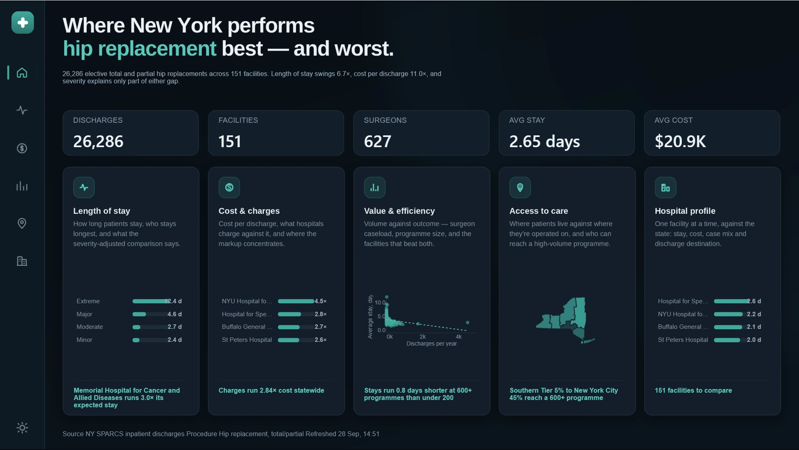
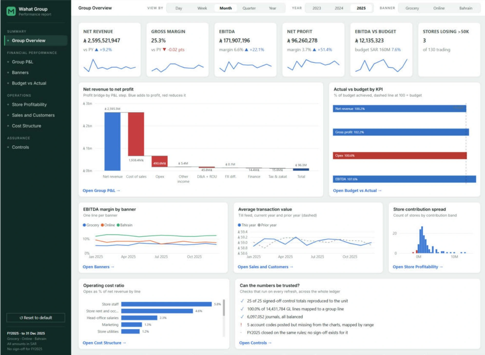
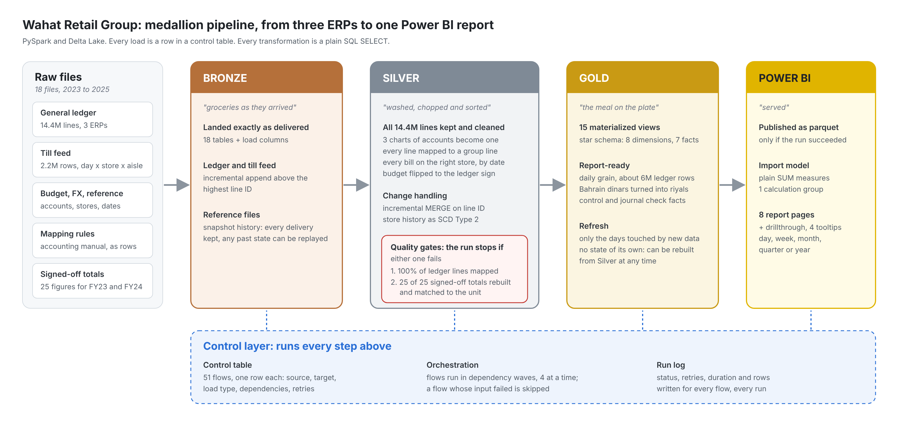

# Power BI Portfolio

Reports I have built in Power BI, each with its own write-up on how it is
engineered: the model, the measure layer, the visuals, and the decisions
behind them.

Only screenshots and writing are published here. The .pbip files, semantic
models and source data stay offline. Where a project has its own data pipeline,
the pipeline lives in a separate repository, linked from the project.

Pick a project below to open its full write-up with screenshots.

---

## Projects

### [Healthcare Dashboard](projects/healthstat/README.md)

<a href="projects/healthstat/README.md">
<picture>
  <source media="(prefers-color-scheme: light)" srcset="screenshots/healthstat/home-light.webp">
  <source media="(prefers-color-scheme: dark)"  srcset="screenshots/healthstat/home-dark.webp">
  
</picture>
</a>

Hospital performance across one year of New York hip replacements: 26,286
operations at 151 hospitals. Hospitals are ranked on a severity-adjusted score,
so a hospital that takes sicker patients is not punished for longer stays.

Every number, sentence and colour on screen comes from the model. Nothing is
typed into a text box, so changing a slicer rewrites the text too.

- **Built with:** PBIP and TMDL, DAX measures that return HTML and SVG, Deneb
  (Vega and Vega-Lite), field parameters, bookmarks
- **Scale:** 13 tables, 3 relationships, 183 measures, 7 report pages
- **Notable:** one model drives a dark and a light version of every page from a
  two-row theme table

**[Read the full write-up](projects/healthstat/README.md)**

---

### [Wahat Retail Group Financial Report](projects/wahat-retail-group-financial-report/README.md)

One group P&L in Saudi riyals for a retailer with three businesses: about 110
grocery shops in Saudi Arabia, an online shop and a Bahrain franchise. Each
business runs its own accounting system, and Bahrain counts in dinars. The
board also wants the true profit of every shop.

There was no account mapping, only a rule book, so the project is built end to
end: a medallion pipeline that maps all 14.4 million ledger lines and proves
them against the signed-off accounts, then a Power BI report on top.

- **Built with:** PySpark and Delta Lake (Bronze, Silver, Gold), metadata-driven
  control tables, SCD Type 2, incremental loads, PBIP and TMDL, a calculation
  group, field parameters, bookmarks
- **Scale:** 14.4M ledger lines from 3 ERPs, 2.2M till records, 51 pipeline
  flows, 218 measures, 8 report pages plus drillthrough and tooltips
- **Notable:** the pipeline stops itself unless all 25 signed-off totals for
  2023 and 2024 are rebuilt to the unit; the report can be viewed by day, week,
  month, quarter or year

**Read the write-ups:** [Power BI](projects/wahat-retail-group-financial-report/power-bi/README.md) ·
[Data engineering, in its own repository: dataeng-jupyter](https://github.com/shazmirza087/dataeng-jupyter)

---

<!--
Template for the next project. Copy, uncomment, fill in.

### [Project Name](projects/PROJECT/README.md)

Two or three plain sentences: what the report covers and what the data is.

One or two sentences on what is interesting about how it is built.

- **Built with:** ...
- **Scale:** ...
- **Notable:** ...

**[Read the full write-up](projects/PROJECT/README.md)**

---
-->
