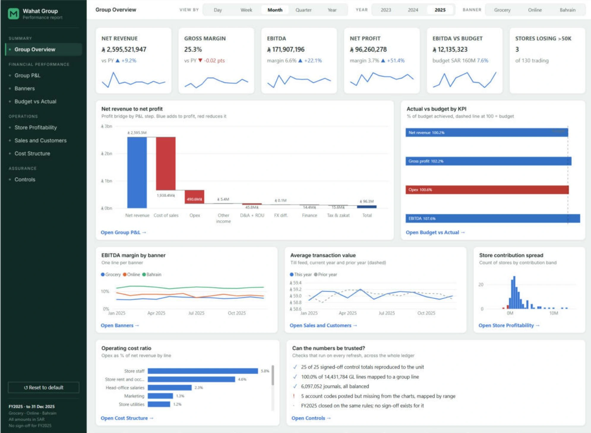
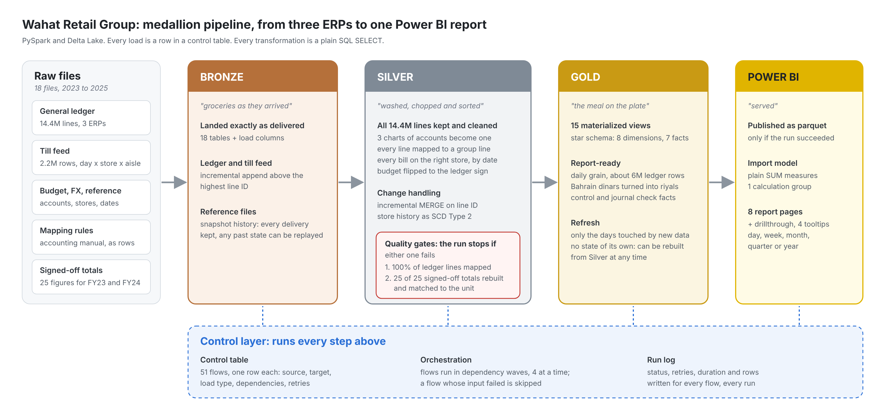

# Wahat Retail Group Financial Report

[Back to the portfolio](../../README.md)

A grocery group with three businesses: about 110 shops in Saudi Arabia, an online shop it bought in April 2024, and a franchise in Bahrain. Each one keeps its books in its own accounting system, and Bahrain counts in dinars. The board wants one profit and loss report in Saudi riyals, plus the true profit of every single shop.

There was no list matching the three sets of accounts. The only guide was a rule book, and two of its rules contradicted each other. So this project is two jobs: a data pipeline that sorts out the mess and proves the numbers, and a Power BI report that shows them.

## The two halves

### [The data engineering side](data-engineering/README.md)

A medallion pipeline (Bronze, Silver, Gold) in PySpark and Delta Lake. It takes 14.4 million ledger lines from three systems, sorts every line into the group P&L and puts every bill on the right shop on the right date. It also turns dinars into riyals. Before any report table is touched, it checks itself against the 25 signed-off totals for 2023 and 2024.

**[Read the data engineering write-up](data-engineering/README.md)**

### [The Power BI side](power-bi/README.md)

The report has eight pages, each answering one question, from "how are we doing?" to "can I trust these numbers?". You can view it by day, week, month, quarter or year. Every click filters the rest of the page, and there's a reset button on every page. Underneath, the measures are mostly plain sums, so it stays fast.

**[Read the Power BI write-up](power-bi/README.md)**
