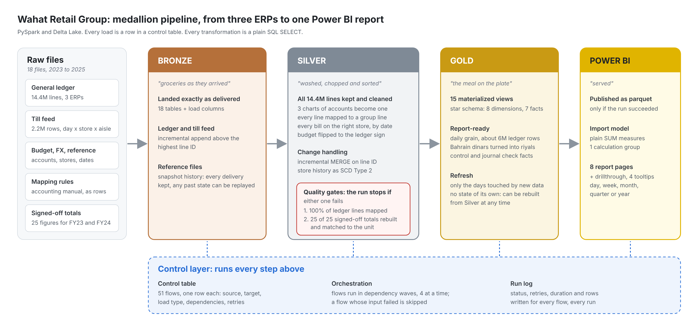

# Wahat Retail Group Financial Report: the data engineering side

[Back to the portfolio](../../../README.md) · [Project overview](../README.md) · [The Power BI side](../power-bi/README.md)

**A little data factory that takes 14.4 million messy money lines and turns them into clean, checked, report-ready tables. On every run, it proves its own numbers are right.**

**On this page:** [The business](#the-business) · [The data](#the-data) · [The challenge](#the-challenge) · [What I built, and why](#what-i-built-and-why) · [Folder structure](#folder-structure) · [Every notebook and script](#every-notebook-and-script) · [The control table](#the-control-table) · [Every flow](#every-flow) · [Load patterns](#load-patterns) · [How a run works](#how-a-run-works) · [Running it yourself](#running-it-yourself)

The code itself is in the [`pipeline`](pipeline/) folder next to this page.

---

## The business

**Wahat Retail Group** is a family of grocery businesses:

- about **110 grocery shops in Saudi Arabia** (*Grocery*),
- an **online grocery shop** it bought on 1 April 2024 (*Online*),
- a **franchise of shops in Bahrain** (*Bahrain*).

The boss wants **one profit and loss report for the whole group, in Saudi riyals**. He also wants to know the **true profit of every single shop**.

## The data

Three years of data, 2023 to 2025, delivered as 18 files:

- **14,431,784 lines from the money diary** (the general ledger). Every riyal in or out.
- **2,237,680 till records**: what each shop sold, each day, per aisle.
- **Three different lists of accounts**, one from each business's accounting system: 272, 98 and 99 accounts.
- **The budget**, **exchange rates**, and lists of **shops, cost centres, aisles and dates**.
- **A rule book** that says how every account should be counted.
- **The signed-off totals for 2023 and 2024.** These are the answers the accountants already agreed on.

## The challenge

Imagine three kids who each keep a money diary, but in **different notebooks, with different labels, and one of them counts in a different currency**. Now someone asks: "How much did all three of you spend on sweets?"

That is this project.

- **There is no matching list.** Nobody says "account 6100 in this book is the same as account 600000 in that book". The only clue is a rule book written in sentences, and two of its rules contradict each other.
- **Some rules only apply between certain dates.** The same account means one thing before a date and another thing after it.
- **Old shop codes get reused.** When a shop closes, a new shop can take over its cost code. If you only look at today's list, you blame the new shop for the old shop's bills.
- **Bahrain counts in dinars.** Its amounts have to be turned into riyals at each month's rate.
- **The budget has its plus and minus signs the other way round.**
- **It's big.** 14.4 million lines is too much to sort out every time someone opens a report.
- **And it has to be right.** If the rebuilt 2023 and 2024 numbers don't match what the accountants signed, nothing else matters.

---

## What I built, and why

### The big idea: a kitchen with three counters

I built it the way a good kitchen works. This is called a **medallion** design, with Bronze, Silver and Gold layers.

| Counter | What happens there | Kitchen version |
|---|---|---|
| **Bronze** | The 18 files land exactly as they arrived, with a note of when they came in | Groceries put away just as they came from the shop |
| **Silver** | Everything is cleaned, labelled and matched up. All 14.4 million lines get sorted into the right group line and the right shop | Washed, chopped, sorted into bowls |
| **Gold** | Tables shaped exactly the way the report needs them, all in riyals | The meal on the plate |

At the end, the Gold tables are **handed to Power BI** as simple files.



**Why:** if something goes wrong, you know which counter it went wrong on. You can also cook a different meal (a new report) from the same chopped ingredients without going back to the shop.

### 1. One recipe card per job, not one giant program

Every job the pipeline does is **one row in a control table**. Think of it as a list of recipe cards. Each card says:
- what to load,
- where it goes,
- what it has to wait for,
- how many times to retry if it hiccups.

There are 51 cards. Each "cook" (a loader notebook) knows how to handle one type of card. Every change is **a plain SQL query**.

**Why:** adding a new table means adding one card and one small SQL file. You don't write a new program. This is the same pattern big companies use on Databricks, so it can move to the cloud with almost no changes.

### 2. It turns the rule book into a matching table

All the rules from the rule book became **rows in a matching table**: "accounts from here to here, in this business, between these dates, go to this group line".

**Why:** when finance changes a rule, you **edit a row, not the code**. Finance can also read the table and sign it off, because it's just a list.

### 3. It finds the right shop for every bill, on the right day

A separate history table says **which shop owned each cost code on each date**. Every money line gets matched to the shop that was really there that day.

**Why:** that is the only way to get the **true** profit of each shop. It is the whole point of the boss's second question.

### 4. It remembers how shops change over time

When a shop changes (gets bigger, changes type, or closes), the pipeline **doesn't overwrite the old version**. It closes the old version and opens a new one. It works like a photo album: you can always flip back and see what a shop looked like last year. Data people call this **SCD Type 2**.

**Why:** last year's numbers should stay last year's numbers, even after a shop is changed today.

### 5. It only does the new homework

After the first full load (about 3 minutes on a laptop), each run **only picks up what's new**:
- **Bronze** adds only the new diary lines and till records.
- **Silver** merges in only those new rows. Running it twice changes nothing.
- **Gold** rebuilds only the days that got new data.

I tested it by feeding it the data in pieces. First everything up to November 2025, then December, with one shop changed and one shop removed. The second run:
- picked up only the new rows,
- spotted the changed shop and the removed shop,
- rebuilt only December,
- and gave **exactly the same answer** as loading everything from scratch.

A third run with nothing new **changed nothing**.

**Why:** fast runs, small bills, and the same answer every time.

### 6. It checks its own homework and refuses to hand in a wrong answer

Two checks run in Silver, before any report table is touched:

1. **Did every one of the 14.4 million lines get sorted?** If even one line has no home, the run stops.
2. **Do the rebuilt 2023 and 2024 numbers match the 25 signed-off totals?** If any one is off by more than one unit, the run stops.

Today: **25 out of 25 match, and 100% of lines are sorted.**

If a check fails, the report keeps showing the last good data. A bad run **never** overwrites good numbers.

**Why:** this is the difference between "I think it's right" and "I can prove it's right".

### 7. It keeps a diary of every run

Every job writes to a **run log**: started, finished, failed, retried, how long it took and how many rows it wrote. One small report shows the latest run, the slowest jobs, and the full error message for anything that broke.

**Why:** when something breaks at 3 a.m., the log says what broke and why. Nobody has to guess.

### 8. The hard work happens here, so the report stays simple

By the time the data reaches Power BI:
- every line is already matched to its group line,
- every bill is already on the right shop,
- the dinars are already riyals,
- the budget signs are already the right way round,
- and the data is **daily**, so the report can be viewed by day, week, month, quarter or year.

The 14.4 million diary lines are squeezed into about **6 million daily rows**. That keeps every detail the report needs and nothing it doesn't.

**Why:** Power BI just adds things up, which is fast. The tricky logic lives in one place you can test, not scattered across fifty report formulas.

---

## What you get, in one breath

You get a pipeline that takes messy data from three systems and turns it into one clean set of numbers. It proves the numbers against the signed-off accounts on every run, and it only does the new work each time. Adding a table is one row and one SQL file, and it can move to the cloud as it is.

If your data lives in more than one system and your finance team keeps asking "but is this number right?", **this is exactly the kind of thing I build.**

---

## The pipeline, in full detail

This part is for the technical reader. It lists every folder, notebook, SQL script and flow in the pipeline.

### Folder structure

The numbers in the folder and file names give the order things run in.

```
pipeline/
  .gitignore
  README.md
  environment.yml
  00_shared/
    000_nb_configurations.ipynb
    001_nb_utils.ipynb
  01_ddl/
    010_provision_core_artifacts.ipynb
    011_create_data_flow_control_table.ipynb
    012_create_pipeline_run_log_table.ipynb
    013_run_ddl.ipynb
  02_bronze/
    020_ingestion/
      0200_ingest_parquet_file.ipynb
      0201_ingest_csv_file.ipynb
    021_orchestration/
      0210_bronze_orchestrator.ipynb
  03_silver/
    030_loaders/
      035_full_load.ipynb
      036_quality_check.ipynb
      037_incremental_merge.ipynb
      039_scd2.ipynb
    030_scripts/
      account_full.sql
      account_mapping_full.sql
      budget_full.sql
      category_full.sql
      check_control_totals.sql
      check_unmapped_gl.sql
      control_totals_full.sql
      cost_centre_full.sql
      cost_centre_history_full.sql
      date_full.sql
      entity_full.sql
      fx_rate_full.sql
      gl_lines_incremental.sql
      group_line_full.sql
      source_type_full.sql
      store_full.sql
      store_history_scd2.sql
      store_sales_incremental.sql
    031_orchestration/
      038_silver_orchestrator.ipynb
  04_gold/
    040_loaders/
      045_materialized_view.ipynb
    040_scripts/
      dim_account.sql
      dim_category.sql
      dim_cost_centre.sql
      dim_date.sql
      dim_entity.sql
      dim_group_line.sql
      dim_source_type.sql
      dim_store.sql
      dim_store_year.sql
      fact_budget.sql
      fact_control_total.sql
      fact_gl.sql
      fact_journal_check.sql
      fact_rule_effect.sql
      fact_store_sales.sql
    041_orchestration/
      048_gold_orchestrator.ipynb
    042_publish/
      0420_publish_to_powerbi.ipynb
  05_helper_scripts/
    050_populate_control_tables.ipynb
    051_populate_control_tables.sql
    052_pipeline_run_report.ipynb
  06_orchestration/
    060_run_pipeline.ipynb
```

Data lives outside this folder. Every location is set with an environment variable (see Settings), so nothing in the code points at a particular machine:

```
<raw folder>/                       WAHAT_RAW_FOLDER: the raw DD-RET-005 files
  DD-RET-005_FactGLLines.parquet
  DD-RET-005_Supporting_Tables/
<mapping folder>/                   WAHAT_MAPPING_FOLDER: the mapping CSVs
<lakehouse>/<env>/                  WAHAT_LAKEHOUSE: Delta tables, not in git
  bronze/  silver/  gold/  metadata/
  publish/                          parquet files for Power BI (WAHAT_PUBLISH_FOLDER)
```

### What each layer does

| Layer | Rule of thumb | In this pipeline |
|---|---|---|
| Bronze | Exactly what arrived, plus load columns | 18 files landed as delivered |
| Silver | The cleaned, conformed, enterprise view. Keeps the source grain. Applies rules every consumer should agree on | Types and blanks fixed. One chart of accounts across three ERPs. Every ledger line mapped to the group chart (manual chapters 3 to 6) and assigned to its store (6.4). Budget flipped to the ledger sign convention (7.5). Quality checks |
| Gold | Shaped for one consumer: this report | 14.4M ledger lines summed to about 6M rows at day grain. Budget spread from month to day. SAR translation (2.3). Report attributes on group lines (order, display sign, bridge step, store contribution). the Sankey flow columns on group lines, and the store-year table |

Gold reads only Silver. Silver keeps all 14.4M ledger lines, so an audit, a drill to journal or a weekly view can be built from it without going back to Bronze.

### Every notebook and script

Loaders hold the load pattern and SQL scripts hold the shape of each table. A loader never contains business logic, and a SQL script never decides how it is loaded.

#### `00_shared/`: Shared code

| File | What it does |
|---|---|
| [`000_nb_configurations.ipynb`](pipeline/00_shared/000_nb_configurations.ipynb) | Shared configuration, reused by every other notebook through `run_notebook()`. Local counterpart of the Databricks `000_nb_configurations`: Functions: `layer_database`, `table_full_name`, `table_path`, `ctrl_table_path`, `is_table_folder`, `register_table`, `register_existing_tables`. |
| [`001_nb_utils.ipynb`](pipeline/00_shared/001_nb_utils.ipynb) | Shared functions for every loader and orchestrator: control-table lookups, run logging, table writes, script execution and the dependency-wave engine. Needs `000_nb_configurations` loaded first (the bootstrap cell of each notebook does both). Functions: `get_flow_config`, `get_active_flows`, `get_registry`, `dependencies_of`, `literal_frame`, `append_run_event`, `new_batch_id`, `latest_status`, `reregister_table`, `write_table`, `with_lineage`, `table_exists`, `write_snapshot`, `read_fresh`, `max_value`, `sql_literal`, `resolve_reference`, `prepare_increment`, `overwrite_through_staging`, `merge_table`, `changed_partitions`, `replace_partitions`, `apply_scd2`, `read_script`, `run_script`, `execute_flow`, `run_layer`. |
#### `01_ddl/`: One-time setup (DDL)

| File | What it does |
|---|---|
| [`010_provision_core_artifacts.ipynb`](pipeline/01_ddl/010_provision_core_artifacts.ipynb) | Creates the lakehouse folders for each layer and the Spark databases. Business-schema databases (`bronze_wahat` and so on) are also created on demand by the loaders. Safe to re-run. |
| [`011_create_data_flow_control_table.ipynb`](pipeline/01_ddl/011_create_data_flow_control_table.ipynb) | Creates `ctrl.data_flow_control` and `ctrl.source_type_registry`. Safe to re-run: a table is only created if it is missing. Rows are added by `05_helper_scripts/050_populate_control_tables`. Differences from the Databricks version: - `depends_on_control_ids` holds a comma-separated list, because a fact usually waits for several tables (the Databricks column holds one id). - `source_connection_name` names a folder in `CONNECTIONS` instead of a secret scope. - `publish_name` is the file name the publish step writes for Power BI (Gold flows only). - The incremental columns at the end drive the INCREMENTAL, PARTITION_REFRESH and SCD2 loaders (see `001_nb_utils`, Incremental loads). |
| [`012_create_pipeline_run_log_table.ipynb`](pipeline/01_ddl/012_create_pipeline_run_log_table.ipynb) | Creates `ctrl.pipeline_run_log`: append-only run events (one `RUNNING` row and one final row per run). Safe to re-run: the table is only created if it is missing. `05_helper_scripts/052_pipeline_run_report` reads it. |
| [`013_run_ddl.ipynb`](pipeline/01_ddl/013_run_ddl.ipynb) | Runs the provisioning notebooks in order. Run once per environment, then run `05_helper_scripts/050_populate_control_tables`. |
#### `02_bronze/`: Bronze

| File | What it does |
|---|---|
| [`020_ingestion/0200_ingest_parquet_file.ipynb`](pipeline/02_bronze/020_ingestion/0200_ingest_parquet_file.ipynb) | Lands one raw parquet file into Bronze exactly as delivered, plus three audit columns: `_ingested_at`, `_source_file`, `_batch_id`. - `load_type = SNAPSHOT`: the file is a full snapshot (reference data). The table holds the latest snapshot and `<table>_snapshots` keeps every delivery. - `load_type = INCREMENTAL`: only rows above the Bronze table's highest `watermark_column` are appended (the ledger and the till feed). Against a live ERP the same watermark goes into the extract query; here the delivered file is filtered on read. Bronze is append-only, so every delivery stays on record with its `_batch_id`. Functions: `ingest_parquet_file`. |
| [`020_ingestion/0201_ingest_csv_file.ipynb`](pipeline/02_bronze/020_ingestion/0201_ingest_csv_file.ipynb) | Lands one CSV file (the mapping workbook) into Bronze as delivered: every column as text, typing happens in Silver. Same audit columns and the same snapshot history as the parquet loader. Functions: `ingest_csv_file`. |
| [`021_orchestration/0210_bronze_orchestrator.ipynb`](pipeline/02_bronze/021_orchestration/0210_bronze_orchestrator.ipynb) | Runs every active Bronze flow, dispatched to its ingestion notebook through `ctrl.source_type_registry`. Bronze flows are independent raw copies, so they run as one parallel wave. |
#### `03_silver/`: Silver

| File | What it does |
|---|---|
| [`030_loaders/035_full_load.ipynb`](pipeline/03_silver/030_loaders/035_full_load.ipynb) | Runs a Silver script (one plain `SELECT` in `030_scripts/`) and replaces the Silver table with its result. The script defines the shape; this notebook owns the load pattern. Functions: `silver_full_load`. |
| [`030_loaders/036_quality_check.ipynb`](pipeline/03_silver/030_loaders/036_quality_check.ipynb) | Runs a check script. A check returns the rows that break its rule, so no rows means pass. The result is always kept in a `dq_` table in Silver, so after a failure you can open it and see exactly which accounts or figures are wrong. A failed check fails the flow (without retrying) and every flow that depends on it is skipped: Gold never builds on data that did not reconcile. Functions: `quality_check`. |
| [`030_loaders/037_incremental_merge.ipynb`](pipeline/03_silver/030_loaders/037_incremental_merge.ipynb) | Silver load for the high-volume feeds (ledger lines, till sales). 1. Take the Bronze rows newer than the Silver table's watermark (`_batch_id`), as `{{increment}}`. 2. Run the flow's script over just those rows. 3. `MERGE` the result into Silver on the flow's key: existing keys are updated, new ones inserted. Running the same batch twice changes nothing. First run, or `full_refresh=True`: the whole Bronze table is processed and the Silver table replaced. Functions: `silver_incremental_merge`. |
| [`030_loaders/039_scd2.ipynb`](pipeline/03_silver/030_loaders/039_scd2.ipynb) | Silver load for a type 2 history (`store_history`). The flow's script returns the latest snapshot of each member; `apply_scd2` in `001_nb_utils` compares it with the current versions and closes or opens versions (new, changed and removed members). `primary_key_columns` is the business key. Functions: `silver_scd2`. |
| [`030_scripts/account_full.sql`](pipeline/03_silver/030_scripts/account_full.sql) | The three local charts of accounts in one list, plus codes that were posted but are missing from every chart. |
| [`030_scripts/account_mapping_full.sql`](pipeline/03_silver/030_scripts/account_mapping_full.sql) | The mapping workbook (manual chapters 3 to 6), typed. One row per rule. A blank cost-centre function means the rule applies to any function. |
| [`030_scripts/budget_full.sql`](pipeline/03_silver/030_scripts/budget_full.sql) | Monthly budget by banner and group line, typed. The budget arrives with revenue and other income as positive numbers; they are flipped to the ledger sign convention (credits negative, manual 7.5) so actuals and budget can be compared line for line. |
| [`030_scripts/category_full.sql`](pipeline/03_silver/030_scripts/category_full.sql) | Till product categories, straight pass-through. |
| [`030_scripts/check_control_totals.sql`](pipeline/03_silver/030_scripts/check_control_totals.sql) | Quality check: the mapped ledger must reproduce the 25 signed-off FY2023 and FY2024 figures (Management Accounts Summary) to within one unit. Returns the figures that do not match, or are missing on either side. No rows = pass. |
| [`030_scripts/check_unmapped_gl.sql`](pipeline/03_silver/030_scripts/check_unmapped_gl.sql) | Returns one row per banner and account that has no mapping rule. No rows = pass. Fix: add a rule to mapping/AccountMapping.csv. |
| [`030_scripts/control_totals_full.sql`](pipeline/03_silver/030_scripts/control_totals_full.sql) | Signed-off FY2023 and FY2024 figures. Read by the quality check only, never published. |
| [`030_scripts/cost_centre_full.sql`](pipeline/03_silver/030_scripts/cost_centre_full.sql) | Cost centres with their function and today's store. History is resolved in gl_mapped. |
| [`030_scripts/cost_centre_history_full.sql`](pipeline/03_silver/030_scripts/cost_centre_history_full.sql) | Which store owns a re-used cost centre, by date (manual 6.4), typed. |
| [`030_scripts/date_full.sql`](pipeline/03_silver/030_scripts/date_full.sql) | Calendar with the extra sort and grouping columns the model needs. Weeks run Sunday to Saturday (the Saudi and Bahraini working week); WeekStart is the Sunday. |
| [`030_scripts/entity_full.sql`](pipeline/03_silver/030_scripts/entity_full.sql) | The three banners, with a display name, a sort order and a typed first period. |
| [`030_scripts/fx_rate_full.sql`](pipeline/03_silver/030_scripts/fx_rate_full.sql) | Monthly average and closing rate to SAR (manual 2.3), keyed by currency and month start. |
| [`030_scripts/gl_lines_incremental.sql`](pipeline/03_silver/030_scripts/gl_lines_incremental.sql) | The ledger at line grain, typed, with its group line and its store. Reads {{increment}}: the Bronze lines not yet in Silver (loader 037 merges them on GLLineID). Group line: the mapping rules (manual chapters 3 to 6). Where several rules match, the lowest Priority wins. Store: the dated cost-centre history first (manual 6.4), otherwise today's store. Every rule depends only on entity, account, cost centre and month, so the rules are resolved once per distinct combination of those and joined back to the lines. The range join then runs on thousands of keys instead of 14.4M lines. |
| [`030_scripts/group_line_full.sql`](pipeline/03_silver/030_scripts/group_line_full.sql) | The group chart of reporting lines, as delivered. Report-specific attributes (order, display sign, bridge step, store contribution) are added in Gold. |
| [`030_scripts/source_type_full.sql`](pipeline/03_silver/030_scripts/source_type_full.sql) | Ledger sources, straight pass-through. |
| [`030_scripts/store_full.sql`](pipeline/03_silver/030_scripts/store_full.sql) | Stores with typed dates. Dark stores are not profit centres (manual 7.4). |
| [`030_scripts/store_history_scd2.sql`](pipeline/03_silver/030_scripts/store_history_scd2.sql) | The latest snapshot of every store. Loader 039 compares it with the current versions: a changed store (format, selling area, closure, name) gets its current version closed and a new one opened; a store missing from the snapshot has its current version closed. Columns added by the loader: ValidFrom (inclusive), ValidTo (exclusive), IsCurrent, _row_hash. |
| [`030_scripts/store_sales_incremental.sql`](pipeline/03_silver/030_scripts/store_sales_incremental.sql) | Daily till sales by store and category, typed. Reads {{increment}}: the Bronze rows not yet in Silver (loader 037 merges them on StoreSalesID). |
| [`031_orchestration/038_silver_orchestrator.ipynb`](pipeline/03_silver/031_orchestration/038_silver_orchestrator.ipynb) | Runs every active Silver flow in dependency waves: reference tables first, then the ledger lines (mapped and store-assigned, loaded incrementally), then the account list and the quality checks. |
#### `04_gold/`: Gold

| File | What it does |
|---|---|
| [`040_loaders/045_materialized_view.ipynb`](pipeline/04_gold/040_loaders/045_materialized_view.ipynb) | Gold holds only materialized views: the definition is the flow's SQL file in `040_scripts` (one `SELECT` over Silver), the result is stored so Power BI can read it. Gold keeps no history and no state of its own, so it can always be rebuilt from Silver. Local Spark has no built-in materialized views, so this loader is the refresh engine: Functions: `refresh_materialized_view`. |
| [`040_scripts/dim_account.sql`](pipeline/04_gold/040_scripts/dim_account.sql) | Union of the three local charts of accounts, plus codes posted but missing from the charts. |
| [`040_scripts/dim_category.sql`](pipeline/04_gold/040_scripts/dim_category.sql) | Till product categories. |
| [`040_scripts/dim_cost_centre.sql`](pipeline/04_gold/040_scripts/dim_cost_centre.sql) | Cost centres. CurrentStoreCode is today's store only; history is resolved in fact_gl. |
| [`040_scripts/dim_date.sql`](pipeline/04_gold/040_scripts/dim_date.sql) | Calendar 2023 to 2025. Marked as the date table in the model. |
| [`040_scripts/dim_entity.sql`](pipeline/04_gold/040_scripts/dim_entity.sql) | The three banners, each with its own ERP and currency. |
| [`040_scripts/dim_group_line.sql`](pipeline/04_gold/040_scripts/dim_group_line.sql) | Group reporting lines with the attributes this report needs: report order (subtotals interleaved), section order, display sign (credits shown positive), profit bridge step and the store-contribution flag (manual 7.4). |
| [`040_scripts/dim_source_type.sql`](pipeline/04_gold/040_scripts/dim_source_type.sql) | Ledger source of each posting. |
| [`040_scripts/dim_store_year.sql`](pipeline/04_gold/040_scripts/dim_store_year.sql) | One row per store and year: its contribution (manual 7.4) and the SAR 0.5M band it falls in. A dimension on fact_gl through StoreYearKey, so picking a band on the spread histogram filters every visual to the stores in that band. Income is negative in the ledger, so the sum is turned round. StoreKey is the dim_store version valid on the last day of the year. Materialized view, incremental refresh: only the years refreshed in fact_gl. |
| [`040_scripts/dim_store.sql`](pipeline/04_gold/040_scripts/dim_store.sql) | Gold: dim_store (materialized view over silver.store_history) One row per version of a store. StoreKey is a hash of the store and the start of the version, so the same version always gets the same key and the view can be rebuilt at any time without the facts pointing at the wrong store. IsCurrent: the version valid today (none for a store that has been removed). IsLatest: the most recent version of each store, current or closed. Measures read a store's lifecycle (open and close dates, name) from it, so removed stores still count for the periods they traded. |
| [`040_scripts/fact_budget.sql`](pipeline/04_gold/040_scripts/fact_budget.sql) | Budget by day, banner and group line, in local currency and in SAR at the monthly average rate. The budget is set by month; each month's amount is spread evenly over its days, so the budget can sit next to actuals by day, week, month, quarter or year. Month totals are unchanged. Already in the ledger sign convention (silver.budget). |
| [`040_scripts/fact_control_total.sql`](pipeline/04_gold/040_scripts/fact_control_total.sql) | One row per signed-off figure (Management Accounts Summary: FY2023 and FY2024, five metrics per banner), next to the same figure rebuilt from the published ledger in gold.fact_gl. IsReconciled: the two agree to within one unit. The report counts these for the "reconciled to sign-off" checks, so the check reads exactly what Power BI shows. |
| [`040_scripts/fact_gl.sql`](pipeline/04_gold/040_scripts/fact_gl.sql) | The ledger at report grain: posting day x banner x group line x account x cost centre x store x source x tender, in local currency and in SAR at the monthly average rate (manual 2.3: every day of a month uses that month's rate). Day grain lets the report show days, weeks, months, quarters and years. Line detail stays in silver.gl_lines. StoreKey is the dim_store version valid on the posting day. Materialized view, incremental refresh: only the days touched by new ledger lines. |
| [`040_scripts/fact_journal_check.sql`](pipeline/04_gold/040_scripts/fact_journal_check.sql) | Double entry check per banner and month: how many journals were posted and how many of them do not net to zero in local currency. A journal is balanced when its lines sum to zero within half a cent. Refreshed by 045 as MV_INCREMENTAL: only the months touched by new ledger lines are rebuilt. |
| [`040_scripts/fact_rule_effect.sql`](pipeline/04_gold/040_scripts/fact_rule_effect.sql) | How much each dated exception or contradiction in the mapping manual moves, per banner and year, in the banner's own currency (AmountLCY) and in SAR at each month's average rate (AmountSAR). One rule = one account range on one banner, optionally from a month and for one cost-centre function. Sign turns the ledger amount into the amount the rule moves (credits shown positive for income rules). |
| [`040_scripts/fact_store_sales.sql`](pipeline/04_gold/040_scripts/fact_store_sales.sql) | Daily till sales by store and category, with the store's banner, in local currency and in SAR at the monthly average rate. StoreKey is the dim_store version valid on the day. Materialized view, incremental refresh: only the days touched by new till rows. |
| [`041_orchestration/048_gold_orchestrator.ipynb`](pipeline/04_gold/041_orchestration/048_gold_orchestrator.ipynb) | Refreshes every Gold materialized view in dependency waves. `fact_gl` waits for both Silver quality checks; the Sankey and histogram views wait for `fact_gl`. |
| [`042_publish/0420_publish_to_powerbi.ipynb`](pipeline/04_gold/042_publish/0420_publish_to_powerbi.ipynb) | Writes each Gold materialized view that has a `publish_name` to one parquet file in `lakehouse/<env>/publish`, which the Power BI model reads through its `DataFolder` parameter. Why a separate step: a Delta table is a folder of part files plus a transaction log, while Power BI's parquet connector reads single files. Each Gold table is written once more as a single parquet file (Spark keeps the exact column types), then renamed to its `publish_name`. Only Gold flows whose latest run succeeded are published, so a failed run never overwrites what the report shows. Functions: `publish_table`. |
#### `05_helper_scripts/`: Helper scripts

| File | What it does |
|---|---|
| [`050_populate_control_tables.ipynb`](pipeline/05_helper_scripts/050_populate_control_tables.ipynb) | Loads every flow definition from `051_populate_control_tables.sql` into the control tables. The SQL uses `INSERT OVERWRITE`, so re-running replaces the definitions instead of duplicating them. To add a table: add a script, add a row to the SQL file, re-run this. |
| [`051_populate_control_tables.sql`](pipeline/05_helper_scripts/051_populate_control_tables.sql) | Every flow of the pipeline as one row of the control table, plus the loader registry. `INSERT OVERWRITE`, so it is safe to re-run. |
| [`052_pipeline_run_report.ipynb`](pipeline/05_helper_scripts/052_pipeline_run_report.ipynb) | Read-only views of the run log: the latest batch flow by flow, the slowest flows, and any failures with their messages. |
#### `06_orchestration/`: Orchestration

| File | What it does |
|---|---|
| [`060_run_pipeline.ipynb`](pipeline/06_orchestration/060_run_pipeline.ipynb) | Runs the whole pipeline: Bronze, Silver, Gold, then publish for Power BI. One batch id for the whole run. Stops at the first layer with a failure, so a later layer never builds on a broken one, and nothing is published unless every Gold table succeeded. On Databricks this would be a Workflow with one task per layer; locally it is this notebook. |

### The control table

| Table | One row per | Main columns |
|---|---|---|
| `ctrl.data_flow_control` | flow | `control_id`, `layer`, `is_active`, `load_sequence`, `depends_on_control_ids`, `source_type`, `source_object`, `destination_table`, `load_type`, `primary_key_columns`, `publish_name`, `retry_count`, and for incremental flows `watermark_column`, `incremental_source`, `partition_column`, `partition_source_column`, `surrogate_key_column` |
| `ctrl.source_type_registry` | source type and layer | which loader notebook handles it |
| `ctrl.pipeline_run_log` | run event | `batch_id`, `status` (RUNNING, SUCCEEDED, FAILED, SKIPPED), `retry_attempt`, `duration_seconds`, `rows_written`, `error_message` |

Control ids: `1xx` Bronze, `2xx` Silver (`22x` quality checks), `3xx` Gold.

### Every flow

All 51 flows in `ctrl.data_flow_control`, as loaded by `051_populate_control_tables.sql`. Loader numbers refer to the notebooks above. Control ids: `1xx` Bronze, `2xx` Silver (`22x` quality checks), `3xx` Gold.

| ID | Layer | Source | Target table | Loader | Load type | Waits for | Key | Published as |
|---|---|---|---|---|---|---|---|---|
| 101 | Bronze | `DD-RET-005_FactGLLines.parquet` | `gl_lines` | 0200 | INCREMENTAL (watermark `GLLineID`) |  |  |  |
| 102 | Bronze | `DD-RET-005_FactStoreSalesDaily.parquet` | `store_sales_daily` | 0200 | INCREMENTAL (watermark `StoreSalesID`) |  |  |  |
| 103 | Bronze | `DD-RET-005_FactBudget.parquet` | `budget` | 0200 | SNAPSHOT |  |  |  |
| 104 | Bronze | `DD-RET-005_DimDate.parquet` | `date` | 0200 | SNAPSHOT |  |  |  |
| 105 | Bronze | `DD-RET-005_DimEntity.parquet` | `entity` | 0200 | SNAPSHOT |  |  |  |
| 106 | Bronze | `DD-RET-005_DimGroupLine.parquet` | `group_line` | 0200 | SNAPSHOT |  |  |  |
| 107 | Bronze | `DD-RET-005_DimStore.parquet` | `store` | 0200 | SNAPSHOT |  |  |  |
| 108 | Bronze | `DD-RET-005_DimCostCentre.parquet` | `cost_centre` | 0200 | SNAPSHOT |  |  |  |
| 109 | Bronze | `DD-RET-005_DimCategory.parquet` | `category` | 0200 | SNAPSHOT |  |  |  |
| 110 | Bronze | `DD-RET-005_DimSourceType.parquet` | `source_type` | 0200 | SNAPSHOT |  |  |  |
| 111 | Bronze | `DD-RET-005_DimFXRate.parquet` | `fx_rate` | 0200 | SNAPSHOT |  |  |  |
| 112 | Bronze | `DD-RET-005_DimLocalAccount_SAP.parquet` | `account_sap` | 0200 | SNAPSHOT |  |  |  |
| 113 | Bronze | `DD-RET-005_DimLocalAccount_NS.parquet` | `account_ns` | 0200 | SNAPSHOT |  |  |  |
| 114 | Bronze | `DD-RET-005_DimLocalAccount_LEG.parquet` | `account_leg` | 0200 | SNAPSHOT |  |  |  |
| 115 | Bronze | `DD-RET-005_DimSupplier.parquet` | `supplier` | 0200 | SNAPSHOT |  |  |  |
| 116 | Bronze | `AccountMapping.csv` | `account_mapping` | 0201 | SNAPSHOT |  |  |  |
| 117 | Bronze | `CostCentreHistory.csv` | `cost_centre_history` | 0201 | SNAPSHOT |  |  |  |
| 118 | Bronze | `ControlTotals.csv` | `control_totals` | 0201 | SNAPSHOT |  |  |  |
| 201 | Silver | `fx_rate_full.sql` | `fx_rate` | 035 | FULL |  | CurrencyCode, MonthStart |  |
| 202 | Silver | `entity_full.sql` | `entity` | 035 | FULL |  | EntityCode |  |
| 203 | Silver | `store_full.sql` | `store` | 035 | FULL |  | StoreCode |  |
| 204 | Silver | `cost_centre_full.sql` | `cost_centre` | 035 | FULL |  | CostCentreCode |  |
| 205 | Silver | `category_full.sql` | `category` | 035 | FULL |  | CategoryCode |  |
| 206 | Silver | `source_type_full.sql` | `source_type` | 035 | FULL |  | SourceType |  |
| 207 | Silver | `date_full.sql` | `date` | 035 | FULL |  | Date |  |
| 208 | Silver | `group_line_full.sql` | `group_line` | 035 | FULL |  | GroupLineCode |  |
| 209 | Silver | `account_mapping_full.sql` | `account_mapping` | 035 | FULL |  | EntityCode, RangeFrom, RangeTo, CostCentreFunction, ValidFrom |  |
| 210 | Silver | `cost_centre_history_full.sql` | `cost_centre_history` | 035 | FULL |  | CostCentreCode, ValidFrom |  |
| 211 | Silver | `control_totals_full.sql` | `control_totals` | 035 | FULL |  | EntityCode, Year, Metric |  |
| 212 | Silver | `gl_lines_incremental.sql` | `gl_lines` | 037 | INCREMENTAL | 101, 204, 209, 210 | GLLineID |  |
| 213 | Silver | `budget_full.sql` | `budget` | 035 | FULL |  | BudgetID |  |
| 214 | Silver | `account_full.sql` | `account` | 035 | FULL | 212 | AccountKey |  |
| 215 | Silver | `store_sales_incremental.sql` | `store_sales` | 037 | INCREMENTAL | 102 | StoreSalesID |  |
| 216 | Silver | `store_history_scd2.sql` | `store_history` | 039 | SCD2 | 203 | StoreCode |  |
| 221 | Silver | `check_unmapped_gl.sql` | `dq_unmapped_gl` | 036 | CHECK | 212 |  |  |
| 222 | Silver | `check_control_totals.sql` | `dq_control_totals` | 036 | CHECK | 212, 211 |  |  |
| 301 | Gold | `dim_date.sql` | `dim_date` | 045 | MV_FULL | 207 | Date | DimDate.parquet |
| 302 | Gold | `dim_entity.sql` | `dim_entity` | 045 | MV_FULL | 202 | EntityCode | DimEntity.parquet |
| 303 | Gold | `dim_group_line.sql` | `dim_group_line` | 045 | MV_FULL | 208 | GroupLineCode | DimGroupLine.parquet |
| 304 | Gold | `dim_account.sql` | `dim_account` | 045 | MV_FULL | 214 | AccountKey | DimAccount.parquet |
| 305 | Gold | `dim_store.sql` | `dim_store` | 045 | MV_FULL | 216 | StoreKey | DimStore.parquet |
| 306 | Gold | `dim_cost_centre.sql` | `dim_cost_centre` | 045 | MV_FULL | 204 | CostCentreCode | DimCostCentre.parquet |
| 307 | Gold | `dim_category.sql` | `dim_category` | 045 | MV_FULL | 205 | CategoryCode | DimCategory.parquet |
| 308 | Gold | `dim_source_type.sql` | `dim_source_type` | 045 | MV_FULL | 206 | SourceType | DimSourceType.parquet |
| 311 | Gold | `fact_gl.sql` | `fact_gl` | 045 | MV_INCREMENTAL (by `Date`) | 221, 222, 201, 202, 305 |  | FactGL.parquet |
| 312 | Gold | `fact_budget.sql` | `fact_budget` | 045 | MV_FULL | 213, 201, 202 | Date, EntityCode, GroupLineCode | FactBudget.parquet |
| 313 | Gold | `fact_store_sales.sql` | `fact_store_sales` | 045 | MV_INCREMENTAL (by `Date`) | 215, 201, 202, 203, 305 | Date, StoreCode, CategoryCode | FactStoreSales.parquet |
| 315 | Gold | `dim_store_year.sql` | `dim_store_year` | 045 | MV_INCREMENTAL (by `Date`) | 311, 303, 305 | Date, StoreCode | DimStoreYear.parquet |
| 316 | Gold | `fact_control_total.sql` | `fact_control_total` | 045 | MV_FULL | 311, 211 | Date, EntityCode, Metric | FactControlTotal.parquet |
| 317 | Gold | `fact_journal_check.sql` | `fact_journal_check` | 045 | MV_INCREMENTAL (by `Date`) | 212 | Date, EntityCode | FactJournalCheck.parquet |
| 318 | Gold | `fact_rule_effect.sql` | `fact_rule_effect` | 045 | MV_FULL | 311, 304, 306 | Date, EntityCode, RuleName | FactRuleEffect.parquet |

### Load patterns

History, change capture and incremental loading live in Bronze and Silver. Gold holds only materialized views.

| Layer | Table | Pattern | How |
|---|---|---|---|
| Bronze | `gl_lines`, `store_sales_daily` | **Incremental append** | Only rows above the table's highest `GLLineID` / `StoreSalesID` are appended. Every delivery stays on record with its `_batch_id` |
| Bronze | Every reference file | **Snapshot history** | The table holds the latest snapshot. `<table>_snapshots` keeps every delivery, append-only, so any past state can be replayed |
| Silver | `gl_lines`, `store_sales` | **Incremental MERGE** | The script runs over the Bronze rows newer than Silver's last `_batch_id`, then `MERGE`s on `GLLineID` / `StoreSalesID`. Re-running a batch changes nothing |
| Silver | `store_history` | **SCD type 2 with change capture** | The latest store snapshot is compared with the current versions. New stores get a first version, changed stores get their version closed and a new one opened, removed stores get their version closed |
| Silver | Other reference tables, budget | **SCD type 1** | Replaced from the latest snapshot: the latest values win |
| Gold | Every table | **Materialized view** | A SQL definition over Silver plus a stored result. Dimensions and small facts are recomputed in full. `fact_gl`, `fact_store_sales`, `dim_store_year` and `fact_journal_check` refresh incrementally: only the days or years touched by new Silver rows are recomputed (Delta `replaceWhere`) |

Every new Delta table has **Change Data Feed** switched on, so any consumer can read just the rows a write inserted, updated or deleted. Every Silver and Gold row records the batch that wrote it in `_batch_id`, which is the watermark for the next layer.

Other history already in the data: `CostCentreHistory.csv` (which store owned a re-used cost centre, by date) and the dated rules in `AccountMapping.csv` are type 2 histories applied in Silver. `DimAccount` carries a type 3 history from the ERPs (`AccountName` with `PreviousName` and `RenamedOn`).

**Gold has no state of its own.** It can be deleted and rebuilt from Silver at any time. `dim_store` gets `StoreKey` as a hash of the store and the start of its version, so a rebuild produces the same keys and the facts still point at the right version. Local Spark has no built-in materialized views, so `045_materialized_view` is the refresh engine.

**When to run a full refresh.** Incremental refreshes assume older rows do not change. After a change to reference data (a mapping rule, an FX rate, a group line), set `full_refresh = True` in `060_run_pipeline` for one run. Store history in Silver is kept either way.

**Tested by replaying deliveries.** First the ledger and till feed to November 2025. Then December 2025, with one store's selling area changed and one store removed. The second run:
- appended only the new rows;
- detected one changed and one removed store;
- refreshed only December 2025 (and the 2025 store-year);
- produced the same report data, and the same store keys, as a full load of all the data.

A third run with nothing new changed nothing.

### How a run works

`06_orchestration/060_run_pipeline` gives the whole run one batch id and runs Bronze, Silver, Gold and publish in that order. It stops at the first layer with a failure, so a later layer never builds on a broken one, and nothing is published unless every Gold table succeeded.

Inside each layer:

1. Read the active flows for the layer.
2. Sort them into waves by `depends_on_control_ids`. Each wave runs in parallel (4 at a time).
3. For each flow, look up its loader in the registry, run it, and log the start and the result.
4. A failed flow is retried up to `retry_count` times. A failed quality check is not retried, because it is a data problem, not a glitch.
5. Any flow whose dependency failed is marked SKIPPED, not run.

#### Which loader handles what

| Source type | Layer | Loader | What it does |
|---|---|---|---|
| PARQUET_FILE | Bronze | `0200_ingest_parquet_file` | Reads the file as delivered, adds load columns |
| CSV_FILE | Bronze | `0201_ingest_csv_file` | Reads the CSV as text, adds load columns |
| FULL_LOAD | Silver | `035_full_load` | Runs the flow's SQL script, replaces the table |
| QUALITY_CHECK | Silver | `036_quality_check` | Runs the check script, fails if it returns any rows |
| INCREMENTAL_MERGE | Silver | `037_incremental_merge` | Runs the script over the new Bronze rows, MERGEs on the key |
| SCD2 | Silver | `039_scd2` | Compares the latest snapshot with the current versions, closes and opens versions |
| MATERIALIZED_VIEW | Gold | `045_materialized_view` | Refreshes the view in full (`MV_FULL`) or only the changed periods (`MV_INCREMENTAL`) |

The Bronze loaders keep snapshot history when `load_type` is `SNAPSHOT`, and append above the watermark when it is `INCREMENTAL`.

Every Silver and Gold transformation is a plain `SELECT` in a `.sql` file. Inside a script, `{{bronze}}`, `{{silver}}` and `{{gold}}` stand for the layer databases, so the scripts never hard-code a location. An incremental script reads `{{increment}}`, the new rows of its source. Each Silver and Gold row records the batch that wrote it in `_batch_id`, which is the watermark for the next layer.

### Publishing

A Delta table is a folder of part files plus a transaction log. Power BI's parquet connector reads single files, so `0420` writes each Gold table once more as a single file named after its `publish_name` (for example `FactGL.parquet`), leaving out the lineage columns that start with `_`. Only Gold flows whose latest run succeeded are published, so a failed run never overwrites what the report shows.

### Running it yourself

#### One-time setup on Windows

**1. Create the conda environment.** Open Anaconda Prompt in this folder:

```
conda env create -f environment.yml
conda activate wahat-pipeline
```

This installs Python 3.11, Java 17, PySpark 3.5.3, Delta Lake 3.2.1, pandas, pyarrow and JupyterLab. Java comes with the environment, so nothing else needs installing system-wide.

If Windows blocks the new environment's `python.exe` (a Device Guard or Smart App Control message), use the Anaconda `base` environment instead: install the Microsoft Build of OpenJDK 17 (tick *Set JAVA_HOME* in the installer), then run `pip install pyspark==3.5.3 delta-spark==3.2.1`. The pipeline works on Python versions newer than Spark 3.5 supports, because it never starts a Python worker.

**2. Add winutils.** Spark needs two Hadoop helper files to read and write local folders on Windows.
- Get `winutils.exe` and `hadoop.dll` built for Hadoop 3.3.
- Put both in a folder called `bin`.
- Set the `HADOOP_HOME` environment variable to the folder that holds `bin`.

The configuration notebook checks for this and stops with a clear message if the files are missing.

**3. First run needs internet.** On its first start, Spark downloads the Delta Lake jars from Maven (a few MB) into the local Ivy cache. After that it runs offline.

**4. Start Jupyter from the environment:**

```
conda activate wahat-pipeline
jupyter lab
```

If you use the Anaconda Navigator or VS Code instead, pick the `wahat-pipeline` kernel.

#### Every run

First time only, in this order:
1. `01_ddl/013_run_ddl` creates the folders, databases and the three control tables.
2. `05_helper_scripts/050_populate_control_tables` loads the 51 flow definitions.

Every refresh after that:
1. `06_orchestration/060_run_pipeline` runs Bronze, Silver and Gold, then publishes. Only new data is processed. Set `full_refresh = True` in its first cell to reload everything.
2. Refresh in Power BI Desktop.

To see what happened, open `05_helper_scripts/052_pipeline_run_report`. It shows the latest batch flow by flow, with status, retries, duration and rows written, and the full error message for anything that failed.

You can also run one layer on its own (`0210`, `038` or `048`) or only the publish (`0420`). A layer only starts a flow when that flow's dependencies have succeeded, including dependencies from an earlier layer.

### Adding a flow

Example: a new Gold materialized view `dim_supplier`.

1. Write `04_gold/040_scripts/dim_supplier.sql` as a single `SELECT` from `{{silver}}`.
2. Add a row to `05_helper_scripts/051_populate_control_tables.sql`, for example with `control_id` 310, layer `GOLD`, source type `MATERIALIZED_VIEW`, load type `MV_FULL`, `source_object` `dim_supplier.sql`, the Silver flow it depends on, and `publish_name` `DimSupplier`.
3. Run `050_populate_control_tables`, then `060_run_pipeline`.
4. In Power BI, add `DimSupplier.parquet` from the `DataFolder` parameter.

To switch a flow off without deleting it, set `is_active` to false.

### Settings

Every location comes from an environment variable, set before starting Jupyter. The four folder variables are required: the configuration notebook stops with a clear message if one is missing.

| Variable | Default | Use |
|---|---|---|
| `WAHAT_ENV` | `dev` | Lakehouse sub-folder, so dev and prod data never mix |
| `WAHAT_RAW_FOLDER` | required | Raw DD-RET-005 files |
| `WAHAT_MAPPING_FOLDER` | required | Mapping CSVs |
| `WAHAT_LAKEHOUSE` | required | Where the Delta tables live |
| `WAHAT_PUBLISH_FOLDER` | `publish` inside the lakehouse | Where Power BI reads from |
| `HADOOP_HOME` | required on Windows | Folder that holds `bin/winutils.exe` |
| `WAHAT_TABLE_FORMAT` | `delta` | `parquet` runs without Delta, for a quick test |
| `WAHAT_DRIVER_MEMORY` | `6g` | Spark memory. Lower it on an 8 GB machine |

### Differences from the Databricks version

| Databricks | Here | Why |
|---|---|---|
| Unity Catalog: `catalog.schema.table` | Spark databases `bronze_wahat`, `silver_wahat`, `gold_wahat`, `ctrl` | Local Spark has no Unity Catalog. Tables are registered from the lakehouse folders at the start of each session |
| `%run ./notebook` | `run_notebook("path")` in each notebook's first cell | Jupyter's `%run` breaks on Windows paths with spaces |
| Workflows with one task per layer | `060_run_pipeline` | Same order and the same stop-on-failure rule |
| Cloud storage | Local folders under `lakehouse/` | |
| Gold read by Power BI through a SQL warehouse | Gold published as parquet files | Power BI Desktop reads local parquet directly, with no gateway |

The control tables, loaders, SQL scripts and run log are the same design, so the notebooks move to Databricks with the path and naming helpers changed in `000_nb_configurations`.
