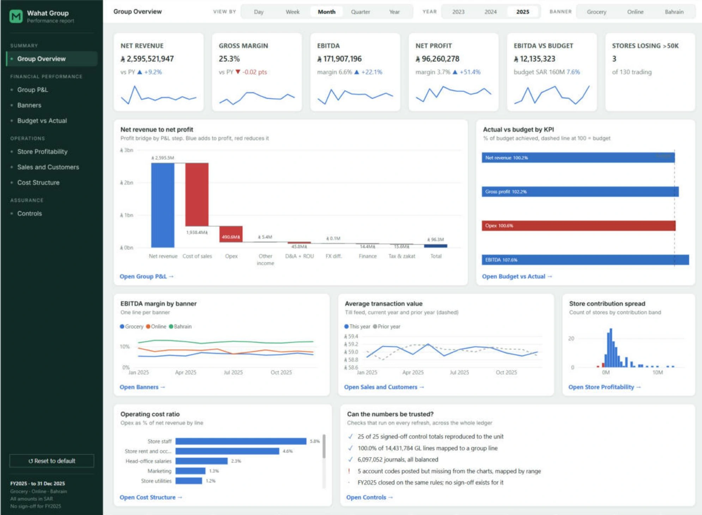
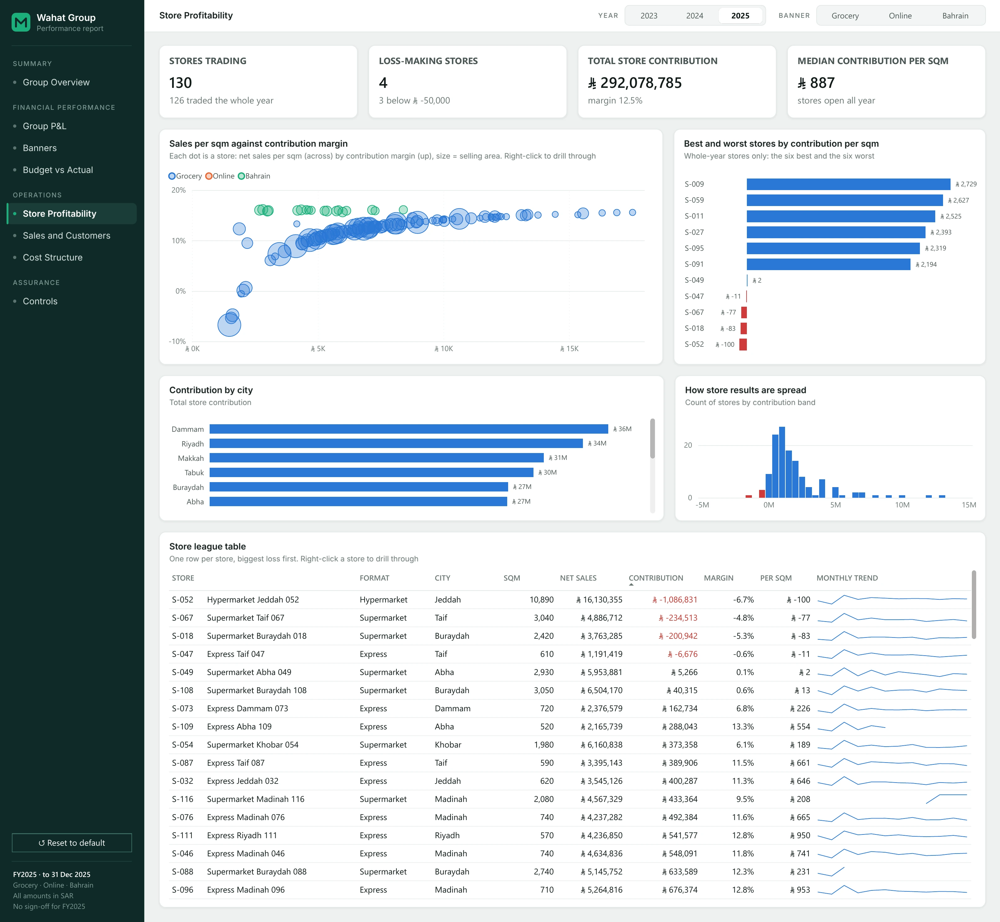

# Wahat Retail Group Financial Report: the Power BI side

[Back to the portfolio](../../../README.md) · [Project overview](../README.md) · [The data engineering side](../data-engineering/README.md)

**One report that tells a shop owner how all his shops are doing. Every number in it checks out.**

---

## The business

Picture a big family of grocery shops called **Wahat Retail Group**.

- About **110 grocery shops in Saudi Arabia**. This is the big one, called *Grocery*.
- An **online grocery shop**. Wahat bought it on 1 April 2024. This one is called *Online*.
- A **bunch of shops in Bahrain**. They run under the Wahat name as a franchise. This one is called *Bahrain*.

That is three businesses under one roof, with 136 shops between them and about 2.6 billion riyals of sales a year.

The boss (the board) asked two simple questions:

1. **"How much money did the whole family make, in Saudi riyals?"**
2. **"Which shops really make money, and which ones only look like they do?"**

## The data

The data is three years of shopping and bookkeeping, from 2023 to 2025.

- **14.4 million lines from the money diary** (the general ledger). Every riyal that came in or went out is a line in there.
- **2.2 million till records.** That is what the shop tills rang up, day by day, shop by shop, aisle by aisle.
- **The budget.** What the boss *hoped* would happen.
- **A rule book** (the Group Accounting Manual). It says how every kind of money should be counted.
- **The signed-off numbers for 2023 and 2024.** These are the answers the accountants already agreed on. 2025 had not been closed yet.

## The challenge

Here is why this is hard.

- **Three businesses, three different accounting systems.** Each one names its money boxes differently. It is like three kids keeping pocket money in three different piggy banks, each with its own labels. Before you can add them up, you have to work out which box in one piggy bank matches which box in the others.
- **Nobody gave us that matching list.** It only exists as rules written in the rule book, and two of the rules even contradict each other.
- **Bahrain counts in dinars, not riyals.** Everything has to be turned into riyals first.
- **Some shops share old cost codes.** When one shop closed and another opened, the new shop got the old shop's code. If you are not careful, you blame the new shop for the old shop's bills.
- **The budget is written upside down.** Its plus and minus signs are the opposite of the money diary's.
- **The boss needs to trust it.** If the 2023 and 2024 numbers do not match what the accountants already signed, nobody will believe 2025.

So the job was never just "make some charts". It was: **sort out the mess, prove the numbers are right, and only then show them.**

---

## What I built, and why

### 1. One front page that answers "how are we doing?" in five seconds

The **Group Overview** page is the landing page. At the top are six number tiles: Net Revenue, Gross Margin, EBITDA, Net Profit, EBITDA vs Budget, and how many shops are losing money.

Each tile also shows:
- whether it went **up or down** compared with last year,
- a **tiny trend line**, so you see the shape and not just one number.

Under the tiles are small versions of every other page. Each one has a link that takes you to the full page.

**Why:** a busy boss reads the top of the page and stops. So the most important answers sit right there.

### 2. Eight pages, each answering one question

| Page | The question it answers |
|---|---|
| Group Overview | How are we doing overall? |
| Group P&L | How did sales turn into profit, step by step? |
| Banners | Which of the three businesses is doing better? |
| Budget vs Actual | Are we ahead of the plan or behind it? |
| Store Profitability | Which shops make money and which ones lose it? |
| Sales and Customers | What are people buying, and when? |
| Cost Structure | Which costs are growing too fast? |
| Controls | Can I trust these numbers? |

There is also a hidden **Store Detail** page. Right-click any shop and pick *Drill through* to see everything about that one shop.

**Why:** one page per question means nobody has to hunt for an answer.

### What the pages look like

**Group P&L:** how revenue turns into profit, line by line

**Banners:** the three businesses side by side

**Budget vs Actual:** ahead of plan or behind it, biggest gaps first

**Store Profitability:** which shops make money and which ones lose it

**Sales and Customers:** what people buy, and when

**Cost Structure:** which costs are growing too fast

**Controls:** the page that proves the numbers

### 3. A "Can I trust this?" page

Most reports just show numbers and hope for the best. This one has a whole page that proves itself:

- **25 out of 25** signed-off numbers from 2023 and 2024 rebuilt from the raw diary and matched.
- **100%** of the 14.4 million diary lines sorted into the right place.
- It counts how many journals do not balance.
- It shows how much each tricky rule in the rule book moves the profit.
- It checks that what the tills rang up matches what the books recorded.

**Why:** a number nobody trusts is worth nothing. This page lets the finance team say yes with confidence.

### 4. Look at it by day, week, month, quarter or year

Every page has a **View by** switch with five buttons: Day, Week, Month, Quarter, Year. Click one and every chart on the page changes to that view.

**Why:** the boss looks at months, the shop manager looks at weeks, and the person checking a weird spike needs days. One switch keeps all three happy.

### 5. Click anything, and the whole page follows

Click a bar, a line, a shop or a slice, and **everything else on the page changes to match**. Click "Online", and the whole page becomes about Online.

I chose this chart by chart:
- Some charts **filter** the others. They show only the matching part.
- Some charts **highlight** instead. They show the matching part in strong colour and keep the rest faded, so you can still see the whole picture.

Nothing on a page works alone.

**Why:** people learn by poking. If one click answers a follow-up question, nobody needs to ask the data team.

### 6. A "Reset to default" button on every page

After all that clicking, one button puts the page back to its starting view: by Month, the year 2025, all three businesses.

**Why:** people get lost after ten clicks. This is the "take me home" button.

### 7. Hover for more

Move the mouse over a month, a shop or a P&L line, and a small pop-up card appears with more detail, like a little trend for that one item.

**Why:** extra detail is there when you want it and hidden when you don't. The page stays clean.

### 8. Money always looks like money

Every amount shows the Saudi riyal sign. Each chart picks the size that reads best:
- big totals in **millions** (2,595.5M),
- single shops in **thousands** (-234K),
- money per square metre **in full** (887),
- the check tables **in full, to the last riyal**, because a check has to be exact.

**Why:** short numbers are easier on the eye, but a reconciliation can't round.

### 9. Simple sums on the inside, so it stays fast

This is the part a buyer doesn't see, but it is why the report is quick.

- **All the heavy sorting happens before the data reaches Power BI.** Matching the three account lists, fixing the dinars, finding the right shop for each bill, flipping the budget signs: all of it is done in the data pipeline (see the [data engineering write-up](../data-engineering/README.md)).
- So inside Power BI, almost every number is just **a plain sum**. Sums are the fastest thing Power BI can do.
- **"Last year", "change vs last year" and "year to date" are written once** and reused by every number. Nobody writes the same formula fifty times.
- **The P&L table is driven by a list of lines**, not one giant formula full of "if this, then that".
- **The tables are shaped like a star.** One table of facts sits in the middle, with lookup tables around it. It is the shape Power BI likes best.
- **Every visual is a standard Power BI visual.** There is nothing to download and nothing to pay for.

**Why:** a fast, simple model is cheap to look after. The next person can open it and understand it on day one.

### 10. Built so the next person can look after it

- The report is saved as a **project folder**. Every page, chart and formula is its own small text file, so changes can be tracked in Git, line by line.
- One **theme file** holds the colours and fonts. Change it once and every page follows.
- Each business keeps **its own colour on every page**: Grocery blue, Online orange, Bahrain green. Last year is always grey and dashed, and anything bad is red.
- **Every formula has a plain-English description.** Hover over it and you see what it does.

---

## What you get, in one breath

A report that a board member can read in five seconds and a finance team can check line by line. You can switch it from days to years with one click, and every click on it updates the whole page. Under the hood it is simple enough that it stays fast and is easy to look after.

If your business has more than one system, more than one currency, and a boss who wants one clear answer, **this is exactly the kind of thing I build.**
