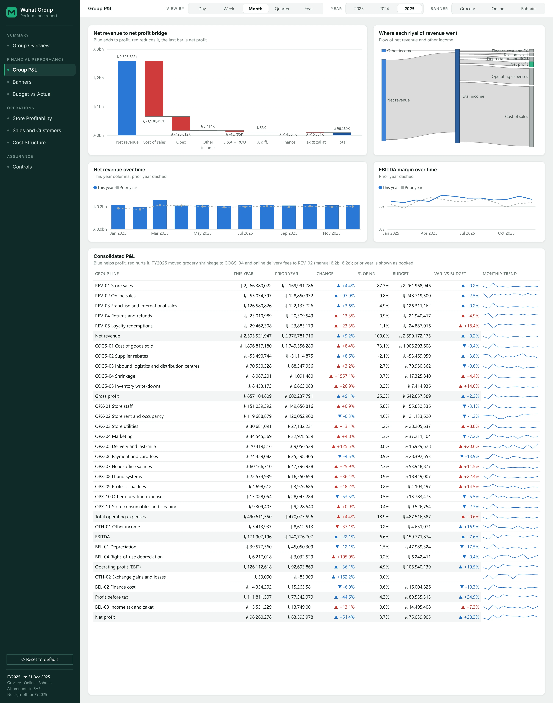
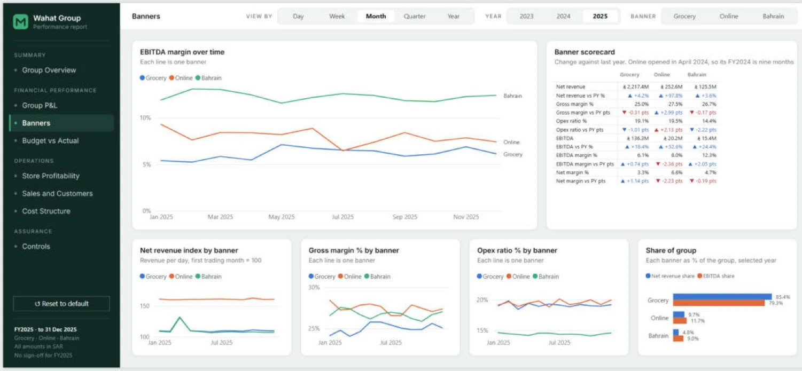
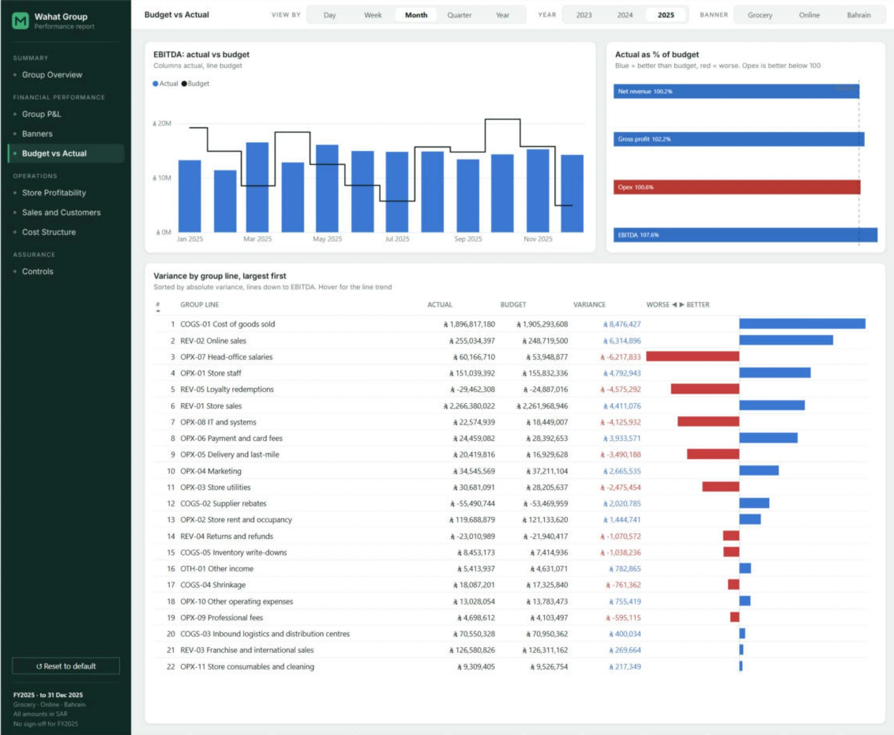
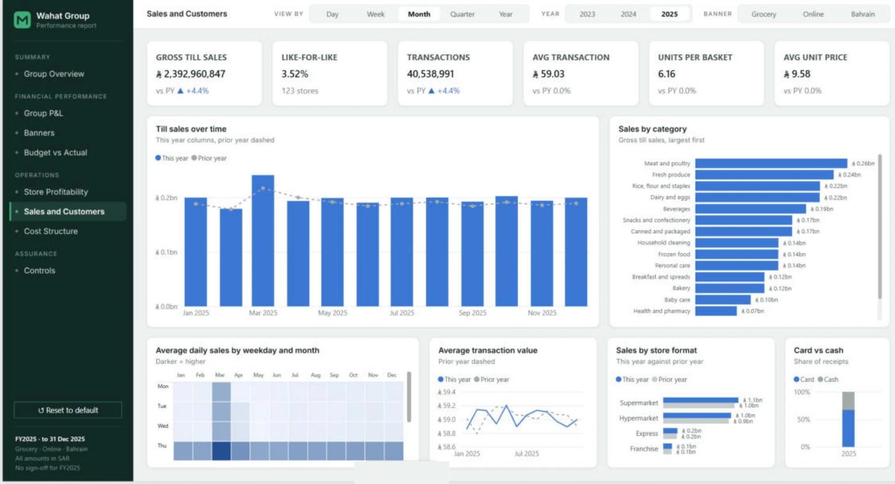
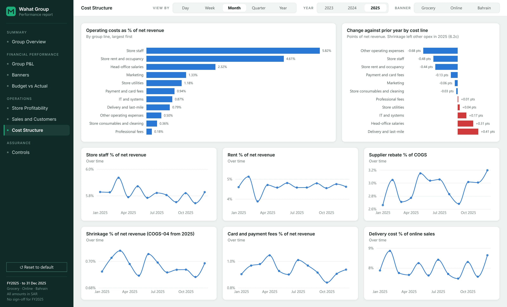
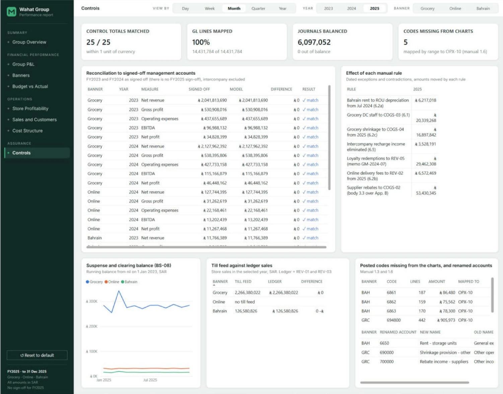
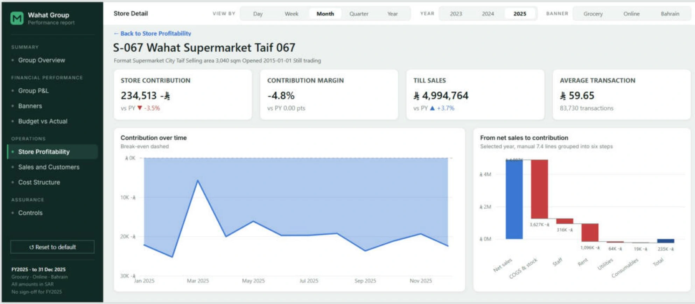
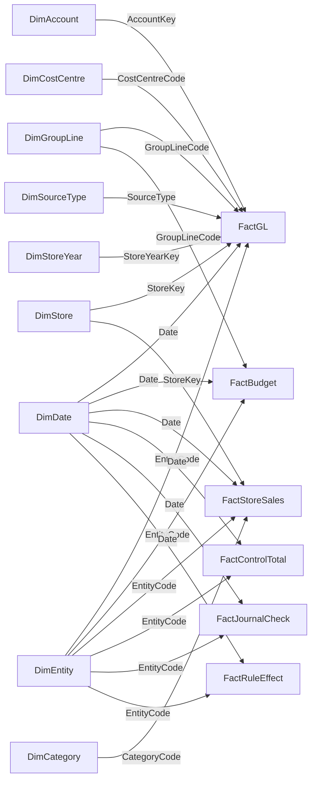

# Wahat Retail Group Financial Report: the Power BI side

[Back to the portfolio](../../../README.md) · [Project overview](../README.md) · [The data engineering side](https://github.com/shazmirza087/dataeng-jupyter)

**One report that tells a shop owner how all his shops are doing. Every number in it checks out.**


**On this page:** [The business](#the-business) · [The data](#the-data) · [The challenge](#the-challenge) · [What I built, and why](#what-i-built-and-why) · [The model](#the-model-in-full-detail) · [Calculation group](#calculation-group-time-intelligence) · [Measures](#measures) · [The report](#the-report-in-full-detail) · [Every page and visual](#every-page-and-visual)

---

## The business

Picture a big family of grocery shops called **Wahat Retail Group**.

- About **110 grocery shops in Saudi Arabia**. This is the big one, called *Grocery*.
- An **online grocery shop**. Wahat bought it on 1 April 2024. This one is called *Online*.
- A **bunch of shops in Bahrain**. They run under the Wahat name as a franchise. This one is called *Bahrain*.

That is three businesses under one roof, with 136 shops and warehouses between them over the three years, and about 2.6 billion riyals of sales a year.

The boss (the board) asked two simple questions:

1. **"How much money did the whole family make, in Saudi riyals?"**
2. **"Which shops really make money, and which ones only look like they do?"**

## The data

The data is three years of shopping and bookkeeping, from 2023 to 2025.

- **14.4 million lines from the money diary** (the general ledger). Every riyal that came in or went out is a line in there.
- **2.2 million till records.** That is what the shop tills rang up, day by day, shop by shop, aisle by aisle.
- **The budget.** What the boss *hoped* would happen.
- **A rule book** (the Group Accounting Manual). It says how every kind of money should be counted.
- **The signed-off numbers for 2023 and 2024.** These are the answers the accountants already agreed on. 2025 had not been closed yet.

## The challenge

This is what made it hard:

- **Three businesses, three different accounting systems.** Each one names its money boxes differently. It is like three kids keeping pocket money in three different piggy banks, each with its own labels. Before you can add them up, you have to work out which box in one piggy bank matches which box in the others.
- **Nobody gave us that matching list.** It only exists as rules written in the rule book, and two of the rules even contradict each other.
- **Bahrain counts in dinars, not riyals.** Everything has to be turned into riyals first.
- **Some shops share old cost codes.** When one shop closed and another opened, the new shop got the old shop's code. If you are not careful, you blame the new shop for the old shop's bills.
- **The budget is written upside down.** Its plus and minus signs are the opposite of the money diary's.
- **The boss needs to trust it.** If the 2023 and 2024 numbers do not match what the accountants already signed, nobody will believe 2025.

So before any chart could be built, the mess had to be sorted out and **the numbers proved right**.

---

## What I built, and why

### 1. One front page that answers "how are we doing?" in five seconds

The **Group Overview** page is the landing page. At the top are six number tiles: Net Revenue, Gross Margin, EBITDA, Net Profit, EBITDA vs Budget, and how many shops are losing money.

Each tile also shows:
- whether it went **up or down** compared with last year,
- a **tiny trend line**, so you see the shape and not just one number.

Under the tiles are small versions of every other page. Each one has a link that takes you to the full page.

**Why:** a busy boss reads the top of the page and stops. So the most important answers sit right there.

### 2. Eight pages, each answering one question

| Page | The question it answers |
|---|---|
| Group Overview | How are we doing overall? |
| Group P&L | How did sales turn into profit, step by step? |
| Banners | Which of the three businesses is doing better? |
| Budget vs Actual | Are we ahead of the plan or behind it? |
| Store Profitability | Which shops make money and which ones lose it? |
| Sales and Customers | What are people buying, and when? |
| Cost Structure | Which costs are growing too fast? |
| Controls | Can I trust these numbers? |

There is also a hidden **Store Detail** page. Right-click any shop and pick *Drill through* to see everything about that one shop.

**Why:** one page per question means nobody has to hunt for an answer.

### What the pages look like

**Group P&L:** how revenue turns into profit, line by line



**Banners:** the three businesses side by side



**Budget vs Actual:** ahead of plan or behind it, biggest gaps first



**Store Profitability:** which shops make money and which ones lose it, with a map of every store city


**Sales and Customers:** what people buy, and when



**Cost Structure:** which costs are growing too fast



**Controls:** the page that proves the numbers



**Store Detail:** everything about one store, reached by drilling through



### 3. A "Can I trust this?" page

One whole page is there to check the numbers:

- **25 out of 25** signed-off numbers from 2023 and 2024 rebuilt from the raw diary and matched.
- **100%** of the 14.4 million diary lines sorted into the right place.
- It counts how many journals do not balance.
- It shows how much each tricky rule in the rule book moves the profit.
- It checks that what the tills rang up matches what the books recorded.

**Why:** if finance can't trust a number, they won't use it. This page gives them the proof.

### 4. Look at it by day, week, month, quarter or year

Every page has a **View by** switch with five buttons: Day, Week, Month, Quarter, Year. Click one and every chart on the page changes to that view.

**Why:** the boss looks at months, the shop manager looks at weeks, and the person checking a weird spike needs days. One switch keeps all three happy.

### 5. Click anything, and the whole page follows

Click a bar, a line, a shop or a slice, and **everything else on the page changes to match**. Click "Online", and the whole page becomes about Online.

I chose this chart by chart:
- Some charts **filter** the others. They show only the matching part.
- Some charts **highlight** instead. They show the matching part in strong colour and keep the rest faded, so you can still see the whole picture.

Nothing on a page works alone.

**Why:** people learn by poking. If one click answers a follow-up question, nobody needs to ask the data team.

### 6. A "Reset to default" button on every page

After all that clicking, one button puts the page back to its starting view: by Month, the year 2025, all three businesses.

**Why:** people get lost after ten clicks. This is the "take me home" button.

### 7. Hover for more

Move the mouse over a month, a shop or a P&L line, and a small pop-up card appears with more detail, like a little trend for that one item.

**Why:** extra detail is there when you want it and hidden when you don't. The page stays clean.

### 8. Money always looks like money

Every amount shows the Saudi riyal sign, always on the left, with the minus sign after it (⃁ -1,938.4M). Every number on every page reads the same way, tooltips included.

Every chart picks its own size automatically, so it always fits whatever is selected:
- a whole year for the group reads in **billions** (⃁ 2.6bn),
- one shop reads in **millions or thousands** (⃁ 4.9M, ⃁ -20K),
- a filter with no data shows a clean empty chart, not strings of zeros.

Every table and every number tile shows **full numbers, to the last riyal** (⃁ 2,266,380,022).

**Why:** a chart is for shape, so it can round. A table is read line by line and has to add up, so it can't.

### 9. Simple sums on the inside, so it stays fast

You don't see this part, but it is why the report is quick.

- **All the heavy sorting happens before the data reaches Power BI.** Matching the three account lists, fixing the dinars, finding the right shop for each bill, flipping the budget signs: all of it is done in the data pipeline (see the [data engineering write-up](https://github.com/shazmirza087/dataeng-jupyter), which lives in its own repository).
- So inside Power BI, almost every number is just **a plain sum**. Sums are the fastest thing Power BI can do.
- **"Last year", "change vs last year" and "year to date" are written once** and reused by every number. Nobody writes the same formula fifty times.
- **The P&L table is driven by a list of lines**, not one giant formula full of "if this, then that".
- **The tables are shaped like a star.** One table of facts sits in the middle, with lookup tables around it. It is the shape Power BI likes best.
- **Every visual comes from Microsoft.** Most are built in. The profit flow uses Microsoft's free Sankey visual from AppSource, and the store map is the built-in shape map. Nothing to buy.

**Why:** a fast, simple model is cheap to look after. The next person can open it and understand it on day one.

### 10. Built so the next person can look after it

- The report is saved as a **project folder**. Every page, chart and formula is its own small text file, so changes can be tracked in Git, line by line.
- One **theme file** holds the colours and fonts. Change it once and every page follows.
- Each business keeps **its own colour on every page**: Grocery blue, Online orange, Bahrain green. Last year is always grey and dashed, and anything bad is red.
- **Every formula has a plain-English description.** Hover over it and you see what it does.

---

## What you get

A board member can read the front page in five seconds, and the finance team can check every line. You can switch it from days to years with one click, and clicking anything updates the rest of the page. Inside, it is kept simple, so it stays fast and is easy to look after.

If your business runs on more than one system or more than one currency and you need one clear set of numbers, **this is the kind of work I do.**

---

## The model, in full detail

This part is for the technical reader. Everything below comes straight from the model files.

The model is saved as PBIP with TMDL, so every table, measure and relationship is a plain text file that can be read, reviewed and tracked in Git. The data comes in through one Power Query parameter, `DataFolder`, which points at the folder the pipeline publishes to. Each table is one parquet file read from that folder, with no transformation steps in Power Query: all shaping is done in the pipeline. Auto date/time is off, implicit measures are discouraged, and `DimDate` is marked as the date table.

| | |
|---|---|
| **20** tables | 6 facts, 9 dimensions, 5 helper tables |
| **21** relationships | all one-to-many, single direction, all active |
| **218** measures | in one `_Measures` table, in 17 display folders |
| **1** calculation group | Time Intelligence, 6 items |
| **2** field parameters | Period (the View by switch) and P&L Statement |
| Storage mode | Import, from parquet files published by the pipeline |
### How the tables connect



Arrows point from the dimension to the fact it filters. Every relationship filters in one direction only.
### Tables
**Facts**

#### FactGL

General-ledger actuals by posting day, mapped to group lines and assigned to the store that owned the cost centre on that day (manual 6.4), in local currency and SAR.  
Rows: **5,998,352**

<details><summary>Columns</summary>

| Column | Type | Hidden | Notes |
|---|---|---|---|
| Date | dateTime | yes |  |
| EntityCode | string | yes |  |
| GroupLineCode | string | yes |  |
| AccountKey | string | yes |  |
| CostCentreCode | string | yes |  |
| StoreCode | string | yes |  |
| StoreKey | int64 | yes |  |
| HasStore | boolean | yes |  |
| SourceType | string | yes |  |
| TenderType | string | yes |  |
| AmountLCY | double | yes |  |
| AmountSAR | double | yes |  |
| LineCount | int64 | yes |  |
| StoreYearKey | string | yes |  |

</details>

#### FactBudget

Budget by day and group line (manual 7.5). Each monthly budget is spread evenly over its days and stored in the ledger sign convention, so budget measures mirror the actual ones.  
Rows: **48,141**

<details><summary>Columns</summary>

| Column | Type | Hidden | Notes |
|---|---|---|---|
| Date | dateTime | yes |  |
| EntityCode | string | yes |  |
| GroupLineCode | string | yes |  |
| BudgetLCY | double | yes |  |
| BudgetSAR | double | yes |  |

</details>

#### FactStoreSales

Till feed by day, store and category. Gross sales before refunds and loyalty.  
Rows: **2,237,680**

<details><summary>Columns</summary>

| Column | Type | Hidden | Notes |
|---|---|---|---|
| Date | dateTime | yes |  |
| StoreCode | string | yes |  |
| StoreKey | int64 | yes |  |
| EntityCode | string | yes |  |
| CategoryCode | string | yes |  |
| GrossSalesLCY | double | yes |  |
| GrossSalesSAR | double | yes |  |
| Units | int64 | yes |  |
| Transactions | int64 | yes |  |

</details>

#### FactControlTotal

Signed-off control totals (FY2023 and FY2024, five metrics per banner) next to the same figure rebuilt from the published ledger. IsReconciled: they agree to within one unit.  
Rows: **25**

<details><summary>Columns</summary>

| Column | Type | Hidden | Notes |
|---|---|---|---|
| Date | dateTime | yes |  |
| EntityCode | string | yes |  |
| Metric | string | yes | Sorted by MetricOrder. |
| MetricOrder | int64 | yes |  |
| SignedOff | double | yes |  |
| Model | double | yes |  |
| Difference | double | yes |  |
| IsReconciled | boolean | yes |  |

</details>

#### FactJournalCheck

Double entry check: journals posted per banner and month, and how many do not net to zero.  
Rows: **93**

<details><summary>Columns</summary>

| Column | Type | Hidden | Notes |
|---|---|---|---|
| Date | dateTime | yes |  |
| EntityCode | string | yes |  |
| Journals | int64 | yes |  |
| UnbalancedJournals | int64 | yes |  |

</details>

#### FactRuleEffect

Amount each dated exception or contradiction in the mapping manual moves, per banner and year, in the banner's own currency (AmountLCY) and in SAR at monthly average rates (AmountSAR).  
Rows: **15**

<details><summary>Columns</summary>

| Column | Type | Hidden | Notes |
|---|---|---|---|
| Date | dateTime | yes |  |
| EntityCode | string | yes |  |
| RuleName | string |  | Sorted by RuleOrder. |
| RuleOrder | int64 | yes |  |
| AmountLCY | double | yes |  |
| AmountSAR | double | yes |  |

</details>

**Dimensions**

#### DimDate

Calendar 2023 to 2025. Marked as the date table.  
Rows: **1,096**

<details><summary>Columns</summary>

| Column | Type | Hidden | Notes |
|---|---|---|---|
| Date | dateTime |  | Key. |
| Year | int64 |  |  |
| Quarter | string |  |  |
| MonthNumber | int64 |  |  |
| MonthName | string |  | Sorted by MonthNumber. |
| YearMonth | string |  | Sorted by YearMonthNumber. |
| YearMonthNumber | int64 | yes |  |
| MonthStart | dateTime | yes |  |
| DayName | string |  | Sorted by DayOfWeekNumber. |
| DayOfWeekNumber | int64 | yes |  |
| IsWeekend | boolean |  |  |
| YearQuarter | string |  | Sorted by YearQuarterNumber. |
| YearQuarterNumber | int64 | yes |  |
| WeekStart | dateTime |  |  |

</details>

#### DimEntity

The three banners, each with its own ERP and currency.  
Rows: **3**

<details><summary>Columns</summary>

| Column | Type | Hidden | Notes |
|---|---|---|---|
| EntityCode | string |  |  |
| EntityName | string |  |  |
| Country | string |  |  |
| ERPSystem | string |  |  |
| CurrencyCode | string |  |  |
| FirstPeriod | dateTime | yes |  |
| Banner | string |  | Sorted by BannerOrder. |
| BannerOrder | int64 | yes |  |

</details>

#### DimGroupLine

Group reporting lines and P&L subtotals. ReportOrder interleaves subtotals for the P&L table. FlowSource and FlowDestination place each line on a link of the profit flow Sankey.  
Rows: **46**

<details><summary>Columns</summary>

| Column | Type | Hidden | Notes |
|---|---|---|---|
| GroupLineCode | string |  |  |
| GroupLineName | string |  | Sorted by ReportOrder. |
| Section | string |  | Sorted by SectionOrder. |
| IsSubtotal | boolean |  |  |
| ReportOrder | int64 | yes |  |
| SectionOrder | int64 | yes |  |
| DisplaySign | int64 | yes |  |
| BridgeStep | string |  | Sorted by BridgeOrder. |
| BridgeOrder | int64 | yes |  |
| IsPnL | boolean |  |  |
| InStoreContribution | boolean | yes |  |
| GroupLineLabel | string |  | Sorted by ReportOrder. |
| SubtotalFrom | int64 | yes |  |
| SubtotalSign | int64 | yes |  |
| ProfitDirection | int64 | yes |  |
| StoreBridgeStep | string |  | Sorted by StoreBridgeOrder. |
| StoreBridgeOrder | int64 | yes |  |
| FlowSource | string |  |  |
| FlowDestination | string |  |  |

</details>

#### DimAccount

Union of the three local charts of accounts, plus codes posted but missing from the charts.  
Rows: **474**

<details><summary>Columns</summary>

| Column | Type | Hidden | Notes |
|---|---|---|---|
| AccountKey | string | yes |  |
| EntityCode | string |  |  |
| LocalAccountCode | string |  |  |
| AccountName | string |  |  |
| AccountLabel | string |  |  |
| LocalClass | string |  |  |
| NormalBalance | string |  |  |
| PreviousName | string |  |  |
| RenamedOn | string |  |  |
| MissingFromChart | boolean |  |  |

</details>

#### DimStore

Stores and fulfilment centres, type 2 slowly changing: one row per version of a store, keyed by StoreKey, valid from ValidFrom (inclusive) to ValidTo (exclusive). Facts join to the version valid on their date. Dark stores are not profit centres (manual 7.4).  
Rows: **136**

<details><summary>Columns</summary>

| Column | Type | Hidden | Notes |
|---|---|---|---|
| StoreKey | int64 | yes | Key. |
| StoreCode | string |  |  |
| EntityCode | string |  |  |
| StoreName | string |  |  |
| StoreFormat | string |  |  |
| City | string |  |  |
| SellingAreaSqm | int64 |  |  |
| OpenDate | dateTime |  |  |
| CloseDate | dateTime |  |  |
| IsProfitCentre | boolean |  |  |
| ValidFrom | dateTime |  |  |
| ValidTo | dateTime |  |  |
| IsCurrent | boolean |  |  |
| IsLatest | boolean | yes |  |
| StoreLabel | string |  | Store code and name without the group prefix, for tables (S-052 Hypermarket Jeddah 052). |
| StoreShortName | string |  | Store name without the group prefix (Hypermarket Jeddah 052). Sits next to StoreCode in the league table, which keeps the table drillable to Store Detail. |
| MapArea | string |  | The map shape a store sits in: its city, except Riffa and Isa Town, which share one shape ("Riffa and Isa Town") because both fall in Bahrain's Southern Governorate. Location for the store map. |

</details>

#### DimStoreYear

One row per store and year: its contribution (manual 7.4) and the SAR 0.5M band it falls in. Filters FactGL through StoreYearKey, so a band picked on the spread histogram filters the whole page.  
Rows: **394**

<details><summary>Columns</summary>

| Column | Type | Hidden | Notes |
|---|---|---|---|
| StoreYearKey | string | yes | Key. |
| Date | dateTime | yes |  |
| StoreCode | string | yes |  |
| StoreKey | int64 | yes |  |
| EntityCode | string | yes |  |
| ContributionLCY | double | yes |  |
| ContributionSAR | double |  |  |
| ContributionBandM | double |  |  |

</details>

#### DimCostCentre

Cost centres. CurrentStoreCode is today's store only; history is resolved in FactGL[StoreCode].  
Rows: **156**

<details><summary>Columns</summary>

| Column | Type | Hidden | Notes |
|---|---|---|---|
| CostCentreCode | string |  |  |
| CostCentreName | string |  |  |
| Function | string |  |  |
| CurrentStoreCode | string |  |  |

</details>

#### DimCategory

Product categories of the till feed.  
Rows: **16**

<details><summary>Columns</summary>

| Column | Type | Hidden | Notes |
|---|---|---|---|
| CategoryCode | string |  |  |
| CategoryName | string |  |  |
| Department | string |  |  |
| CostRatio | double |  |  |

</details>

#### DimSourceType

Ledger source of each posting.  
Rows: **6**

<details><summary>Columns</summary>

| Column | Type | Hidden | Notes |
|---|---|---|---|
| SourceType | string |  |  |
| SourceName | string |  |  |
| Ledger | string |  |  |

</details>

**Helper tables**

#### Trend Month

Every month of the calendar, not related to anything. Axis of the 36-month trends in the tooltip pages, so the trend keeps all months while the tooltip is filtered to one.

<details><summary>Columns</summary>

| Column | Type | Hidden | Notes |
|---|---|---|---|
| MonthStart | dateTime |  |  |

</details>

### Relationships

| From (many) | To (one) |
|---|---|
| FactGL.Date | DimDate.Date |
| FactGL.EntityCode | DimEntity.EntityCode |
| FactGL.GroupLineCode | DimGroupLine.GroupLineCode |
| FactGL.AccountKey | DimAccount.AccountKey |
| FactGL.CostCentreCode | DimCostCentre.CostCentreCode |
| FactGL.StoreKey | DimStore.StoreKey |
| FactGL.SourceType | DimSourceType.SourceType |
| FactGL.StoreYearKey | DimStoreYear.StoreYearKey |
| FactBudget.Date | DimDate.Date |
| FactBudget.EntityCode | DimEntity.EntityCode |
| FactBudget.GroupLineCode | DimGroupLine.GroupLineCode |
| FactStoreSales.Date | DimDate.Date |
| FactStoreSales.StoreKey | DimStore.StoreKey |
| FactStoreSales.EntityCode | DimEntity.EntityCode |
| FactStoreSales.CategoryCode | DimCategory.CategoryCode |
| FactControlTotal.Date | DimDate.Date |
| FactControlTotal.EntityCode | DimEntity.EntityCode |
| FactJournalCheck.Date | DimDate.Date |
| FactJournalCheck.EntityCode | DimEntity.EntityCode |
| FactRuleEffect.Date | DimDate.Date |
| FactRuleEffect.EntityCode | DimEntity.EntityCode |

### Calculation group: Time Intelligence

Apply any measure to the prior year or as a change against it. Precedence 20. Put `Time Calculation` on a matrix column, or filter a visual to one item.

<details><summary><b>Current</b></summary>

```dax
SELECTEDMEASURE ()
```

</details>

<details><summary><b>PY</b></summary>

```dax
CALCULATE (
    SELECTEDMEASURE (),
    SAMEPERIODLASTYEAR ( DimDate[Date] )
)
```

</details>

<details><summary><b>YoY</b></summary>

```dax
VAR CurrentPeriodValue =
    SELECTEDMEASURE ()
VAR PriorYearValue =
    CALCULATE (
        SELECTEDMEASURE (),
        SAMEPERIODLASTYEAR ( DimDate[Date] )
    )
RETURN
    IF (
        NOT ISBLANK ( CurrentPeriodValue )
            && NOT ISBLANK ( PriorYearValue ),
        CurrentPeriodValue - PriorYearValue
    )
```

</details>

<details><summary><b>YoY %</b></summary>

```dax
VAR CurrentPeriodValue =
    SELECTEDMEASURE ()
VAR PriorYearValue =
    CALCULATE (
        SELECTEDMEASURE (),
        SAMEPERIODLASTYEAR ( DimDate[Date] )
    )
RETURN
    IF (
        NOT ISBLANK ( CurrentPeriodValue ),
        DIVIDE (
            CurrentPeriodValue - PriorYearValue,
            ABS ( PriorYearValue )
        )
    )
```

Format string: `▲ +0.0%;▼ -0.0%;0.0%`

</details>

<details><summary><b>YTD</b></summary>

```dax
CALCULATE (
    SELECTEDMEASURE (),
    DATESYTD ( DimDate[Date] )
)
```

</details>

<details><summary><b>PY YTD</b></summary>

```dax
CALCULATE (
    SELECTEDMEASURE (),
    DATESYTD ( SAMEPERIODLASTYEAR ( DimDate[Date] ) )
)
```

</details>

### Field parameter: Period

Field parameter for the time axis. The View by slicer in each page header picks the level (day, week, month, quarter or year) for every trend chart on the page. Weeks run Sunday to Saturday.

```dax
{
    ( "Day", NAMEOF ( 'DimDate'[Date] ), 0 ),
    ( "Week", NAMEOF ( 'DimDate'[WeekStart] ), 1 ),
    ( "Month", NAMEOF ( 'DimDate'[MonthStart] ), 2 ),
    ( "Quarter", NAMEOF ( 'DimDate'[YearQuarter] ), 3 ),
    ( "Year", NAMEOF ( 'DimDate'[Year] ), 4 )
}
```

### Field parameter: P&L Statement

Field parameter for the P&L matrix. Put it in Values with 'Show values on rows' on: each P&L measure becomes a row, in this order.

```dax
{
    ( "Net Revenue", NAMEOF ( '_Measures'[Net Revenue] ), 0 ),
    ( "Cost of Sales", NAMEOF ( '_Measures'[Cost of Sales] ), 1 ),
    ( "Gross Profit", NAMEOF ( '_Measures'[Gross Profit] ), 2 ),
    ( "Operating Expenses", NAMEOF ( '_Measures'[Operating Expenses] ), 3 ),
    ( "Other Income", NAMEOF ( '_Measures'[Other Income] ), 4 ),
    ( "EBITDA", NAMEOF ( '_Measures'[EBITDA] ), 5 ),
    ( "Depreciation and ROU", NAMEOF ( '_Measures'[Depreciation and ROU] ), 6 ),
    ( "EBIT", NAMEOF ( '_Measures'[EBIT] ), 7 ),
    ( "Exchange Differences", NAMEOF ( '_Measures'[Exchange Differences] ), 8 ),
    ( "Finance Cost", NAMEOF ( '_Measures'[Finance Cost] ), 9 ),
    ( "Profit Before Tax", NAMEOF ( '_Measures'[Profit Before Tax] ), 10 ),
    ( "Income Tax and Zakat", NAMEOF ( '_Measures'[Income Tax and Zakat] ), 11 ),
    ( "Net Profit", NAMEOF ( '_Measures'[Net Profit] ), 12 )
}
```

### Measures

All report measures. Built on [Amount]; every P&L line follows the Group Accounting Manual v4.0. 218 measures in 17 folders. Click a folder to see every measure's DAX.

| Folder | Measures |
|---|---|
| Base | 3 |
| P&L | 14 |
| P&L / Margins | 5 |
| P&L / Statement | 15 |
| P&L / Drivers | 8 |
| Budget | 16 |
| Stores | 16 |
| Sales | 12 |
| Sales / Like-for-like | 4 |
| Visuals | 6 |
| Report Labels | 20 |
| Controls | 23 |
| Visuals / Change vs PY | 15 |
| Trust Checks | 15 |
| Banners | 3 |
| Tooltips | 41 |
| Visuals / Prior year | 2 |

#### Base

| Measure | Format | What it does |
|---|---|---|
| Amount | riyal | Signed ledger amount in SAR at the monthly average rate (manual 2.3), debit +, credit -. Every actual P&L measure is built on this. |
| Budget Amount | riyal | Signed budget amount in SAR, same sign convention as [Amount]. Every budget measure is built on this. |
| Loss Threshold (hidden) | riyal | Store contribution below this counts as a significant loss. Change it here if management changes the threshold. |

<details><summary>DAX for the 3 measures in Base</summary>

```dax
Amount =
SUM ( FactGL[AmountSAR] )
```

```dax
Budget Amount =
SUM ( FactBudget[BudgetSAR] )
```

```dax
Loss Threshold =
-50000
```

</details>

#### P&L

| Measure | Format | What it does |
|---|---|---|
| Net Revenue | riyal | Manual 7.1: REV-01 + REV-02 + REV-03 - REV-04 - REV-05, shown positive. |
| Cost of Sales | riyal | Manual 7.1: COGS-01 - COGS-02 + COGS-03 + COGS-04 + COGS-05. |
| Gross Profit | riyal | Net revenue less cost of sales. |
| Operating Expenses | riyal | Manual 7.1: OPX-01 to OPX-11. |
| Other Income | riyal | OTH-01, shown positive. |
| EBITDA | riyal | Manual 7.2: gross profit - operating expenses + other income. Exchange differences are excluded. |
| Depreciation and ROU | riyal | BEL-01 depreciation + BEL-04 right-of-use depreciation. |
| EBIT | riyal | Manual 7.2: EBITDA - BEL-01 - BEL-04. |
| Exchange Differences | riyal | OTH-02, shown as a gain when positive. |
| Finance Cost | riyal | BEL-02. |
| Profit Before Tax | riyal | Manual 7.3: EBIT + exchange differences - finance cost. |
| Income Tax and Zakat | riyal | BEL-03. |
| Net Profit | riyal | Manual 7.3: profit before tax - BEL-03. |
| Intercompany Eliminated | riyal | Manual 6.5: Grocery recharge income (790000-790999) removed on consolidation, shown positive. Never part of any P&L measure. |

<details><summary>DAX for the 14 measures in P&L</summary>

```dax
Net Revenue =
-CALCULATE (
    [Amount],
    DimGroupLine[Section] = "Revenue"
)
```

```dax
Cost of Sales =
CALCULATE (
    [Amount],
    DimGroupLine[Section] = "Cost of sales"
)
```

```dax
Gross Profit =
[Net Revenue] - [Cost of Sales]
```

```dax
Operating Expenses =
CALCULATE (
    [Amount],
    DimGroupLine[Section] = "Operating expenses"
)
```

```dax
Other Income =
-CALCULATE (
    [Amount],
    DimGroupLine[GroupLineCode] = "OTH-01"
)
```

```dax
EBITDA =
[Gross Profit] - [Operating Expenses] + [Other Income]
```

```dax
Depreciation and ROU =
CALCULATE (
    [Amount],
    DimGroupLine[GroupLineCode] IN { "BEL-01", "BEL-04" }
)
```

```dax
EBIT =
[EBITDA] - [Depreciation and ROU]
```

```dax
Exchange Differences =
-CALCULATE (
    [Amount],
    DimGroupLine[GroupLineCode] = "OTH-02"
)
```

```dax
Finance Cost =
CALCULATE (
    [Amount],
    DimGroupLine[GroupLineCode] = "BEL-02"
)
```

```dax
Profit Before Tax =
[EBIT] + [Exchange Differences] - [Finance Cost]
```

```dax
Income Tax and Zakat =
CALCULATE (
    [Amount],
    DimGroupLine[GroupLineCode] = "BEL-03"
)
```

```dax
Net Profit =
[Profit Before Tax] - [Income Tax and Zakat]
```

```dax
Intercompany Eliminated =
-CALCULATE (
    [Amount],
    DimGroupLine[GroupLineCode] = "ELIM-01",
    DimEntity[EntityCode] = "GRC"
)
```

</details>

#### P&L / Margins

| Measure | Format | What it does |
|---|---|---|
| Gross Margin % | 0.0% | Gross profit / net revenue. |
| Opex Ratio % | 0.0% | Operating expenses / net revenue. |
| EBITDA Margin % | 0.0% | EBITDA / net revenue. |
| EBIT Margin % | 0.0% | EBIT / net revenue. |
| Net Margin % | 0.0% | Net profit / net revenue. |

<details><summary>DAX for the 5 measures in P&L / Margins</summary>

```dax
Gross Margin % =
DIVIDE (
    [Gross Profit],
    [Net Revenue]
)
```

```dax
Opex Ratio % =
DIVIDE (
    [Operating Expenses],
    [Net Revenue]
)
```

```dax
EBITDA Margin % =
DIVIDE (
    [EBITDA],
    [Net Revenue]
)
```

```dax
EBIT Margin % =
DIVIDE (
    [EBIT],
    [Net Revenue]
)
```

```dax
Net Margin % =
DIVIDE (
    [Net Profit],
    [Net Revenue]
)
```

</details>

#### P&L / Statement

| Measure | Format | What it does |
|---|---|---|
| Line Value | riyal | Amount of the group lines in context, signed by section: revenue and other income show credits as positive, so refunds and loyalty show as deductions and section subtotals add up. |
| Profit Contribution | riyal | How much the lines in context add to profit: income positive, costs negative. Drives the profit bridge waterfall. |
| % of Net Revenue | 0.0% | Line value as a share of net revenue for the same filters. |
| Statement Value | riyal | Value of a statement row: a group line as Line Value shows it, or a subtotal (net revenue, gross profit, total opex, EBITDA, EBIT, profit before tax, net profit) built from the lines above it. |
| Statement Budget | riyal | Budget of a statement row, built the same way as Statement Value. |
| Statement PY | riyal | Statement Value for the same period last year. |
| Statement Change % | ▲ +0.0%;▼ -0.0%;0.0% | Change of the statement row against last year, as the change in size of the amount: returns of -23.0M against -20.3M read +13.3% (returns grew). When the row changes sign (a loss became a gain) it is the change against the prior amount. The colour comes from Statement Change Effect. |
| Statement % of Net Revenue | 0.0% | Statement row as a share of net revenue. |
| Statement vs Budget % | ▲ +0.0%;▼ -0.0%;0.0% | Statement row against its budget, as the difference in size of the amount (returns above budget read as a positive %). Blank when the row has no budget. The colour comes from Budget Variance. |
| Statement Change Effect (hidden) | riyal | Effect of the change against last year on profit: positive is good. Colours the change column. |
| Budget Variance | riyal | Actual against budget, turned round for costs so that positive is always better than budget. Blank when the row has no budget. |
| Variance Bar | riyal | Same as Budget Variance. Drawn as a bar in the variance table, blue right when better than budget, red left when worse. |
| Statement Row Shade (hidden) | 0 | 1 on subtotal rows. Shades them in the statement table. |
| Variance Rank | 0 | Rank of the line by the size of its budget variance, largest first, among the revenue, cost of sales, opex and other income lines (the lines in the variance table). |
| Net Revenue PY | riyal | Net revenue for the same period last year. The dashed prior-year line on the monthly revenue chart. |

<details><summary>DAX for the 15 measures in P&L / Statement</summary>

```dax
Line Value =
SUMX (
    VALUES ( DimGroupLine[DisplaySign] ),
    DimGroupLine[DisplaySign] * [Amount]
)
```

```dax
Profit Contribution =
-[Amount]
```

```dax
% of Net Revenue =
VAR NetRevenueAllLines =
    CALCULATE (
        [Net Revenue],
        REMOVEFILTERS ( DimGroupLine )
    )
RETURN
    DIVIDE (
        [Line Value],
        NetRevenueAllLines
    )
```

```dax
Statement Value =
VAR RowOrder =
    MAX ( DimGroupLine[ReportOrder] )
VAR FromOrder =
    MAX ( DimGroupLine[SubtotalFrom] )
VAR SubtotalSign =
    MAX ( DimGroupLine[SubtotalSign] )
VAR IsSubtotalRow =
    HASONEVALUE ( DimGroupLine[GroupLineCode] )
        && NOT ISBLANK ( SubtotalSign )
VAR SubtotalValue =
    SubtotalSign
        * CALCULATE (
            [Amount],
            REMOVEFILTERS ( DimGroupLine ),
            DimGroupLine[IsPnL] = TRUE (),
            DimGroupLine[ReportOrder] >= FromOrder,
            DimGroupLine[ReportOrder] < RowOrder
        )
RETURN
    IF (
        IsSubtotalRow,
        SubtotalValue,
        [Line Value]
    )
```

```dax
Statement Budget =
VAR RowOrder =
    MAX ( DimGroupLine[ReportOrder] )
VAR FromOrder =
    MAX ( DimGroupLine[SubtotalFrom] )
VAR SubtotalSign =
    MAX ( DimGroupLine[SubtotalSign] )
VAR IsSubtotalRow =
    HASONEVALUE ( DimGroupLine[GroupLineCode] )
        && NOT ISBLANK ( SubtotalSign )
VAR SubtotalValue =
    SubtotalSign
        * CALCULATE (
            [Budget Amount],
            REMOVEFILTERS ( DimGroupLine ),
            DimGroupLine[IsPnL] = TRUE (),
            DimGroupLine[ReportOrder] >= FromOrder,
            DimGroupLine[ReportOrder] < RowOrder
        )
RETURN
    IF (
        IsSubtotalRow,
        SubtotalValue,
        [Budget Line Value]
    )
```

```dax
Statement PY =
CALCULATE (
    [Statement Value],
    'Time Intelligence'[Time Calculation] = "PY"
)
```

```dax
Statement Change % =
VAR CurrentValue =
    [Statement Value]
VAR PriorValue =
    [Statement PY]
VAR SameSign =
    SIGN ( CurrentValue ) = SIGN ( PriorValue )
VAR Change =
    IF (
        SameSign,
        DIVIDE ( ABS ( CurrentValue ), ABS ( PriorValue ) ) - 1,
        DIVIDE ( CurrentValue - PriorValue, ABS ( PriorValue ) )
    )
RETURN
    IF (
        NOT ISBLANK ( CurrentValue ) && NOT ISBLANK ( PriorValue ),
        ROUND ( Change, 3 )
    )
```

```dax
Statement % of Net Revenue =
VAR NetRevenueAllLines =
    CALCULATE (
        [Net Revenue],
        REMOVEFILTERS ( DimGroupLine )
    )
RETURN
    DIVIDE (
        [Statement Value],
        NetRevenueAllLines
    )
```

```dax
Statement vs Budget % =
VAR CurrentValue =
    [Statement Value]
VAR BudgetValue =
    [Statement Budget]
VAR SameSign =
    SIGN ( CurrentValue ) = SIGN ( BudgetValue )
RETURN
    IF (
        NOT ISBLANK ( BudgetValue ),
        IF (
            SameSign,
            DIVIDE ( ABS ( CurrentValue ), ABS ( BudgetValue ) ) - 1,
            DIVIDE ( CurrentValue - BudgetValue, ABS ( BudgetValue ) )
        )
    )
```

```dax
Statement Change Effect =
VAR Direction =
    MAX ( DimGroupLine[ProfitDirection] )
VAR CurrentValue =
    [Statement Value]
VAR PriorValue =
    [Statement PY]
RETURN
    IF (
        NOT ISBLANK ( CurrentValue ) && NOT ISBLANK ( PriorValue ),
        ROUND ( CurrentValue - PriorValue, 0 ) * Direction
    )
```

```dax
Budget Variance =
VAR Direction =
    MAX ( DimGroupLine[ProfitDirection] )
VAR BudgetValue =
    [Statement Budget]
RETURN
    IF (
        NOT ISBLANK ( BudgetValue ),
        ( [Statement Value] - BudgetValue ) * Direction
    )
```

```dax
Variance Bar =
[Budget Variance]
```

```dax
Statement Row Shade =
VAR SubtotalSign =
    MAX ( DimGroupLine[SubtotalSign] )
RETURN
    INT ( NOT ISBLANK ( SubtotalSign ) )
```

```dax
Variance Rank =
-- size of the variance in whole SAR from the two base measures, so a line always ties with itself
VAR CurrentSize =
    IF (
        NOT ISBLANK ( [Budget Variance] ),
        ROUND ( ABS ( [Amount] - [Budget Amount] ), 0 )
    )
VAR TableLines =
    FILTER (
        ALL ( DimGroupLine[GroupLineCode] ),
        LEFT ( DimGroupLine[GroupLineCode], 4 ) IN { "REV-", "COGS", "OPX-" }
            || DimGroupLine[GroupLineCode] = "OTH-01"
    )
VAR LinesWithBiggerVariance =
    FILTER (
        TableLines,
        VAR LineCode = DimGroupLine[GroupLineCode]
        VAR LineSize =
            ROUND (
                ABS (
                    CALCULATE (
                        [Amount] - [Budget Amount],
                        REMOVEFILTERS ( DimGroupLine ),
                        DimGroupLine[GroupLineCode] = LineCode
                    )
                ),
                0
            )
        RETURN
            LineSize > CurrentSize
    )
RETURN
    IF (
        NOT ISBLANK ( CurrentSize ),
        COUNTROWS ( LinesWithBiggerVariance ) + 1
    )
```

```dax
Net Revenue PY =
CALCULATE (
    [Net Revenue],
    SAMEPERIODLASTYEAR ( DimDate[Date] )
)
```

</details>

#### P&L / Drivers

| Measure | Format | What it does |
|---|---|---|
| Gross Sales | riyal | REV-01 + REV-02 + REV-03 before refunds and loyalty. |
| Returns and Refunds | riyal | REV-04. |
| Refund Rate % | 0.0% | Refunds / gross sales. |
| Loyalty Redemptions | riyal | REV-05 (memo GM-2024-07). |
| Loyalty Rate % | 0.0% | Loyalty redemptions / gross sales. |
| Supplier Rebates | riyal | COGS-02, shown positive. |
| Rebate Rate % | 0.0% | Supplier rebates / cost of goods sold (COGS-01). |
| Delivery Cost % of Online Sales | 0.0% | OPX-05 / REV-02. |

<details><summary>DAX for the 8 measures in P&L / Drivers</summary>

```dax
Gross Sales =
-CALCULATE (
    [Amount],
    DimGroupLine[GroupLineCode] IN { "REV-01", "REV-02", "REV-03" }
)
```

```dax
Returns and Refunds =
CALCULATE (
    [Amount],
    DimGroupLine[GroupLineCode] = "REV-04"
)
```

```dax
Refund Rate % =
DIVIDE (
    [Returns and Refunds],
    [Gross Sales]
)
```

```dax
Loyalty Redemptions =
CALCULATE (
    [Amount],
    DimGroupLine[GroupLineCode] = "REV-05"
)
```

```dax
Loyalty Rate % =
DIVIDE (
    [Loyalty Redemptions],
    [Gross Sales]
)
```

```dax
Supplier Rebates =
-CALCULATE (
    [Amount],
    DimGroupLine[GroupLineCode] = "COGS-02"
)
```

```dax
Rebate Rate % =
VAR CostOfGoodsSold =
    CALCULATE (
        [Amount],
        DimGroupLine[GroupLineCode] = "COGS-01"
    )
RETURN
    DIVIDE (
        [Supplier Rebates],
        CostOfGoodsSold
    )
```

```dax
Delivery Cost % of Online Sales =
VAR DeliveryCost =
    CALCULATE (
        [Amount],
        DimGroupLine[GroupLineCode] = "OPX-05"
    )
VAR OnlineSales =
    -CALCULATE (
        [Amount],
        DimGroupLine[GroupLineCode] = "REV-02"
    )
RETURN
    DIVIDE (
        DeliveryCost,
        OnlineSales
    )
```

</details>

#### Budget

| Measure | Format | What it does |
|---|---|---|
| Budget Net Revenue | riyal | Budget net revenue. |
| Budget Cost of Sales | riyal | Budget cost of sales. |
| Budget Gross Profit | riyal | Budget gross profit. |
| Budget Operating Expenses | riyal | Budget operating expenses. |
| Budget Other Income | riyal | Budget other income. |
| Budget EBITDA | riyal | Budget EBITDA. |
| Budget Line Value | riyal | Budget of the group lines in context, shown as the positive amount the line name describes. |
| Line vs Budget | riyal | Line value minus budget line value. For cost lines, positive means overspend. |
| EBITDA vs Budget | riyal | Actual EBITDA - budget EBITDA. Positive = better than budget. |
| EBITDA vs Budget % | 0.0% | EBITDA variance / budget EBITDA. |
| Net Revenue vs Budget % | 0.0% | Net revenue variance / budget. |
| Opex vs Budget % | 0.0% | Operating expenses variance / budget. Positive = overspend. |
| Net Revenue Achieved % | 0.0"% | Net Revenue as a percentage of its budget. 100 means on budget. Drives the budget bar chart, with a constant line at 100. |
| Gross Profit Achieved % | 0.0"% | Gross Profit as a percentage of its budget. 100 means on budget. Drives the budget bar chart, with a constant line at 100. |
| Opex Achieved % | 0.0"% | Operating Expenses as a percentage of its budget. 100 means on budget. Drives the budget bar chart, with a constant line at 100. |
| EBITDA Achieved % | 0.0"% | EBITDA as a percentage of its budget. 100 means on budget. Drives the budget bar chart, with a constant line at 100. |

<details><summary>DAX for the 16 measures in Budget</summary>

```dax
Budget Net Revenue =
-CALCULATE (
    [Budget Amount],
    DimGroupLine[Section] = "Revenue"
)
```

```dax
Budget Cost of Sales =
CALCULATE (
    [Budget Amount],
    DimGroupLine[Section] = "Cost of sales"
)
```

```dax
Budget Gross Profit =
[Budget Net Revenue] - [Budget Cost of Sales]
```

```dax
Budget Operating Expenses =
CALCULATE (
    [Budget Amount],
    DimGroupLine[Section] = "Operating expenses"
)
```

```dax
Budget Other Income =
-CALCULATE (
    [Budget Amount],
    DimGroupLine[GroupLineCode] = "OTH-01"
)
```

```dax
Budget EBITDA =
[Budget Gross Profit] - [Budget Operating Expenses] + [Budget Other Income]
```

```dax
Budget Line Value =
SUMX (
    VALUES ( DimGroupLine[DisplaySign] ),
    DimGroupLine[DisplaySign] * [Budget Amount]
)
```

```dax
Line vs Budget =
[Line Value] - [Budget Line Value]
```

```dax
EBITDA vs Budget =
[EBITDA] - [Budget EBITDA]
```

```dax
EBITDA vs Budget % =
DIVIDE (
    [EBITDA vs Budget],
    [Budget EBITDA]
)
```

```dax
Net Revenue vs Budget % =
DIVIDE (
    [Net Revenue] - [Budget Net Revenue],
    [Budget Net Revenue]
)
```

```dax
Opex vs Budget % =
DIVIDE (
    [Operating Expenses] - [Budget Operating Expenses],
    [Budget Operating Expenses]
)
```

```dax
Net Revenue Achieved % =
DIVIDE (
    [Net Revenue],
    [Budget Net Revenue]
) * 100
```

```dax
Gross Profit Achieved % =
DIVIDE (
    [Gross Profit],
    [Budget Gross Profit]
) * 100
```

```dax
Opex Achieved % =
DIVIDE (
    [Operating Expenses],
    [Budget Operating Expenses]
) * 100
```

```dax
EBITDA Achieved % =
DIVIDE (
    [EBITDA],
    [Budget EBITDA]
) * 100
```

</details>

#### Stores

| Measure | Format | What it does |
|---|---|---|
| Store Contribution | riyal | Manual 7.4: store REV-01/03 less REV-04, REV-05, COGS-01/04/05, OPX-01/02/03/11 on the store's cost centre. Store assignment follows 6.4. |
| Store Net Sales | riyal | Store REV-01/03 less REV-04 and REV-05. |
| Store Contribution Margin % | 0.0% | Store contribution / store net sales. |
| Selling Area Sqm | #,0 | Selling area of the stores in context, as it was at the end of the selected period (DimStore keeps every version of a store). |
| Contribution per Sqm | riyal | Store contribution / selling area. |
| Net Sales per Sqm | riyal | Store net sales / selling area. |
| Stores Trading | #,0 | Stores open at any time in the selected period, in the banners selected. Counts each store once, using its latest version. |
| Traded Whole Period | 0 | 1 when the single store in context was open for the whole selected period. Use as a visual filter (= 1). |
| Loss-Making Stores | #,0 | Stores with negative contribution. |
| Stores Below Loss Threshold | #,0 | Stores with contribution below the loss threshold (SAR -50,000). |
| Selected Store |  | Store code and name when one store is in context. Used in the drillthrough page header. |
| Stores Whole Year | #,0 | Stores in context that were open for the whole selected period and sold something. |
| Median Contribution per Sqm | riyal | Median contribution per sqm of the stores open for the whole selected period. |
| Best or Worst Six | 0 | 1 for the six best and six worst stores by contribution per sqm among stores open the whole period. Visual filter (= 1). |
| Store Headline (hidden) |  | Store Detail headline: the store code and name. The figures are on the cards below it. |
| Store Facts (hidden) |  | Store Detail facts line: format, city, selling area, opening and closing date. |

<details><summary>DAX for the 16 measures in Stores</summary>

```dax
Store Contribution =
VAR StoreLedgerAmount =
    CALCULATE (
        [Amount],
        DimGroupLine[InStoreContribution] = TRUE (),
        FactGL[HasStore] = TRUE ()
    )
RETURN
    -- blank (not 0) for a store with no postings in context, such as a Bahrain store while Grocery is selected,
    -- so medians and rankings only see the stores in view
    IF ( NOT ISBLANK ( StoreLedgerAmount ), -StoreLedgerAmount )
```

```dax
Store Net Sales =
-CALCULATE (
    [Amount],
    DimGroupLine[GroupLineCode] IN { "REV-01", "REV-03", "REV-04", "REV-05" },
    FactGL[HasStore] = TRUE ()
)
```

```dax
Store Contribution Margin % =
DIVIDE (
    [Store Contribution],
    [Store Net Sales]
)
```

```dax
Selling Area Sqm =
VAR PeriodEnd =
    MAX ( DimDate[Date] )
VAR AreaByStore =
    ADDCOLUMNS (
        VALUES ( DimStore[StoreCode] ),
        "@Area",
            CALCULATE (
                MAX ( DimStore[SellingAreaSqm] ),
                DimStore[ValidFrom] <= PeriodEnd,
                DimStore[ValidTo] > PeriodEnd
            )
    )
RETURN
    SUMX (
        AreaByStore,
        [@Area]
    )
```

```dax
Contribution per Sqm =
DIVIDE (
    [Store Contribution],
    [Selling Area Sqm]
)
```

```dax
Net Sales per Sqm =
DIVIDE (
    [Store Net Sales],
    [Selling Area Sqm]
)
```

```dax
Stores Trading =
VAR PeriodStart =
    MIN ( DimDate[Date] )
VAR PeriodEnd =
    MAX ( DimDate[Date] )
VAR BannersInView =
    VALUES ( DimEntity[EntityCode] )
VAR StoresOpenInPeriod =
    FILTER (
        DimStore,
        DimStore[IsLatest]
            && DimStore[EntityCode] IN BannersInView
            && DimStore[OpenDate] <= PeriodEnd
            && (
                ISBLANK ( DimStore[CloseDate] )
                    || DimStore[CloseDate] >= PeriodStart
            )
    )
RETURN
    COUNTROWS ( StoresOpenInPeriod )
```

```dax
Traded Whole Period =
VAR PeriodStart =
    MIN ( DimDate[Date] )
VAR PeriodEnd =
    MAX ( DimDate[Date] )
VAR StoreOpenDate =
    CALCULATE (
        SELECTEDVALUE ( DimStore[OpenDate] ),
        DimStore[IsLatest] = TRUE ()
    )
VAR StoreCloseDate =
    CALCULATE (
        SELECTEDVALUE ( DimStore[CloseDate] ),
        DimStore[IsLatest] = TRUE ()
    )
VAR IsOpenWholePeriod =
    StoreOpenDate <= PeriodStart
        && (
            ISBLANK ( StoreCloseDate )
                || StoreCloseDate >= PeriodEnd
        )
RETURN
    IF (
        HASONEVALUE ( DimStore[StoreCode] ),
        INT ( IsOpenWholePeriod )
    )
```

```dax
Loss-Making Stores =
VAR StoresWithLoss =
    FILTER (
        VALUES ( DimStore[StoreCode] ),
        [Store Contribution] < 0
    )
RETURN
    COUNTROWS ( StoresWithLoss ) + 0
```

```dax
Stores Below Loss Threshold =
VAR StoresBelowThreshold =
    FILTER (
        VALUES ( DimStore[StoreCode] ),
        [Store Contribution] < [Loss Threshold]
    )
RETURN
    COUNTROWS ( StoresBelowThreshold ) + 0
```

```dax
Selected Store =
VAR SelectedStoreCode =
    SELECTEDVALUE ( DimStore[StoreCode] )
VAR SelectedStoreName =
    CALCULATE (
        SELECTEDVALUE ( DimStore[StoreName] ),
        DimStore[IsLatest] = TRUE ()
    )
RETURN
    IF (
        NOT ISBLANK ( SelectedStoreCode ),
        SelectedStoreCode & " " & SelectedStoreName,
        "Select a store"
    )
```

```dax
Stores Whole Year =
VAR WholeYearStores =
    FILTER (
        VALUES ( DimStore[StoreCode] ),
        [Traded Whole Period] = 1
            && [Store Net Sales] > 0
    )
RETURN
    COUNTROWS ( WholeYearStores ) + 0
```

```dax
Median Contribution per Sqm =
VAR WholeYearStores =
    FILTER (
        VALUES ( DimStore[StoreCode] ),
        [Traded Whole Period] = 1
            && NOT ISBLANK ( [Contribution per Sqm] )
    )
RETURN
    -- stores of other banners have no contribution in context; MEDIANX would count them as 0, so they are left out above
    MEDIANX (
        WholeYearStores,
        [Contribution per Sqm]
    )
```

```dax
Best or Worst Six =
VAR CurrentValue =
    [Contribution per Sqm]
VAR EligibleStores =
    FILTER (
        ALLSELECTED ( DimStore[StoreCode] ),
        [Traded Whole Period] = 1
            && NOT ISBLANK ( [Contribution per Sqm] )
    )
VAR StoresAbove =
    COUNTROWS ( FILTER ( EligibleStores, [Contribution per Sqm] > CurrentValue ) )
VAR StoresBelow =
    COUNTROWS ( FILTER ( EligibleStores, [Contribution per Sqm] < CurrentValue ) )
VAR IsEligible =
    [Traded Whole Period] = 1
        && NOT ISBLANK ( CurrentValue )
RETURN
    IF (
        IsEligible && ( StoresAbove < 6 || StoresBelow < 6 ),
        1,
        0
    )
```

```dax
Store Headline =
VAR SelectedStoreCode =
    SELECTEDVALUE ( DimStore[StoreCode] )
VAR SelectedStoreName =
    CALCULATE (
        SELECTEDVALUE ( DimStore[StoreName] ),
        DimStore[IsLatest] = TRUE ()
    )
RETURN
    IF (
        ISBLANK ( SelectedStoreCode ),
        "Select a store",
        SelectedStoreCode & " " & SelectedStoreName
    )
```

```dax
Store Facts =
VAR SelectedStoreCode =
    SELECTEDVALUE ( DimStore[StoreCode] )
VAR LatestVersion =
    CALCULATETABLE (
        DimStore,
        DimStore[IsLatest] = TRUE ()
    )
VAR StoreFormat =
    MAXX ( LatestVersion, DimStore[StoreFormat] )
VAR StoreCity =
    MAXX ( LatestVersion, DimStore[City] )
VAR SellingArea =
    MAXX ( LatestVersion, DimStore[SellingAreaSqm] )
VAR OpenedOn =
    MAXX ( LatestVersion, DimStore[OpenDate] )
VAR ClosedOn =
    MAXX ( LatestVersion, DimStore[CloseDate] )
VAR StatusText =
    IF (
        ISBLANK ( ClosedOn ),
        "Still trading",
        "Closed " & FORMAT ( ClosedOn, "yyyy-mm-dd" )
    )
RETURN
    IF (
        NOT ISBLANK ( SelectedStoreCode ),
        "Format " & StoreFormat & "      City " & StoreCity
            & "      Selling area " & FORMAT ( SellingArea, "#,0" ) & " sqm"
            & "      Opened " & FORMAT ( OpenedOn, "yyyy-mm-dd" )
            & "      " & StatusText
    )
```

</details>

#### Sales

| Measure | Format | What it does |
|---|---|---|
| Gross Till Sales | riyal | Till sales before refunds and loyalty, in SAR. |
| Transactions | #,0 | Till transactions. |
| Units Sold | #,0 | Units sold at the tills. |
| Average Transaction Value | riyal 0.00 | Gross till sales / transactions. |
| Units per Transaction | #,0.00 | Units / transactions. |
| Average Unit Price | riyal 0.00 | Gross till sales / units. |
| Till Receipts | riyal | Money received at the tills and online checkout (debits to card clearing and cash). |
| Card Share % | 0.0% | Card receipts / all till receipts. |
| Gross Till Sales PY | riyal | Gross till sales for the same period last year. The dashed prior-year line on the monthly till chart. |
| Card Receipts | riyal | Till receipts paid by card. |
| Cash Receipts | riyal | Till receipts paid in cash. |
| Average Daily Till Sales | riyal | Gross till sales per calendar day in context. The weekday by month heatmap. |

<details><summary>DAX for the 12 measures in Sales</summary>

```dax
Gross Till Sales =
SUM ( FactStoreSales[GrossSalesSAR] )
```

```dax
Transactions =
SUM ( FactStoreSales[Transactions] )
```

```dax
Units Sold =
SUM ( FactStoreSales[Units] )
```

```dax
Average Transaction Value =
DIVIDE (
    [Gross Till Sales],
    [Transactions]
)
```

```dax
Units per Transaction =
DIVIDE (
    [Units Sold],
    [Transactions]
)
```

```dax
Average Unit Price =
DIVIDE (
    [Gross Till Sales],
    [Units Sold]
)
```

```dax
Till Receipts =
CALCULATE (
    [Amount],
    FactGL[SourceType] IN { "POS", "WEB" },
    DimGroupLine[GroupLineCode] IN { "BS-03", "BS-05" },
    FactGL[AmountLCY] > 0
)
```

```dax
Card Share % =
VAR CardReceipts =
    CALCULATE (
        [Till Receipts],
        FactGL[TenderType] = "Card"
    )
RETURN
    DIVIDE (
        CardReceipts,
        [Till Receipts]
    )
```

```dax
Gross Till Sales PY =
CALCULATE (
    [Gross Till Sales],
    SAMEPERIODLASTYEAR ( DimDate[Date] )
)
```

```dax
Card Receipts =
CALCULATE (
    [Till Receipts],
    FactGL[TenderType] = "Card"
)
```

```dax
Cash Receipts =
CALCULATE (
    [Till Receipts],
    FactGL[TenderType] = "Cash"
)
```

```dax
Average Daily Till Sales =
AVERAGEX (
    VALUES ( DimDate[Date] ),
    [Gross Till Sales]
)
```

</details>

#### Sales / Like-for-like

| Measure | Format | What it does |
|---|---|---|
| LFL Till Sales | riyal | Till sales of stores that traded for the whole of the selected period and the same period a year earlier. |
| LFL Till Sales PY | riyal | Same like-for-like stores, same period last year. |
| LFL Growth % | 0.0% | Like-for-like till sales growth. |
| LFL Store Count | #,0 | Stores in the like-for-like base: open for the whole of the selected period and the same period a year earlier. |

<details><summary>DAX for the 4 measures in Sales / Like-for-like</summary>

```dax
LFL Till Sales =
VAR PeriodStart =
    MIN ( DimDate[Date] )
VAR PeriodEnd =
    MAX ( DimDate[Date] )
VAR PriorPeriodStart =
    EDATE (
        PeriodStart,
        -12
    )
VAR LikeForLikeStores =
    CALCULATETABLE (
        VALUES ( DimStore[StoreCode] ),
        FILTER (
            DimStore,
            DimStore[IsLatest]
                && DimStore[OpenDate] <= PriorPeriodStart
                && (
                    ISBLANK ( DimStore[CloseDate] )
                        || DimStore[CloseDate] >= PeriodEnd
                )
        )
    )

RETURN
    CALCULATE (
        [Gross Till Sales],
        LikeForLikeStores
    )
```

```dax
LFL Till Sales PY =
VAR PeriodStart =
    MIN ( DimDate[Date] )
VAR PeriodEnd =
    MAX ( DimDate[Date] )
VAR PriorPeriodStart =
    EDATE (
        PeriodStart,
        -12
    )
VAR LikeForLikeStores =
    CALCULATETABLE (
        VALUES ( DimStore[StoreCode] ),
        FILTER (
            DimStore,
            DimStore[IsLatest]
                && DimStore[OpenDate] <= PriorPeriodStart
                && (
                    ISBLANK ( DimStore[CloseDate] )
                        || DimStore[CloseDate] >= PeriodEnd
                )
        )
    )

RETURN
    CALCULATE (
        [Gross Till Sales],
        LikeForLikeStores,
        SAMEPERIODLASTYEAR ( DimDate[Date] )
    )
```

```dax
LFL Growth % =
DIVIDE (
    [LFL Till Sales] - [LFL Till Sales PY],
    [LFL Till Sales PY]
)
```

```dax
LFL Store Count =
VAR PeriodStart =
    MIN ( DimDate[Date] )
VAR PeriodEnd =
    MAX ( DimDate[Date] )
VAR PriorPeriodStart =
    EDATE (
        PeriodStart,
        -12
    )
VAR LikeForLikeStores =
    CALCULATETABLE (
        VALUES ( DimStore[StoreCode] ),
        FILTER (
            DimStore,
            DimStore[IsLatest]
                && DimStore[OpenDate] <= PriorPeriodStart
                && (
                    ISBLANK ( DimStore[CloseDate] )
                        || DimStore[CloseDate] >= PeriodEnd
                )
        )
    )

VAR StoresWithSales =
    FILTER (
        LikeForLikeStores,
        CALCULATE ( [Gross Till Sales] ) > 0
    )
RETURN
    COUNTROWS ( StoresWithSales ) + 0
```

</details>

#### Visuals

| Measure | Format | What it does |
|---|---|---|
| Flow Amount | riyal | Weight of each profit flow in the Sankey, in SAR: the statement value of the group lines on the link (DimGroupLine FlowSource to FlowDestination). The Net profit row carries the last link. |
| Cost Ratio Fall | 0.00 | How far a cost line fell as a share of net revenue against prior year, in percentage points. Left side of the Tornado. |
| Cost Ratio Rise | 0.00 | How far a cost line rose as a share of net revenue against prior year, in percentage points. Right side of the Tornado. |
| Stores in Band | #,0 | Stores whose yearly contribution falls in the band (a store counts once per year). Drives the store spread histogram. Counted through FactGL, so the histogram follows every other filter on the page. |
| Band Start (hidden) | 0.0 | Lower edge of the contribution band in SAR millions, used to colour loss bands red. |
| Cost Ratio Change | +0.00" pts";-0.00" pts";0.00" pts | Change of a cost line as a share of net revenue against prior year, in percentage points. Negative = cheaper. |

<details><summary>DAX for the 6 measures in Visuals</summary>

```dax
Flow Amount =
SUMX (
    VALUES ( DimGroupLine[GroupLineCode] ),
    [Statement Value]
)
```

```dax
Cost Ratio Fall =
VAR ChangeInRatio =
    CALCULATE (
        [% of Net Revenue],
        'Time Intelligence'[Time Calculation] = "YoY"
    )
RETURN
    IF (
        ChangeInRatio < 0,
        -ChangeInRatio * 100
    )
```

```dax
Cost Ratio Rise =
VAR ChangeInRatio =
    CALCULATE (
        [% of Net Revenue],
        'Time Intelligence'[Time Calculation] = "YoY"
    )
RETURN
    IF (
        ChangeInRatio > 0,
        ChangeInRatio * 100
    )
```

```dax
Stores in Band =
CALCULATE (
    DISTINCTCOUNTNOBLANK ( FactGL[StoreYearKey] ),
    DimGroupLine[InStoreContribution] = TRUE ()
)
```

```dax
Band Start =
MIN ( DimStoreYear[ContributionBandM] )
```

```dax
Cost Ratio Change =
VAR ChangeInRatio =
    CALCULATE (
        [% of Net Revenue],
        'Time Intelligence'[Time Calculation] = "YoY"
    )
RETURN
    ChangeInRatio * 100
```

</details>

#### Report Labels

| Measure | Format | What it does |
|---|---|---|
| Banner Label (hidden) |  | Selected banners, or All banners when the Banner slicer is clear. |
| Year Label (hidden) |  | FY and the selected year, or All years. |
| Footer Period (hidden) |  | Sidebar footer: the year in view and the last ledger day it covers. |
| Footer Currency (hidden) |  | Sidebar footer: the currency every amount is shown in. |
| Tile Context EBITDA (hidden) |  | Context line on the EBITDA tile: the EBITDA margin. |
| Tile Context Net Profit (hidden) |  | Context line on the Net profit tile: the net margin. |
| Tile Context EBITDA Budget (hidden) |  | Context line on the EBITDA vs budget tile: the budget EBITDA in SAR millions. |
| Stores Trading Note (hidden) |  | Note on the Stores trading tile. |
| Loss Stores Note (hidden) |  | Note on the Loss-making stores tile. |
| Store Margin Note (hidden) |  | Note on the Total store contribution tile. |
| Transactions Note (hidden) |  | Note on the Average transaction tile. |
| LFL Stores Note (hidden) |  | Note on the Like-for-like growth tile. |
| Ledger Mapping Note (hidden) |  | Note on the GL lines mapped tile. |
| Ledger Journals Note (hidden) |  | Note on the Journals balanced tile. |
| Loss Threshold Note |  | Note under the Stores below -50K tile: out of how many stores trading. |
| Control Totals Note |  | Note under the Control totals matched tile. |
| Stores Open All Year Note |  | Note under the Median contribution per sqm tile. |
| Missing Codes Note |  | Note under the Codes missing from charts tile. |
| Footer Banners (hidden) |  | Sidebar footer: the banners in view, in banner order. |
| Footer Sign-off (hidden) |  | Sidebar footer: signed-off figures reproduced for the years and banners in view. |

<details><summary>DAX for the 20 measures in Report Labels</summary>

```dax
Banner Label =
IF (
    ISFILTERED ( DimEntity[Banner] ),
    CONCATENATEX (
        VALUES ( DimEntity[Banner] ),
        DimEntity[Banner],
        ", "
    ),
    "All banners"
)
```

```dax
Year Label =
IF (
    HASONEVALUE ( DimDate[Year] ),
    "FY" & VALUES ( DimDate[Year] ),
    "All years"
)
```

```dax
Footer Period =
VAR LastDay =
    FORMAT ( [Ledger End Date], "d mmm yyyy" )
RETURN
    [Year Label] & "  ·  to " & LastDay
```

```dax
Footer Currency =
"All amounts in SAR"
```

```dax
Tile Context EBITDA =
"margin " & FORMAT ( [EBITDA Margin %], "0.0%" )
```

```dax
Tile Context Net Profit =
"margin " & FORMAT ( [Net Margin %], "0.0%" )
```

```dax
Tile Context EBITDA Budget =
VAR BudgetMillions =
    DIVIDE ( [Budget EBITDA], 1000000 )
VAR Pattern =
    IF ( ABS ( BudgetMillions ) >= 100, "#,0", "#,0.0" )
RETURN
    "budget ⃁ " & FORMAT ( BudgetMillions, Pattern ) & "M"
```

```dax
Stores Trading Note =
FORMAT ( [Stores Whole Year], "#,0" ) & " traded the whole year"
```

```dax
Loss Stores Note =
FORMAT ( [Stores Below Loss Threshold] + 0, "#,0" ) & " below ⃁ -50,000"
```

```dax
Store Margin Note =
"margin " & FORMAT ( [Store Contribution Margin %], "0.0%" )
```

```dax
Transactions Note =
FORMAT ( [Transactions], "#,0" ) & " transactions"
```

```dax
LFL Stores Note =
FORMAT ( [LFL Store Count], "#,0" ) & " stores"
```

```dax
Ledger Mapping Note =
VAR MappedLines =
    CALCULATE (
        [GL Lines] - [Unmapped GL Lines],
        REMOVEFILTERS ( DimDate )
    )
VAR AllLines =
    CALCULATE (
        [GL Lines],
        REMOVEFILTERS ( DimDate )
    )
RETURN
    FORMAT ( MappedLines, "#,0" ) & " of " & FORMAT ( AllLines, "#,0" )
```

```dax
Ledger Journals Note =
VAR Unbalanced =
    CALCULATE (
        [Unbalanced Journals],
        REMOVEFILTERS ( DimDate )
    )
RETURN
    FORMAT ( Unbalanced, "#,0" ) & " out of balance"
```

```dax
Loss Threshold Note =
"of " & FORMAT ( [Stores Trading], "#,0" ) & " trading"
```

```dax
Control Totals Note =
"within 1 unit of currency"
```

```dax
Stores Open All Year Note =
"stores open all year"
```

```dax
Missing Codes Note =
"mapped by range to OPX-10 (manual 1.6)"
```

```dax
Footer Banners =
CONCATENATEX (
    VALUES ( DimEntity[Banner] ),
    DimEntity[Banner],
    " · ",
    CALCULATE ( MIN ( DimEntity[BannerOrder] ) ),
    ASC
)
```

```dax
Footer Sign-off =
VAR Total =
    [Control Totals] + 0
VAR Reconciled =
    [Control Totals Reconciled]
RETURN
    IF (
        Total = 0,
        "No sign-off for " & [Year Label],
        "Reconciled " & Reconciled & " / " & Total & " to sign-off"
    )
```

</details>

#### Controls

| Measure | Format | What it does |
|---|---|---|
| GL Lines | #,0 | Count of source general-ledger lines. |
| Unmapped GL Lines | #,0 | Source lines without a group line. Must be zero; the gold build stops otherwise. |
| Mapping Coverage % | 0.0% | Share of GL lines mapped to a group line. |
| Accounts Missing From Charts | #,0 | Codes posted in the ledger but absent from all three charts (manual 1.6). |
| Suspense Balance | riyal | Running balance of BS-08 suspense and clearing accounts, in SAR. |
| Ledger Store Sales | riyal | Store sales booked in the ledger: REV-01 (Grocery) and REV-03 (Bahrain). |
| Till vs Ledger Difference | riyal | Till feed gross sales minus ledger store sales. Should be close to zero. |
| Control Totals | #,0 | Signed-off figures in scope (Management Accounts Summary, FY2023 and FY2024). |
| Control Totals Reconciled | #,0 | Signed-off figures the published ledger reproduces to within one unit. |
| Journals | #,0 | Journals posted, counted per banner and month. |
| Unbalanced Journals | #,0 | Journals whose lines do not net to zero in local currency. Must be zero. |
| Ledger End Date | dd mmm yyyy | Last day of the latest ledger month in view. |
| Signed Off | riyal | Signed-off control total (Management Accounts Summary, local currency). |
| Rebuilt From Ledger | riyal | The same figure rebuilt from the published ledger. |
| Control Difference | riyal | Rebuilt figure minus signed-off figure. Within one unit counts as a match. |
| Control Result |  | Match when the rebuilt figure is within one unit of the signed-off figure. |
| Control Passed (hidden) | 0 | 1 when the row matches, 0 when it does not. Colours the result column. |
| Control Totals Matched |  | Signed-off figures reproduced, out of all of them, for the banners in view. Not filtered by year. |
| Ledger Mapping Coverage % | 0.0% | Share of GL lines mapped to a group line, across the whole ledger of the banners in view. |
| Ledger Journals | #,0 | Journals posted across the whole ledger of the banners in view. |
| Rule Effect | riyal | Amount moved by a dated exception or contradiction in the mapping manual, in SAR at monthly average rates (the Bahrain rule is in BHD in the ledger). |
| Mapped To |  | Group lines the postings in context are mapped to. |
| Till Feed |  | Till feed gross sales for the banner and year, or 'no till feed' for a banner without one (Online). |

<details><summary>DAX for the 23 measures in Controls</summary>

```dax
GL Lines =
SUM ( FactGL[LineCount] )
```

```dax
Unmapped GL Lines =
CALCULATE (
    SUM ( FactGL[LineCount] ),
    ISBLANK ( FactGL[GroupLineCode] )
) + 0
```

```dax
Mapping Coverage % =
DIVIDE (
    [GL Lines] - [Unmapped GL Lines],
    [GL Lines]
)
```

```dax
Accounts Missing From Charts =
CALCULATE (
    COUNTROWS ( DimAccount ),
    DimAccount[MissingFromChart] = TRUE ()
)
```

```dax
Suspense Balance =
VAR LastDateInContext =
    MAX ( DimDate[Date] )
RETURN
    CALCULATE (
        [Amount],
        DimGroupLine[GroupLineCode] = "BS-08",
        DATESBETWEEN (
            DimDate[Date],
            BLANK (),
            LastDateInContext
        )
    )
```

```dax
Ledger Store Sales =
-CALCULATE (
    [Amount],
    DimGroupLine[GroupLineCode] IN { "REV-01", "REV-03" }
)
```

```dax
Till vs Ledger Difference =
[Gross Till Sales] - [Ledger Store Sales]
```

```dax
Control Totals =
COUNTROWS ( FactControlTotal )
```

```dax
Control Totals Reconciled =
CALCULATE (
    COUNTROWS ( FactControlTotal ),
    FactControlTotal[IsReconciled] = TRUE ()
) + 0
```

```dax
Journals =
SUM ( FactJournalCheck[Journals] )
```

```dax
Unbalanced Journals =
SUM ( FactJournalCheck[UnbalancedJournals] ) + 0
```

```dax
Ledger End Date =
VAR LastMonth =
    MAX ( FactGL[Date] )
RETURN
    EOMONTH ( LastMonth, 0 )
```

```dax
Signed Off =
SUM ( FactControlTotal[SignedOff] )
```

```dax
Rebuilt From Ledger =
SUM ( FactControlTotal[Model] )
```

```dax
Control Difference =
[Rebuilt From Ledger] - [Signed Off]
```

```dax
Control Result =
VAR Difference =
    [Control Difference]
RETURN
    IF (
        NOT ISBLANK ( [Signed Off] ),
        IF ( ABS ( Difference ) <= 1, "✓ match", "✗ differs" )
    )
```

```dax
Control Passed =
VAR Difference =
    [Control Difference]
RETURN
    IF (
        NOT ISBLANK ( [Signed Off] ),
        INT ( ABS ( Difference ) <= 1 )
    )
```

```dax
Control Totals Matched =
VAR Reconciled =
    CALCULATE (
        [Control Totals Reconciled],
        REMOVEFILTERS ( DimDate )
    )
VAR Total =
    CALCULATE (
        [Control Totals],
        REMOVEFILTERS ( DimDate )
    )
RETURN
    Reconciled & " / " & Total
```

```dax
Ledger Mapping Coverage % =
CALCULATE (
    [Mapping Coverage %],
    REMOVEFILTERS ( DimDate )
)
```

```dax
Ledger Journals =
CALCULATE (
    [Journals],
    REMOVEFILTERS ( DimDate )
)
```

```dax
Rule Effect =
SUM ( FactRuleEffect[AmountSAR] )
```

```dax
Mapped To =
CONCATENATEX (
    VALUES ( FactGL[GroupLineCode] ),
    FactGL[GroupLineCode],
    ", "
)
```

```dax
Till Feed =
VAR TillSales =
    [Gross Till Sales]
RETURN
    IF (
        ISBLANK ( TillSales ),
        "no till feed",
        FORMAT ( TillSales, "#,0" )
    )
```

</details>

#### Visuals / Change vs PY

| Measure | Format | What it does |
|---|---|---|
| Net Revenue YoY % | ▲ +0.0%;▼ -0.0%;0.0% | Change of Net Revenue against the same period last year, in %. Reference label on the Net Revenue card. |
| EBITDA YoY % | ▲ +0.0%;▼ -0.0%;0.0% | Change of EBITDA against the same period last year, in %. Reference label on the EBITDA card. |
| Net Profit YoY % | ▲ +0.0%;▼ -0.0%;0.0% | Change of Net Profit against the same period last year, in %. Reference label on the Net Profit card. |
| Store Contribution YoY % | ▲ +0.0%;▼ -0.0%;0.0% | Change of Store Contribution against the same period last year, in %. Reference label on the Store Contribution card. |
| Store Net Sales YoY % | ▲ +0.0%;▼ -0.0%;0.0% | Change of Store Net Sales against the same period last year, in %. Reference label on the Store Net Sales card. |
| Gross Till Sales YoY % | ▲ +0.0%;▼ -0.0%;0.0% | Change of Gross Till Sales against the same period last year, in %. Reference label on the Gross Till Sales card. |
| Transactions YoY % | ▲ +0.0%;▼ -0.0%;0.0% | Change of Transactions against the same period last year, in %. Reference label on the Transactions card. |
| Average Transaction Value YoY % | ▲ +0.0%;▼ -0.0%;0.0% | Change of Average Transaction Value against the same period last year, in %. Reference label on the Average Transaction Value card. |
| Units per Transaction YoY % | ▲ +0.0%;▼ -0.0%;0.0% | Change of Units per Transaction against the same period last year, in %. Reference label on the Units per Transaction card. |
| Average Unit Price YoY % | ▲ +0.0%;▼ -0.0%;0.0% | Change of Average Unit Price against the same period last year, in %. Reference label on the Average Unit Price card. |
| Gross Margin YoY pts | ▲ +0.00" pts";▼ -0.00" pts";0.00" pts | Change of Gross Margin % against the same period last year, in percentage points. Reference label on the Gross Margin % card. |
| Store Contribution Margin YoY pts | ▲ +0.00" pts";▼ -0.00" pts";0.00" pts | Change of Store Contribution Margin % against the same period last year, in percentage points. Reference label on the Store Contribution Margin % card. |
| Opex Ratio YoY pts | ▲ +0.00" pts";▼ -0.00" pts";0.00" pts | Change of Opex Ratio % against the same period last year, in percentage points. Reference label on the Opex Ratio % card. |
| EBITDA Margin YoY pts | ▲ +0.00" pts";▼ -0.00" pts";0.00" pts | Change of EBITDA Margin % against the same period last year, in percentage points. Reference label on the EBITDA Margin % card. |
| Net Margin YoY pts | ▲ +0.00" pts";▼ -0.00" pts";0.00" pts | Change of Net Margin % against the same period last year, in percentage points. Reference label on the Net Margin % card. |

<details><summary>DAX for the 15 measures in Visuals / Change vs PY</summary>

```dax
Net Revenue YoY % =
VAR ChangeVsPY =
    CALCULATE (
        [Net Revenue],
        'Time Intelligence'[Time Calculation] = "YoY %"
    )
RETURN
    IF (
        NOT ISBLANK ( ChangeVsPY ),
        ROUND ( ChangeVsPY, 3 )
    )
```

```dax
EBITDA YoY % =
VAR ChangeVsPY =
    CALCULATE (
        [EBITDA],
        'Time Intelligence'[Time Calculation] = "YoY %"
    )
RETURN
    IF (
        NOT ISBLANK ( ChangeVsPY ),
        ROUND ( ChangeVsPY, 3 )
    )
```

```dax
Net Profit YoY % =
VAR ChangeVsPY =
    CALCULATE (
        [Net Profit],
        'Time Intelligence'[Time Calculation] = "YoY %"
    )
RETURN
    IF (
        NOT ISBLANK ( ChangeVsPY ),
        ROUND ( ChangeVsPY, 3 )
    )
```

```dax
Store Contribution YoY % =
VAR ChangeVsPY =
    CALCULATE (
        [Store Contribution],
        'Time Intelligence'[Time Calculation] = "YoY %"
    )
RETURN
    IF (
        NOT ISBLANK ( ChangeVsPY ),
        ROUND ( ChangeVsPY, 3 )
    )
```

```dax
Store Net Sales YoY % =
VAR ChangeVsPY =
    CALCULATE (
        [Store Net Sales],
        'Time Intelligence'[Time Calculation] = "YoY %"
    )
RETURN
    IF (
        NOT ISBLANK ( ChangeVsPY ),
        ROUND ( ChangeVsPY, 3 )
    )
```

```dax
Gross Till Sales YoY % =
VAR ChangeVsPY =
    CALCULATE (
        [Gross Till Sales],
        'Time Intelligence'[Time Calculation] = "YoY %"
    )
RETURN
    IF (
        NOT ISBLANK ( ChangeVsPY ),
        ROUND ( ChangeVsPY, 3 )
    )
```

```dax
Transactions YoY % =
VAR ChangeVsPY =
    CALCULATE (
        [Transactions],
        'Time Intelligence'[Time Calculation] = "YoY %"
    )
RETURN
    IF (
        NOT ISBLANK ( ChangeVsPY ),
        ROUND ( ChangeVsPY, 3 )
    )
```

```dax
Average Transaction Value YoY % =
VAR ChangeVsPY =
    CALCULATE (
        [Average Transaction Value],
        'Time Intelligence'[Time Calculation] = "YoY %"
    )
RETURN
    IF (
        NOT ISBLANK ( ChangeVsPY ),
        ROUND ( ChangeVsPY, 3 )
    )
```

```dax
Units per Transaction YoY % =
VAR ChangeVsPY =
    CALCULATE (
        [Units per Transaction],
        'Time Intelligence'[Time Calculation] = "YoY %"
    )
RETURN
    IF (
        NOT ISBLANK ( ChangeVsPY ),
        ROUND ( ChangeVsPY, 3 )
    )
```

```dax
Average Unit Price YoY % =
VAR ChangeVsPY =
    CALCULATE (
        [Average Unit Price],
        'Time Intelligence'[Time Calculation] = "YoY %"
    )
RETURN
    IF (
        NOT ISBLANK ( ChangeVsPY ),
        ROUND ( ChangeVsPY, 3 )
    )
```

```dax
Gross Margin YoY pts =
VAR ChangeVsPY =
    CALCULATE (
        [Gross Margin %],
        'Time Intelligence'[Time Calculation] = "YoY"
    )
RETURN
    IF (
        NOT ISBLANK ( ChangeVsPY ),
        ROUND ( ChangeVsPY * 100, 2 )
    )
```

```dax
Store Contribution Margin YoY pts =
VAR ChangeVsPY =
    CALCULATE (
        [Store Contribution Margin %],
        'Time Intelligence'[Time Calculation] = "YoY"
    )
RETURN
    IF (
        NOT ISBLANK ( ChangeVsPY ),
        ROUND ( ChangeVsPY * 100, 2 )
    )
```

```dax
Opex Ratio YoY pts =
VAR ChangeVsPY =
    CALCULATE (
        [Opex Ratio %],
        'Time Intelligence'[Time Calculation] = "YoY"
    )
RETURN
    IF (
        NOT ISBLANK ( ChangeVsPY ),
        ROUND ( ChangeVsPY * 100, 2 )
    )
```

```dax
EBITDA Margin YoY pts =
VAR ChangeVsPY =
    CALCULATE (
        [EBITDA Margin %],
        'Time Intelligence'[Time Calculation] = "YoY"
    )
RETURN
    IF (
        NOT ISBLANK ( ChangeVsPY ),
        ROUND ( ChangeVsPY * 100, 2 )
    )
```

```dax
Net Margin YoY pts =
VAR ChangeVsPY =
    CALCULATE (
        [Net Margin %],
        'Time Intelligence'[Time Calculation] = "YoY"
    )
RETURN
    IF (
        NOT ISBLANK ( ChangeVsPY ),
        ROUND ( ChangeVsPY * 100, 2 )
    )
```

</details>

#### Trust Checks

| Measure | Format | What it does |
|---|---|---|
| Check Sign-off Text |  | Signed-off control totals reproduced by the published ledger. |
| Check Sign-off Passed (hidden) | 0 | 1 when every signed-off control total is reproduced, otherwise 0. |
| Check Mapping Text |  | GL lines mapped to a group line, across the whole ledger. |
| Check Mapping Passed (hidden) | 0 | 1 when no GL line is left without a group line, otherwise 0. |
| Check Journals Text |  | Journals posted and whether each one balances. |
| Check Journals Passed (hidden) | 0 | 1 when every journal balances, otherwise 0. |
| Check Accounts Text |  | Account codes posted in the ledger but missing from all three charts. |
| Check Accounts Passed (hidden) | 0 | 1 when every posted account code is in a chart, otherwise 0. |
| Check Year Text |  | Whether the selected year has signed-off accounts, and whether the report agrees with them. |
| Check Year Passed (hidden) | 0 | 1 when the selected year agrees with its sign-off, 0 when it does not, -1 when it has no sign-off. |
| Check Sign-off Icon |  | Status mark for the check: a tick when it passes, an exclamation mark when it fails. |
| Check Mapping Icon |  | Status mark for the check: a tick when it passes, an exclamation mark when it fails. |
| Check Journals Icon |  | Status mark for the check: a tick when it passes, an exclamation mark when it fails. |
| Check Accounts Icon |  | Status mark for the check: a tick when it passes, an exclamation mark when it fails. |
| Check Year Icon (hidden) |  | Status mark for the year check: a dot when the year has no sign-off. |

<details><summary>DAX for the 15 measures in Trust Checks</summary>

```dax
Check Sign-off Text =
VAR Reconciled =
    CALCULATE (
        [Control Totals Reconciled],
        REMOVEFILTERS ( DimDate ),
        REMOVEFILTERS ( DimEntity )
    )
VAR Total =
    CALCULATE (
        [Control Totals],
        REMOVEFILTERS ( DimDate ),
        REMOVEFILTERS ( DimEntity )
    )
RETURN
    Reconciled & " of " & Total & " signed-off control totals reproduced to the unit"
```

```dax
Check Sign-off Passed =
VAR Reconciled =
    CALCULATE (
        [Control Totals Reconciled],
        REMOVEFILTERS ( DimDate ),
        REMOVEFILTERS ( DimEntity )
    )
VAR Total =
    CALCULATE (
        [Control Totals],
        REMOVEFILTERS ( DimDate ),
        REMOVEFILTERS ( DimEntity )
    )
RETURN
    INT ( Total > 0 && Reconciled = Total )
```

```dax
Check Mapping Text =
VAR Coverage =
    CALCULATE (
        [Mapping Coverage %],
        REMOVEFILTERS ( DimDate ),
        REMOVEFILTERS ( DimEntity )
    )
VAR Lines =
    CALCULATE (
        [GL Lines],
        REMOVEFILTERS ( DimDate ),
        REMOVEFILTERS ( DimEntity )
    )
RETURN
    FORMAT ( Coverage, "0.0%" ) & " of " & FORMAT ( Lines, "#,0" ) & " GL lines mapped to a group line"
```

```dax
Check Mapping Passed =
VAR Unmapped =
    CALCULATE (
        [Unmapped GL Lines],
        REMOVEFILTERS ( DimDate ),
        REMOVEFILTERS ( DimEntity )
    )
RETURN
    INT ( Unmapped = 0 )
```

```dax
Check Journals Text =
VAR JournalCount =
    CALCULATE (
        [Journals],
        REMOVEFILTERS ( DimDate ),
        REMOVEFILTERS ( DimEntity )
    )
VAR Unbalanced =
    CALCULATE (
        [Unbalanced Journals],
        REMOVEFILTERS ( DimDate ),
        REMOVEFILTERS ( DimEntity )
    )
VAR Outcome =
    IF (
        Unbalanced = 0,
        "all balanced",
        FORMAT ( Unbalanced, "#,0" ) & " out of balance"
    )
RETURN
    FORMAT ( JournalCount, "#,0" ) & " journals, " & Outcome
```

```dax
Check Journals Passed =
VAR Unbalanced =
    CALCULATE (
        [Unbalanced Journals],
        REMOVEFILTERS ( DimDate ),
        REMOVEFILTERS ( DimEntity )
    )
RETURN
    INT ( Unbalanced = 0 )
```

```dax
Check Accounts Text =
VAR Missing =
    CALCULATE (
        [Accounts Missing From Charts],
        REMOVEFILTERS ( DimDate ),
        REMOVEFILTERS ( DimEntity )
    ) + 0
RETURN
    IF (
        Missing = 0,
        "Every posted account code is in its chart of accounts",
        Missing & " account codes posted but missing from the charts, mapped by range"
    )
```

```dax
Check Accounts Passed =
VAR Missing =
    CALCULATE (
        [Accounts Missing From Charts],
        REMOVEFILTERS ( DimDate ),
        REMOVEFILTERS ( DimEntity )
    ) + 0
RETURN
    INT ( Missing = 0 )
```

```dax
Check Year Text =
VAR Total =
    CALCULATE (
        [Control Totals],
        REMOVEFILTERS ( DimEntity )
    ) + 0
VAR Reconciled =
    CALCULATE (
        [Control Totals Reconciled],
        REMOVEFILTERS ( DimEntity )
    )
VAR Outcome =
    IF (
        Reconciled = Total,
        " agrees with its signed-off accounts",
        " differs from its signed-off accounts"
    )
RETURN
    IF (
        Total = 0,
        [Year Label] & " closed on the same rules; no sign-off exists for it",
        [Year Label] & Outcome
    )
```

```dax
Check Year Passed =
VAR Total =
    CALCULATE (
        [Control Totals],
        REMOVEFILTERS ( DimEntity )
    ) + 0
VAR Reconciled =
    CALCULATE (
        [Control Totals Reconciled],
        REMOVEFILTERS ( DimEntity )
    )
RETURN
    IF (
        Total = 0,
        -1,
        INT ( Reconciled = Total )
    )
```

```dax
Check Sign-off Icon =
IF (
    [Check Sign-off Passed] = 1,
    "✓",
    "!"
)
```

```dax
Check Mapping Icon =
IF (
    [Check Mapping Passed] = 1,
    "✓",
    "!"
)
```

```dax
Check Journals Icon =
IF (
    [Check Journals Passed] = 1,
    "✓",
    "!"
)
```

```dax
Check Accounts Icon =
IF (
    [Check Accounts Passed] = 1,
    "✓",
    "!"
)
```

```dax
Check Year Icon =
VAR YearResult =
    [Check Year Passed]
RETURN
    IF (
        YearResult = -1,
        "·",
        IF ( YearResult = 1, "✓", "!" )
    )
```

</details>

#### Banners

| Measure | Format | What it does |
|---|---|---|
| Net Revenue Index | 0 | Net revenue per day as an index: the first month with revenue = 100. Per day, so the index means the same at day, week, month, quarter or year level. Compares banners of different size on one axis. |
| Net Revenue Share % | 0.0% | Each banner's Net Revenue as a share of the whole group's Net Revenue. Ignores the banner filter so the share is always of the group. |
| EBITDA Share % | 0.0% | Each banner's EBITDA as a share of the whole group's EBITDA. Ignores the banner filter so the share is always of the group. |

<details><summary>DAX for the 3 measures in Banners</summary>

```dax
Net Revenue Index =
VAR FirstMonth =
    CALCULATE (
        MINX (
            FILTER (
                VALUES ( DimDate[MonthStart] ),
                [Net Revenue] <> 0
            ),
            DimDate[MonthStart]
        ),
        REMOVEFILTERS ( DimDate )
    )
VAR FirstMonthPerDay =
    CALCULATE (
        DIVIDE (
            [Net Revenue],
            COUNTROWS ( DimDate )
        ),
        REMOVEFILTERS ( DimDate ),
        DimDate[MonthStart] = FirstMonth
    )
VAR RevenuePerDay =
    DIVIDE (
        [Net Revenue],
        COUNTROWS ( DimDate )
    )
RETURN
    DIVIDE ( RevenuePerDay, FirstMonthPerDay ) * 100
```

```dax
Net Revenue Share % =
DIVIDE (
    [Net Revenue],
    CALCULATE (
        [Net Revenue],
        REMOVEFILTERS ( DimEntity )
    )
)
```

```dax
EBITDA Share % =
DIVIDE (
    [EBITDA],
    CALCULATE (
        [EBITDA],
        REMOVEFILTERS ( DimEntity )
    )
)
```

</details>

#### Tooltips

| Measure | Format | What it does |
|---|---|---|
| TT Month Title (hidden) |  | Header of the TT Month tooltip: the period hovered (day, week, month, quarter or year) and the scope. |
| TT Net Revenue (hidden) |  | Net revenue as text for the tooltip rows. |
| TT Net Revenue Change (hidden) |  | Net revenue change against the same period last year. |
| TT Net Revenue Change Status (hidden) | 0 | 1 when the change in [TT Net Revenue Change] helps profit, 0 when it hurts, -1 when there is none. Colours the change. |
| TT Gross Margin (hidden) |  | Gross margin % as text. |
| TT Gross Margin Change (hidden) |  | Gross margin change in percentage points against the same period last year. |
| TT Gross Margin Change Status (hidden) | 0 | 1 when the change in [TT Gross Margin Change] helps profit, 0 when it hurts, -1 when there is none. Colours the change. |
| TT EBITDA (hidden) |  | EBITDA as text. |
| TT EBITDA Change (hidden) |  | EBITDA change against the same period last year. |
| TT EBITDA Change Status (hidden) | 0 | 1 when the change in [TT EBITDA Change] helps profit, 0 when it hurts, -1 when there is none. Colours the change. |
| TT EBITDA vs Budget (hidden) |  | EBITDA less budget EBITDA as signed text, or no budget. |
| TT EBITDA vs Budget Change (hidden) |  | EBITDA against budget in %. |
| TT EBITDA vs Budget Change Status (hidden) | 0 | 1 when the change in [TT EBITDA vs Budget Change] helps profit, 0 when it hurts, -1 when there is none. Colours the change. |
| TT Net Revenue Trend (hidden) | riyal | Net revenue by month on the Trend Month axis, ignoring the month and year in the tooltip context, so the tooltip draws all 36 months. |
| TT Hovered Month Revenue (hidden) | riyal | Net revenue of each month in view, drawn as dots on the TT Month trend: one dot for a hovered month, twelve for a year. |
| TT Line Title (hidden) |  | Header of the TT Group Line tooltip: code and name of the line, or the bridge step on a waterfall. |
| TT Prior Year Label (hidden) |  | FY of the year before the one in view. |
| TT Line Value (hidden) |  | The group line for the year in view as text. |
| TT Line Prior Year (hidden) |  | The group line for the prior year as text. |
| TT Line Trend (hidden) | riyal | The group line by month on the Trend Month axis, all 36 months. |
| TT Store Title (hidden) |  | Header of the TT Store tooltip: store code and name. |
| TT Contribution Label (hidden) |  | Row label: Contribution and the year in view. |
| TT Store Contribution (hidden) |  | Store contribution as text. |
| TT Store Contribution Change (hidden) |  | Store contribution change against last year. |
| TT Store Contribution Change Status (hidden) | 0 | 1 when the change in [TT Store Contribution Change] helps profit, 0 when it hurts, -1 when there is none. Colours the change. |
| TT Store Margin (hidden) |  | Contribution margin as text. |
| TT Store per Sqm (hidden) |  | Contribution per sqm of selling area as text. |
| TT Store Format City (hidden) |  | Format and city of the store. |
| TT Store Trend (hidden) | riyal | Store contribution by month on the Trend Month axis, all 36 months. |
| TT Split COGS (hidden) | riyal | Store COGS & stock cost, for the net sales split bar. |
| TT Split Staff (hidden) | riyal | Store Staff cost, for the net sales split bar. |
| TT Split Rent (hidden) | riyal | Store Rent cost, for the net sales split bar. |
| TT Split Utilities and Consumables (hidden) | riyal | Store utilities and consumables, for the net sales split bar. |
| TT Split Contribution (hidden) | riyal | Store contribution when positive, for the net sales split bar. |
| TT Banner Title (hidden) |  | Header of the TT Banner tooltip: banner and the period hovered. |
| TT Gross Profit (hidden) |  | Gross profit as text. |
| TT Operating Expenses (hidden) |  | Operating expenses as text. |
| TT Net Profit (hidden) |  | Net profit as text. |
| TT Gross Profit Row (hidden) |  | [TT Gross Profit] with [Gross Margin %] in brackets. |
| TT EBITDA Row (hidden) |  | [TT EBITDA] with [EBITDA Margin %] in brackets. |
| Period Label (hidden) |  | The period in view as text, at whatever level the chart shows: a day, a week (Sunday to Saturday), a month, a quarter, or the year. |

<details><summary>DAX for the 41 measures in Tooltips</summary>

```dax
TT Month Title =
VAR PeriodLabel =
    [Period Label]
VAR ScopeLabel =
    IF ( ISFILTERED ( DimEntity[Banner] ), SELECTEDVALUE ( DimEntity[Banner], "Group" ), "Group" )
RETURN
    PeriodLabel & " · " & ScopeLabel
```

```dax
TT Net Revenue =
VAR AmountShown = [Net Revenue]
RETURN
    IF ( NOT ISBLANK ( AmountShown ), "⃁ " & IF ( AmountShown < 0, "-", "" ) & SWITCH ( TRUE (), ABS ( AmountShown ) >= 1E9, FORMAT ( ABS ( AmountShown ) / 1E9, "0.00" ) & "bn", ABS ( AmountShown ) >= 1E8, FORMAT ( ABS ( AmountShown ) / 1E6, "#,0" ) & "M", ABS ( AmountShown ) >= 1E6, FORMAT ( ABS ( AmountShown ) / 1E6, "0.0" ) & "M", ABS ( AmountShown ) >= 1E5, FORMAT ( ABS ( AmountShown ) / 1E3, "#,0" ) & "K", ABS ( AmountShown ) >= 1E3, FORMAT ( ABS ( AmountShown ) / 1E3, "0.0" ) & "K", FORMAT ( ABS ( AmountShown ), "#,0" ) ) )
```

```dax
TT Net Revenue Change =
VAR ChangeVsPrior = [Net Revenue YoY %]
RETURN
    IF ( NOT ISBLANK ( ChangeVsPrior ), FORMAT ( ChangeVsPrior * 1, "▲ +0.0%;▼ -0.0%;0.0%" ) )
```

```dax
TT Net Revenue Change Status =
VAR ChangeVsPrior = [Net Revenue YoY %]
RETURN
    IF ( ISBLANK ( ChangeVsPrior ), -1, IF ( ChangeVsPrior >= 0, 1, 0 ) )
```

```dax
TT Gross Margin =
FORMAT ( [Gross Margin %], "0.0%" )
```

```dax
TT Gross Margin Change =
VAR ChangeVsPrior =
    VAR PriorMargin = CALCULATE ( [Gross Margin %], 'Time Intelligence'[Time Calculation] = "PY" )
    RETURN IF ( NOT ISBLANK ( PriorMargin ), [Gross Margin %] - PriorMargin )
RETURN
    IF ( NOT ISBLANK ( ChangeVsPrior ), FORMAT ( ChangeVsPrior * 100, "▲ +0.00"" pts"";▼ -0.00"" pts"";0.00"" pts""" ) )
```

```dax
TT Gross Margin Change Status =
VAR ChangeVsPrior =
    VAR PriorMargin = CALCULATE ( [Gross Margin %], 'Time Intelligence'[Time Calculation] = "PY" )
    RETURN IF ( NOT ISBLANK ( PriorMargin ), [Gross Margin %] - PriorMargin )
RETURN
    IF ( ISBLANK ( ChangeVsPrior ), -1, IF ( ChangeVsPrior >= 0, 1, 0 ) )
```

```dax
TT EBITDA =
VAR AmountShown = [EBITDA]
RETURN
    IF ( NOT ISBLANK ( AmountShown ), "⃁ " & IF ( AmountShown < 0, "-", "" ) & SWITCH ( TRUE (), ABS ( AmountShown ) >= 1E9, FORMAT ( ABS ( AmountShown ) / 1E9, "0.00" ) & "bn", ABS ( AmountShown ) >= 1E8, FORMAT ( ABS ( AmountShown ) / 1E6, "#,0" ) & "M", ABS ( AmountShown ) >= 1E6, FORMAT ( ABS ( AmountShown ) / 1E6, "0.0" ) & "M", ABS ( AmountShown ) >= 1E5, FORMAT ( ABS ( AmountShown ) / 1E3, "#,0" ) & "K", ABS ( AmountShown ) >= 1E3, FORMAT ( ABS ( AmountShown ) / 1E3, "0.0" ) & "K", FORMAT ( ABS ( AmountShown ), "#,0" ) ) )
```

```dax
TT EBITDA Change =
VAR ChangeVsPrior = [EBITDA YoY %]
RETURN
    IF ( NOT ISBLANK ( ChangeVsPrior ), FORMAT ( ChangeVsPrior * 1, "▲ +0.0%;▼ -0.0%;0.0%" ) )
```

```dax
TT EBITDA Change Status =
VAR ChangeVsPrior = [EBITDA YoY %]
RETURN
    IF ( ISBLANK ( ChangeVsPrior ), -1, IF ( ChangeVsPrior >= 0, 1, 0 ) )
```

```dax
TT EBITDA vs Budget =
VAR BudgetGap = [EBITDA] - [Budget EBITDA]
RETURN
    IF ( ISBLANK ( [Budget EBITDA] ), "no budget", "⃁ " & IF ( BudgetGap >= 0, "+", "-" ) & SWITCH ( TRUE (), ABS ( BudgetGap ) >= 1E9, FORMAT ( ABS ( BudgetGap ) / 1E9, "0.00" ) & "bn", ABS ( BudgetGap ) >= 1E8, FORMAT ( ABS ( BudgetGap ) / 1E6, "#,0" ) & "M", ABS ( BudgetGap ) >= 1E6, FORMAT ( ABS ( BudgetGap ) / 1E6, "0.0" ) & "M", ABS ( BudgetGap ) >= 1E5, FORMAT ( ABS ( BudgetGap ) / 1E3, "#,0" ) & "K", ABS ( BudgetGap ) >= 1E3, FORMAT ( ABS ( BudgetGap ) / 1E3, "0.0" ) & "K", FORMAT ( ABS ( BudgetGap ), "#,0" ) ) )
```

```dax
TT EBITDA vs Budget Change =
VAR ChangeVsPrior = [EBITDA vs Budget %]
RETURN
    IF ( NOT ISBLANK ( ChangeVsPrior ), FORMAT ( ChangeVsPrior * 1, "▲ +0.0%;▼ -0.0%;0.0%" ) )
```

```dax
TT EBITDA vs Budget Change Status =
VAR ChangeVsPrior = [EBITDA vs Budget %]
RETURN
    IF ( ISBLANK ( ChangeVsPrior ), -1, IF ( ChangeVsPrior >= 0, 1, 0 ) )
```

```dax
TT Net Revenue Trend =
CALCULATE (
    [Net Revenue],
    REMOVEFILTERS ( DimDate ),
    TREATAS ( VALUES ( 'Trend Month'[MonthStart] ), DimDate[MonthStart] )
)
```

```dax
TT Hovered Month Revenue =
VAR TrendMonth = MAX ( 'Trend Month'[MonthStart] )
RETURN
    IF ( TrendMonth IN VALUES ( DimDate[MonthStart] ), [TT Net Revenue Trend] )
```

```dax
TT Line Title =
VAR OneLine = SELECTEDVALUE ( DimGroupLine[GroupLineLabel] )
VAR OneStep = SELECTEDVALUE ( DimGroupLine[BridgeStep] )
RETURN
    COALESCE ( OneLine, OneStep, "Group lines" )
```

```dax
TT Prior Year Label =
IF ( HASONEVALUE ( DimDate[Year] ), "FY" & ( VALUES ( DimDate[Year] ) - 1 ), "Prior year" )
```

```dax
TT Line Value =
VAR AmountShown = [Line Value]
RETURN
    IF ( NOT ISBLANK ( AmountShown ), "⃁ " & IF ( AmountShown < 0, "-", "" ) & SWITCH ( TRUE (), ABS ( AmountShown ) >= 1E9, FORMAT ( ABS ( AmountShown ) / 1E9, "0.00" ) & "bn", ABS ( AmountShown ) >= 1E8, FORMAT ( ABS ( AmountShown ) / 1E6, "#,0" ) & "M", ABS ( AmountShown ) >= 1E6, FORMAT ( ABS ( AmountShown ) / 1E6, "0.0" ) & "M", ABS ( AmountShown ) >= 1E5, FORMAT ( ABS ( AmountShown ) / 1E3, "#,0" ) & "K", ABS ( AmountShown ) >= 1E3, FORMAT ( ABS ( AmountShown ) / 1E3, "0.0" ) & "K", FORMAT ( ABS ( AmountShown ), "#,0" ) ) )
```

```dax
TT Line Prior Year =
VAR AmountShown = CALCULATE ( [Line Value], 'Time Intelligence'[Time Calculation] = "PY" )
RETURN
    IF ( NOT ISBLANK ( AmountShown ), "⃁ " & IF ( AmountShown < 0, "-", "" ) & SWITCH ( TRUE (), ABS ( AmountShown ) >= 1E9, FORMAT ( ABS ( AmountShown ) / 1E9, "0.00" ) & "bn", ABS ( AmountShown ) >= 1E8, FORMAT ( ABS ( AmountShown ) / 1E6, "#,0" ) & "M", ABS ( AmountShown ) >= 1E6, FORMAT ( ABS ( AmountShown ) / 1E6, "0.0" ) & "M", ABS ( AmountShown ) >= 1E5, FORMAT ( ABS ( AmountShown ) / 1E3, "#,0" ) & "K", ABS ( AmountShown ) >= 1E3, FORMAT ( ABS ( AmountShown ) / 1E3, "0.0" ) & "K", FORMAT ( ABS ( AmountShown ), "#,0" ) ) )
```

```dax
TT Line Trend =
CALCULATE (
    [Line Value],
    REMOVEFILTERS ( DimDate ),
    TREATAS ( VALUES ( 'Trend Month'[MonthStart] ), DimDate[MonthStart] )
)
```

```dax
TT Store Title =
SELECTEDVALUE ( DimStore[StoreCode] ) & " · " & MAX ( DimStore[StoreName] )
```

```dax
TT Contribution Label =
"Contribution " & [Year Label]
```

```dax
TT Store Contribution =
VAR AmountShown = [Store Contribution]
RETURN
    IF ( NOT ISBLANK ( AmountShown ), "⃁ " & IF ( AmountShown < 0, "-", "" ) & SWITCH ( TRUE (), ABS ( AmountShown ) >= 1E9, FORMAT ( ABS ( AmountShown ) / 1E9, "0.00" ) & "bn", ABS ( AmountShown ) >= 1E8, FORMAT ( ABS ( AmountShown ) / 1E6, "#,0" ) & "M", ABS ( AmountShown ) >= 1E6, FORMAT ( ABS ( AmountShown ) / 1E6, "0.0" ) & "M", ABS ( AmountShown ) >= 1E5, FORMAT ( ABS ( AmountShown ) / 1E3, "#,0" ) & "K", ABS ( AmountShown ) >= 1E3, FORMAT ( ABS ( AmountShown ) / 1E3, "0.0" ) & "K", FORMAT ( ABS ( AmountShown ), "#,0" ) ) )
```

```dax
TT Store Contribution Change =
VAR ChangeVsPrior = [Store Contribution YoY %]
RETURN
    IF ( NOT ISBLANK ( ChangeVsPrior ), FORMAT ( ChangeVsPrior * 1, "▲ +0.0%;▼ -0.0%;0.0%" ) )
```

```dax
TT Store Contribution Change Status =
VAR ChangeVsPrior = [Store Contribution YoY %]
RETURN
    IF ( ISBLANK ( ChangeVsPrior ), -1, IF ( ChangeVsPrior >= 0, 1, 0 ) )
```

```dax
TT Store Margin =
FORMAT ( [Store Contribution Margin %], "0.0%" )
```

```dax
TT Store per Sqm =
VAR ContributionPerSqm = [Contribution per Sqm]
RETURN
    IF ( ISBLANK ( ContributionPerSqm ), "n/a", "⃁ " & FORMAT ( ContributionPerSqm, "#,0" ) )
```

```dax
TT Store Format City =
MAX ( DimStore[StoreFormat] ) & " · " & MAX ( DimStore[City] )
```

```dax
TT Store Trend =
CALCULATE (
    [Store Contribution],
    REMOVEFILTERS ( DimDate ),
    TREATAS ( VALUES ( 'Trend Month'[MonthStart] ), DimDate[MonthStart] )
)
```

```dax
TT Split COGS =
CALCULATE (
    [Amount],
    DimGroupLine[StoreBridgeStep] = "COGS & stock",
    FactGL[HasStore] = TRUE ()
)
```

```dax
TT Split Staff =
CALCULATE (
    [Amount],
    DimGroupLine[StoreBridgeStep] = "Staff",
    FactGL[HasStore] = TRUE ()
)
```

```dax
TT Split Rent =
CALCULATE (
    [Amount],
    DimGroupLine[StoreBridgeStep] = "Rent",
    FactGL[HasStore] = TRUE ()
)
```

```dax
TT Split Utilities and Consumables =
CALCULATE (
    [Amount],
    DimGroupLine[StoreBridgeStep] IN { "Utilities", "Consumables" },
    FactGL[HasStore] = TRUE ()
)
```

```dax
TT Split Contribution =
MAX ( [Store Contribution], 0 )
```

```dax
TT Banner Title =
VAR PeriodLabel =
    [Period Label]
RETURN
    SELECTEDVALUE ( DimEntity[Banner], "Group" ) & " · " & PeriodLabel
```

```dax
TT Gross Profit =
VAR AmountShown = [Gross Profit]
RETURN
    IF ( NOT ISBLANK ( AmountShown ), "⃁ " & IF ( AmountShown < 0, "-", "" ) & SWITCH ( TRUE (), ABS ( AmountShown ) >= 1E9, FORMAT ( ABS ( AmountShown ) / 1E9, "0.00" ) & "bn", ABS ( AmountShown ) >= 1E8, FORMAT ( ABS ( AmountShown ) / 1E6, "#,0" ) & "M", ABS ( AmountShown ) >= 1E6, FORMAT ( ABS ( AmountShown ) / 1E6, "0.0" ) & "M", ABS ( AmountShown ) >= 1E5, FORMAT ( ABS ( AmountShown ) / 1E3, "#,0" ) & "K", ABS ( AmountShown ) >= 1E3, FORMAT ( ABS ( AmountShown ) / 1E3, "0.0" ) & "K", FORMAT ( ABS ( AmountShown ), "#,0" ) ) )
```

```dax
TT Operating Expenses =
VAR AmountShown = [Operating Expenses]
RETURN
    IF ( NOT ISBLANK ( AmountShown ), "⃁ " & IF ( AmountShown < 0, "-", "" ) & SWITCH ( TRUE (), ABS ( AmountShown ) >= 1E9, FORMAT ( ABS ( AmountShown ) / 1E9, "0.00" ) & "bn", ABS ( AmountShown ) >= 1E8, FORMAT ( ABS ( AmountShown ) / 1E6, "#,0" ) & "M", ABS ( AmountShown ) >= 1E6, FORMAT ( ABS ( AmountShown ) / 1E6, "0.0" ) & "M", ABS ( AmountShown ) >= 1E5, FORMAT ( ABS ( AmountShown ) / 1E3, "#,0" ) & "K", ABS ( AmountShown ) >= 1E3, FORMAT ( ABS ( AmountShown ) / 1E3, "0.0" ) & "K", FORMAT ( ABS ( AmountShown ), "#,0" ) ) )
```

```dax
TT Net Profit =
VAR AmountShown = [Net Profit]
RETURN
    IF ( NOT ISBLANK ( AmountShown ), "⃁ " & IF ( AmountShown < 0, "-", "" ) & SWITCH ( TRUE (), ABS ( AmountShown ) >= 1E9, FORMAT ( ABS ( AmountShown ) / 1E9, "0.00" ) & "bn", ABS ( AmountShown ) >= 1E8, FORMAT ( ABS ( AmountShown ) / 1E6, "#,0" ) & "M", ABS ( AmountShown ) >= 1E6, FORMAT ( ABS ( AmountShown ) / 1E6, "0.0" ) & "M", ABS ( AmountShown ) >= 1E5, FORMAT ( ABS ( AmountShown ) / 1E3, "#,0" ) & "K", ABS ( AmountShown ) >= 1E3, FORMAT ( ABS ( AmountShown ) / 1E3, "0.0" ) & "K", FORMAT ( ABS ( AmountShown ), "#,0" ) ) )
```

```dax
TT Gross Profit Row =
VAR RowAmount = [TT Gross Profit]
RETURN
    IF ( NOT ISBLANK ( RowAmount ), RowAmount & " (" & FORMAT ( [Gross Margin %], "0.0%" ) & ")" )
```

```dax
TT EBITDA Row =
VAR RowAmount = [TT EBITDA]
RETURN
    IF ( NOT ISBLANK ( RowAmount ), RowAmount & " (" & FORMAT ( [EBITDA Margin %], "0.0%" ) & ")" )
```

```dax
Period Label =
VAR FirstDay =
    MIN ( DimDate[Date] )
VAR LastDay =
    MAX ( DimDate[Date] )
RETURN
    IF (
        FirstDay = LastDay,
        FORMAT ( FirstDay, "dd mmm yyyy" ),
        IF (
            HASONEVALUE ( DimDate[WeekStart] ),
            "Week of " & FORMAT ( MIN ( DimDate[WeekStart] ), "dd mmm yyyy" ),
            IF (
                HASONEVALUE ( DimDate[MonthStart] ),
                FORMAT ( MIN ( DimDate[MonthStart] ), "mmm yyyy" ),
                IF (
                    HASONEVALUE ( DimDate[YearQuarter] ),
                    SELECTEDVALUE ( DimDate[YearQuarter] ),
                    [Year Label]
                )
            )
        )
    )
```

</details>

#### Visuals / Prior year

| Measure | Format | What it does |
|---|---|---|
| Average Transaction Value PY | riyal 0.00 | Average Transaction Value for the same period last year. The dashed prior-year series on its monthly chart. |
| EBITDA Margin % PY | 0.0% | EBITDA Margin % for the same period last year. The dashed prior-year series on its monthly chart. |

<details><summary>DAX for the 2 measures in Visuals / Prior year</summary>

```dax
Average Transaction Value PY =
CALCULATE (
    [Average Transaction Value],
    SAMEPERIODLASTYEAR ( DimDate[Date] )
)
```

```dax
EBITDA Margin % PY =
CALCULATE (
    [EBITDA Margin %],
    SAMEPERIODLASTYEAR ( DimDate[Date] )
)
```

</details>


---

## The report, in full detail

### Canvas and look

- **Size:** every page is 1600 pixels wide. Heights follow the content: Group Overview 1170, Group P&L 2032, Banners 724, Budget vs Actual 1312, Store Profitability 2134, Sales and Customers 858, Cost Structure 974, Controls 1250, Store Detail 688. Tooltip pages are 320 wide.
- **Background renders:** each page has its own background image (`bg_<page>.png`, drawn at 2x). It holds the dark navigation rail, the white header bar, the page title and the white card behind every visual, card titles and subtitles included. The visuals sit on top with transparent backgrounds, so they carry almost no formatting of their own.
- **Theme:** `WahatGroup.json` on top of the CY24SU10 base theme. Fonts (Segoe UI type scale), colours, axes, gridlines, legends, cards, tables, matrices, waterfalls and slicers all come from the theme. Change it once and every page follows.
- **Fixed colours:** Grocery blue, Online orange, Bahrain green. Prior year is grey and dashed. Adverse variance is red, favourable is blue.
- **Visuals:** native Power BI visuals, plus the Sankey chart published by Microsoft on AppSource for the profit flow. Nothing paid, nothing to install.
- **Store map:** a shape map with a custom TopoJSON file, `wahat-governorates.json`, stored in the report's resources. It holds the 147 governorates of Saudi Arabia and the 4 governorates of Bahrain, so each store city is its own area rather than a whole region. The store areas are named exactly like the cities in `DimStore`, and every other area stays grey. Each area is shaded by store contribution: the darker, the more it earns. Two gaps in the source data were filled by hand: the Dammam governorate is missing from the source, so it was rebuilt from the space the other Eastern Province governorates leave, and Riffa and Isa Town share one shape, because Bahrain has no open boundaries smaller than a governorate. Shape map is still a Power BI preview feature: turn on **Shape map visual** under Options → Preview features before opening the file. Map boundaries © OpenStreetMap contributors (ODbL), via [geoBoundaries](https://www.geoboundaries.org).

### Navigation

- The landing page is **Group Overview**. Every other page is reached from the navigation rail on the left (transparent buttons over the background render, so the current page is highlighted) or from the "Open ... →" link on each Overview card.
- **Store Detail** is a drillthrough page. Right-click a store on Store Profitability (scatter, ranking or league table) and pick Drill through. A "Back to Store Profitability" button returns.
- The four tooltip pages are hidden and only appear on hover.

### Slicers and default state

Every page header has the same three slicers. They are synced, so a choice made on one page carries to the next:

| Slicer | Values | Default |
|---|---|---|
| View by | Day, Week, Month, Quarter, Year (the Period field parameter) | Month |
| Year | 2023, 2024, 2025 | 2025 |
| Banner | Grocery, Online, Bahrain | all three |

Store Profitability has no View by switch, because every visual on it is a store-level total.

### Reset to default

Every page has a **↺ Reset to default** button. Each one runs its own bookmark (nine in total, one per page) that puts the slicers back to Month, 2025 and all banners, and clears any cross-filter. The Store Detail bookmark only resets the slicers, so the drilled store stays selected.

### How visuals talk to each other

Every visual on a page filters or highlights every other visual. Nothing works alone. The rule used for each pair:

| Source visual | What happens to the others |
|---|---|
| Distribution and ranking charts: store contribution spread (Overview and Stores), contribution by city, the store map, best and worst stores, the sales per sqm scatter, sales by category, sales by format, monthly till sales | **Highlight.** The rest of the picture stays visible in faded colour, so you can still see the whole group |
| Every other chart, card and table | **Filter.** The other visuals show only the matching part |
| Slicers, buttons and background shapes | Never filtered by a chart click |

The store map is the one exception as a target: shape maps can't be highlighted, so every click elsewhere on Store Profitability filters it.

In the file this is 641 filter pairs, 85 highlight pairs and 712 deliberate "no filter" pairs (slicers and decorative shapes).

To make clicks work everywhere, anything a visual is grouped by sits on a dimension, never on a fact:
- The Sankey takes its links from `DimGroupLine[FlowSource]` and `[FlowDestination]`, so clicking a flow filters the page to those group lines.
- The spread histogram takes its bands from `DimStoreYear`, which filters `FactGL` through `StoreYearKey`, so clicking a band filters the page to the stores in it.
- Prior-year lines are their own measures (for example `Average Transaction Value PY`), so a click on any line filters by period only.

### Tooltip pages

| Tooltip page | Shows | Used on |
|---|---|---|
| TT Month | Net revenue, gross margin, EBITDA and EBITDA vs budget for the hovered period, each with its change, plus a 36-month trend with the months in view marked | KPI cards on Group Overview and Sales, trend charts on Group P&L, Sales and Cost Structure, both budget charts |
| TT Group Line | The hovered P&L line this year and last year, and its 36-month trend | Both profit bridges, the P&L table, the budget variance table, the operating cost charts |
| TT Store | The store's contribution and its change, margin and per-sqm figures, a split of where its net sales went, and its 36-month trend | Best and worst stores, the sales per sqm scatter, the store league table |
| TT Banner | Net revenue, gross profit, opex, EBITDA and net profit for the hovered banner | Every chart on Banners, and EBITDA margin by banner on Group Overview |

The 36-month trends use the hidden `Trend Month` table as their axis, so the trend keeps every month while the tooltip itself is filtered to one.

### Display units

All money measures share one static format string, with the riyal sign on the left for positive and negative values alike:

```
"⃁"\ #,0;"⃁"\ -#,0;"⃁"\ #,0
```

The tooltip measures that build text use the same sign, so tooltips match the visuals. Display units are set per visual:

| Visual | Units |
|---|---|
| Every chart (bridges, trends, bar charts), labels and axes | Auto, so the unit follows the data and empty filters stay clean |
| Every table and matrix (P&L statement, budget variance, banner scorecard, store league table, Controls), KPI cards, per-sqm figures | None: full numbers, so every row adds up |

### Every page and visual

Card titles and subtitles are part of the background render, so the visual IDs below are the names in the report files.

#### Group Overview

report page, 1600 x 1170

| Visual | Type | Fields |
|---|---|---|
| `footer_0` | Text (shape) | Text: Footer Period |
| `footer_1` | Text (shape) | Text: Footer Banners |
| `footer_2` | Text (shape) | Text: Footer Currency |
| `footer_3` | Text (shape) | Text: Footer Sign-off |
| `ov_atv` | Line chart | Category: Period (View by switch); Y: Average Transaction Value (label "This year"); Y: Average Transaction Value PY (label "Prior year") |
| `ov_banner_margin` | Line chart | Category: Period (View by switch); Series: Banner; Y: EBITDA Margin % |
| `ov_bridge` | Waterfall | Category: BridgeStep; Y: Profit Contribution |
| `ov_bud_card` | Card | Data: EBITDA vs Budget |
| `ov_bud_spark` | Line chart | Category: MonthStart; Y: EBITDA vs Budget |
| `ov_bullet` | Bar chart | Y: Net Revenue Achieved % (label "Net revenue"); Y: Gross Profit Achieved % (label "Gross profit"); Y: Opex Achieved % (label "Opex"); Y: EBITDA Achieved % (label "EBITDA") |
| `ov_check_0` | Text (shape) | Text: Check Sign-off Text |
| `ov_check_0_icon` | Text (shape) | Text: Check Sign-off Icon |
| `ov_check_1` | Text (shape) | Text: Check Mapping Text |
| `ov_check_1_icon` | Text (shape) | Text: Check Mapping Icon |
| `ov_check_2` | Text (shape) | Text: Check Journals Text |
| `ov_check_2_icon` | Text (shape) | Text: Check Journals Icon |
| `ov_check_3` | Text (shape) | Text: Check Accounts Text |
| `ov_check_3_icon` | Text (shape) | Text: Check Accounts Icon |
| `ov_check_4` | Text (shape) | Text: Check Year Text |
| `ov_check_4_icon` | Text (shape) | Text: Check Year Icon |
| `ov_eb_card` | Card | Data: EBITDA |
| `ov_eb_spark` | Line chart | Category: MonthStart; Y: EBITDA |
| `ov_gm_card` | Card | Data: Gross Margin % (label "GROSS MARGIN") |
| `ov_gm_spark` | Line chart | Category: MonthStart; Y: Gross Margin % |
| `ov_loss_card` | Card | Data: Stores Below Loss Threshold (label "STORES LOSING >50K") |
| `ov_np_card` | Card | Data: Net Profit |
| `ov_np_spark` | Line chart | Category: MonthStart; Y: Net Profit |
| `ov_nr_card` | Card | Data: Net Revenue |
| `ov_nr_spark` | Line chart | Category: MonthStart; Y: Net Revenue |
| `ov_opex` | Bar chart | Category: GroupLineName; Y: % of Net Revenue |
| `ov_spread` | Column chart | Category: ContributionBandM; Y: Stores in Band |

#### Group P&L

report page, 1600 x 2032

| Visual | Type | Fields |
|---|---|---|
| `pnl_bridge` | Waterfall | Category: BridgeStep; Y: Profit Contribution |
| `pnl_lines` | Table | Values: GroupLineLabel (label "GROUP LINE"); Values: Statement Value (label "THIS YEAR"); Values: Statement PY (label "PRIOR YEAR"); Values: Statement Change % (label "CHANGE"); Values: Statement % of Net Revenue (label "% OF NR"); Values: Statement Budget (label "BUDGET"); Values: Statement vs Budget % (label "VAR. VS BUDGET"); Values: sparkline of Statement Value (label "MONTHLY TREND") |
| `pnl_margin` | Line chart | Category: Period (View by switch); Y: EBITDA Margin % (label "This year"); Y: EBITDA Margin % PY (label "Prior year") |
| `pnl_rev_month` | Column and line combo | Category: Period (View by switch); Y: Net Revenue (label "This year"); Y2: Net Revenue PY (label "Prior year") |
| `pnl_sankey` | Sankey (Microsoft AppSource) | Source: FlowSource; Destination: FlowDestination; Weight: Flow Amount |

#### Banners

report page, 1600 x 724

| Visual | Type | Fields |
|---|---|---|
| `bn_ebitda` | Line chart | Category: Period (View by switch); Series: Banner; Y: EBITDA Margin % |
| `bn_line_0` | Line chart | Category: Period (View by switch); Series: Banner; Y: Net Revenue Index |
| `bn_line_1` | Line chart | Category: Period (View by switch); Series: Banner; Y: Gross Margin % |
| `bn_line_2` | Line chart | Category: Period (View by switch); Series: Banner; Y: Opex Ratio % |
| `bn_scorecard` | Matrix | Columns: Banner; Values: Net Revenue; Values: Net Revenue YoY % (label "Net revenue vs PY %"); Values: Gross Margin %; Values: Gross Margin YoY pts (label "Gross margin vs PY pts"); Values: Opex Ratio %; Values: Opex Ratio YoY pts (label "Opex ratio vs PY pts"); Values: EBITDA; Values: EBITDA YoY % (label "EBITDA vs PY %"); Values: EBITDA Margin %; Values: EBITDA Margin YoY pts (label "EBITDA margin vs PY pts"); Values: Net Margin %; Values: Net Margin YoY pts (label "Net margin vs PY pts") |
| `bn_share` | Bar chart | Category: Banner; Y: Net Revenue Share % (label "Net revenue share"); Y: EBITDA Share % (label "EBITDA share") |

#### Budget vs Actual

report page, 1600 x 1312

| Visual | Type | Fields |
|---|---|---|
| `bud_bullet` | Bar chart | Y: Net Revenue Achieved % (label "Net revenue"); Y: Gross Profit Achieved % (label "Gross profit"); Y: Opex Achieved % (label "Opex"); Y: EBITDA Achieved % (label "EBITDA") |
| `bud_lines` | Table | Values: Variance Rank (label "#"); Values: GroupLineLabel (label "GROUP LINE"); Values: Statement Value (label "ACTUAL"); Values: Statement Budget (label "BUDGET"); Values: Budget Variance (label "VARIANCE"); Values: Variance Bar (label "WORSE  ◀  ▶  BETTER") |
| `bud_month` | Column and line combo | Category: Period (View by switch); Y: EBITDA (label "Actual"); Y2: Budget EBITDA (label "Budget") |

#### Store Profitability

report page, 1600 x 2134

| Visual | Type | Fields |
|---|---|---|
| `st_city` | Bar chart | Category: City; Y: Store Contribution |
| `st_contrib_card` | Card | Data: Store Contribution (label "TOTAL STORE CONTRIBUTION") |
| `st_loss_card` | Card | Data: Loss-Making Stores |
| `st_map` | Shape map (custom map `wahat-governorates.json`) | Location: MapArea; Color saturation: Store Contribution; Tooltips: Stores Trading (label "Stores trading"), Store Net Sales (label "Net sales"), Store Contribution Margin % (label "Contribution margin") |
| `st_median_card` | Card | Data: Median Contribution per Sqm |
| `st_rank` | Bar chart | Category: StoreCode; Y: Contribution per Sqm |
| `st_scatter` | Scatter | Category: StoreCode; Series: Banner; Size: Selling Area Sqm; X: Net Sales per Sqm; Y: Store Contribution Margin % |
| `st_spread` | Column chart | Category: ContributionBandM; Y: Stores in Band |
| `st_table` | Table | Values: StoreCode (label "STORE"); Values: StoreShortName (label " "); Values: StoreFormat (label "FORMAT"); Values: City; Values: Selling Area Sqm (label "SQM"); Values: Store Net Sales (label "NET SALES"); Values: Store Contribution (label "CONTRIBUTION"); Values: Store Contribution Margin % (label "MARGIN"); Values: Contribution per Sqm (label "PER SQM"); Values: sparkline of Store Contribution (label "MONTHLY TREND") |
| `st_trading_card` | Card | Data: Stores Trading |

#### Sales and Customers

report page, 1600 x 858

| Visual | Type | Fields |
|---|---|---|
| `sa_atv_card` | Card | Data: Average Transaction Value (label "AVG TRANSACTION") |
| `sa_atv_line` | Line chart | Category: Period (View by switch); Y: Average Transaction Value (label "This year"); Y: Average Transaction Value PY (label "Prior year") |
| `sa_aup_card` | Card | Data: Average Unit Price (label "AVG UNIT PRICE") |
| `sa_card` | 100% stacked column | Category: Year; Y: Card Receipts (label "Card"); Y: Cash Receipts (label "Cash") |
| `sa_category` | Bar chart | Category: CategoryName; Y: Gross Till Sales |
| `sa_format` | Bar chart | Category: StoreFormat; Y: Gross Till Sales (label "This year"); Y: Gross Till Sales PY (label "Prior year") |
| `sa_gross_card` | Card | Data: Gross Till Sales |
| `sa_heat` | Matrix | Columns: MonthName; Rows: DayName (label " "); Values: Average Daily Till Sales |
| `sa_lfl_card` | Card | Data: LFL Growth % (label "LIKE-FOR-LIKE") |
| `sa_month` | Column and line combo | Category: Period (View by switch); Y: Gross Till Sales (label "This year"); Y2: Gross Till Sales PY (label "Prior year") |
| `sa_tx_card` | Card | Data: Transactions |
| `sa_upt_card` | Card | Data: Units per Transaction (label "UNITS PER BASKET") |

#### Cost Structure

report page, 1600 x 974

| Visual | Type | Fields |
|---|---|---|
| `co_change` | Bar chart | Category: GroupLineName; Y: Cost Ratio Change |
| `co_rate_0` | Line chart | Category: Period (View by switch); Y: % of Net Revenue |
| `co_rate_1` | Line chart | Category: Period (View by switch); Y: % of Net Revenue |
| `co_rate_2` | Line chart | Category: Period (View by switch); Y: Rebate Rate % |
| `co_rate_3` | Line chart | Category: Period (View by switch); Y: % of Net Revenue |
| `co_rate_4` | Line chart | Category: Period (View by switch); Y: % of Net Revenue |
| `co_rate_5` | Line chart | Category: Period (View by switch); Y: Delivery Cost % of Online Sales |
| `co_share` | Bar chart | Category: GroupLineName; Y: % of Net Revenue |

#### Controls

report page, 1600 x 1250

| Visual | Type | Fields |
|---|---|---|
| `he_0_card` | Card | Data: Control Totals Matched |
| `he_1_card` | Card | Data: Ledger Mapping Coverage % (label "GL LINES MAPPED") |
| `he_2_card` | Card | Data: Ledger Journals (label "JOURNALS BALANCED") |
| `he_3_card` | Card | Data: Accounts Missing From Charts (label "CODES MISSING FROM CHARTS") |
| `he_missing` | Table | Values: EntityCode (label "BANNER"); Values: LocalAccountCode (label "CODE"); Values: GL Lines (label "LINES"); Values: Amount; Values: Mapped To |
| `he_recon` | Table | Values: Banner; Values: Year; Values: Metric (label "MEASURE"); Values: Signed Off; Values: Rebuilt From Ledger (label "MODEL"); Values: Control Difference (label "DIFFERENCE"); Values: Control Result (label "RESULT") |
| `he_renamed` | Table | Values: EntityCode (label "BANNER"); Values: LocalAccountCode (label "RENAMED ACCOUNT"); Values: AccountName (label "NEW NAME"); Values: PreviousName (label "OLD NAME") |
| `he_rules` | Matrix | Columns: Year; Rows: RuleName (label "RULE"); Values: Rule Effect (label "Amount") |
| `he_suspense` | Line chart | Category: Period (View by switch); Y: Suspense Balance; Series: Banner |
| `he_till` | Table | Values: Banner; Values: Till Feed; Values: Ledger Store Sales (label "LEDGER"); Values: Till vs Ledger Difference (label "DIFFERENCE") |

#### Store Detail

drillthrough page, 1600 x 688

| Visual | Type | Fields |
|---|---|---|
| `sd_atv_card` | Card | Data: Average Transaction Value (label "AVERAGE TRANSACTION") |
| `sd_bridge` | Waterfall | Category: StoreBridgeStep; Y: Profit Contribution |
| `sd_contrib_card` | Card | Data: Store Contribution |
| `sd_facts` | Text (shape) | Text: Store Facts |
| `sd_margin_card` | Card | Data: Store Contribution Margin % (label "CONTRIBUTION MARGIN") |
| `sd_till_card` | Card | Data: Gross Till Sales (label "TILL SALES") |
| `sd_trend` | Area chart | Category: Period (View by switch); Y: Store Contribution |

#### TT Month

tooltip page, 320 x 208

| Visual | Type | Fields |
|---|---|---|
| `tt_month_title` | Text (shape) | Text: TT Month Title |
| `ttm_bud_chg` | Text (shape) | Text: TT EBITDA vs Budget Change |
| `ttm_bud_val` | Text (shape) | Text: TT EBITDA vs Budget |
| `ttm_eb_chg` | Text (shape) | Text: TT EBITDA Change |
| `ttm_eb_val` | Text (shape) | Text: TT EBITDA |
| `ttm_gm_chg` | Text (shape) | Text: TT Gross Margin Change |
| `ttm_gm_val` | Text (shape) | Text: TT Gross Margin |
| `ttm_nr_chg` | Text (shape) | Text: TT Net Revenue Change |
| `ttm_nr_val` | Text (shape) | Text: TT Net Revenue |
| `ttm_trend` | Line chart | Category: MonthStart; Y: TT Net Revenue Trend; Y: TT Hovered Month Revenue |

#### TT Group Line

tooltip page, 320 x 166

| Visual | Type | Fields |
|---|---|---|
| `tt_line_title` | Text (shape) | Text: TT Line Title |
| `ttl_cy_lbl` | Text (shape) | Text: Year Label |
| `ttl_cy_val` | Text (shape) | Text: TT Line Value |
| `ttl_py_lbl` | Text (shape) | Text: TT Prior Year Label |
| `ttl_py_val` | Text (shape) | Text: TT Line Prior Year |
| `ttl_trend` | Line chart | Category: MonthStart; Y: TT Line Trend |

#### TT Store

tooltip page, 320 x 296

| Visual | Type | Fields |
|---|---|---|
| `tt_store_title` | Text (shape) | Text: TT Store Title |
| `tts_c_chg` | Text (shape) | Text: TT Store Contribution Change |
| `tts_c_lbl` | Text (shape) | Text: TT Contribution Label |
| `tts_c_val` | Text (shape) | Text: TT Store Contribution |
| `tts_fc_val` | Text (shape) | Text: TT Store Format City |
| `tts_m_val` | Text (shape) | Text: TT Store Margin |
| `tts_split` | 100% stacked bar | Y: TT Split COGS (label "COGS"); Y: TT Split Staff (label "Staff"); Y: TT Split Rent (label "Rent"); Y: TT Split Utilities and Consumables (label "Utilities and consumables"); Y: TT Split Contribution (label "Contribution") |
| `tts_sq_val` | Text (shape) | Text: TT Store per Sqm |
| `tts_trend` | Line chart | Category: MonthStart; Y: TT Store Trend |

#### TT Banner

tooltip page, 320 x 146

| Visual | Type | Fields |
|---|---|---|
| `tt_banner_title` | Text (shape) | Text: TT Banner Title |
| `ttb_eb_val` | Text (shape) | Text: TT EBITDA Row |
| `ttb_gp_val` | Text (shape) | Text: TT Gross Profit Row |
| `ttb_np_val` | Text (shape) | Text: TT Net Profit |
| `ttb_nr_val` | Text (shape) | Text: TT Net Revenue |
| `ttb_ox_val` | Text (shape) | Text: TT Operating Expenses |
